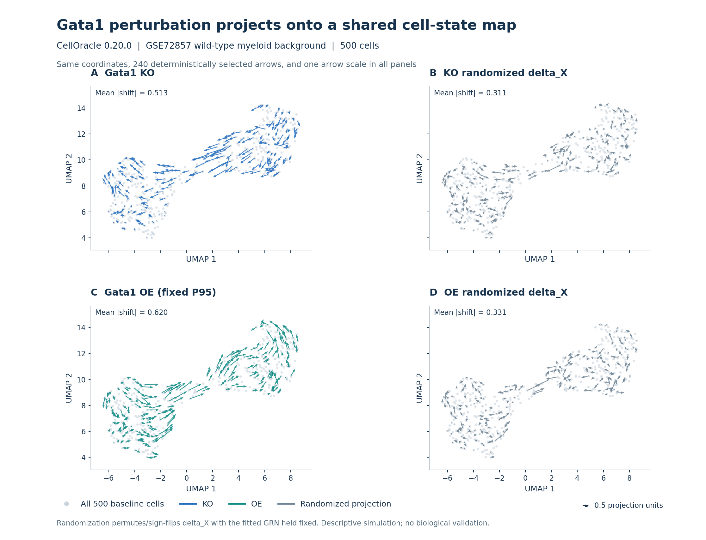
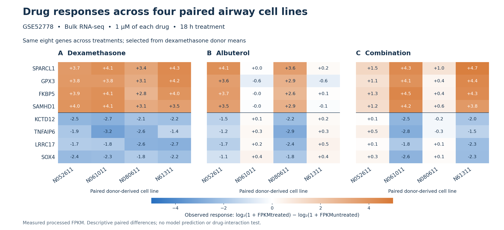
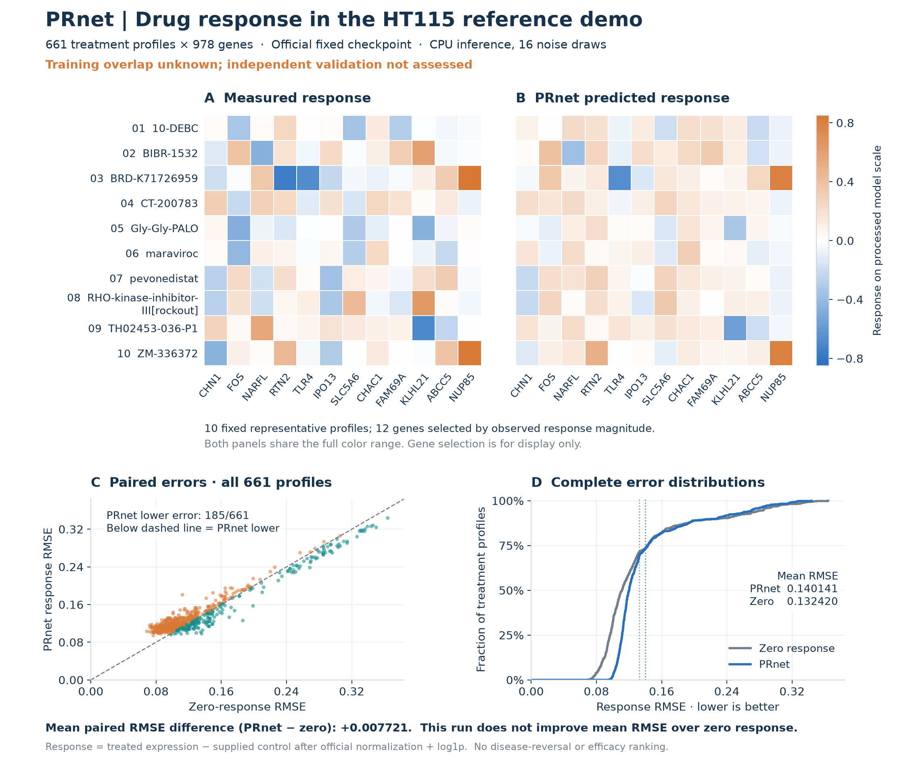
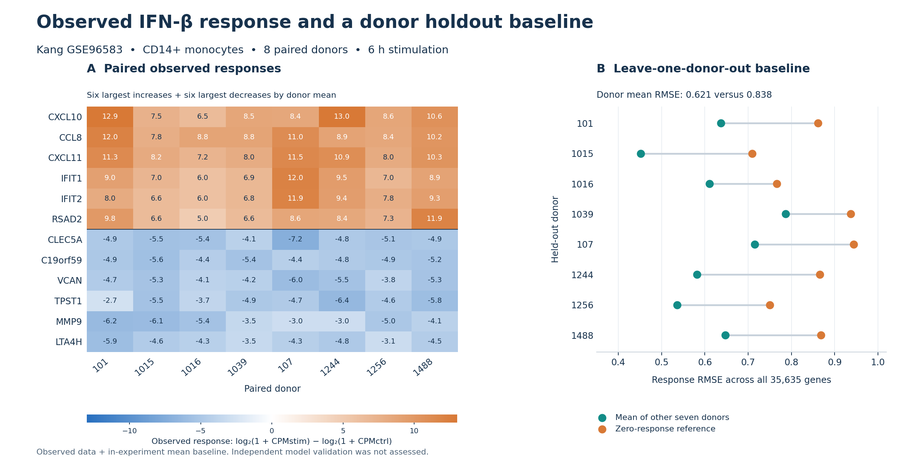

# Virtual Cell Research · 虚拟细胞研究 Skill

**一句话发起虚拟敲除、过表达与药物筛选，让 Agent 完成从数据检查到结果解读的繁琐步骤。**

**Virtual Cell Research** 是面向转录组和单细胞研究的科研 Agent Skill。提供表达矩阵、目标基因或药物库后，Agent 按研究目标检查数据与对照、匹配模型、运行虚拟干预，生成预测响应、变化基因、状态位移或药物评分，并交付图表、质量检查与可追溯的运行记录。

## 三项核心能力

| 研究任务 | 提供什么 | 得到什么 |
| --- | --- | --- |
| **虚拟基因敲除** | 表达数据、目标基因、细胞背景 | 模型支持的表达变化、受影响基因与细胞状态变化 |
| **虚拟过表达** | 表达数据、目标基因、明确的过表达设定 | 设定条件下的模拟响应，以及对应基线和实际作用范围 |
| **虚拟药物筛选** | 药物库、细胞背景和模型所需基线；疾病方向比较另需疾病参照 | 逐药转录响应、适用的评分与排序；支持剂量的模型可比较浓度 |

结果类型随模型能力而定。具体入口、所需资源及真实运行范围见 [模型能力表](virtual-cell-research/references/model-capabilities.md)。

## 看看实际跑出的结果

下面的图由本仓库脚本读取公开案例数据，实际完成分析后生成。每组结果都附数据来源、复现命令、绘图入口和检查记录；完整图集见 [公开案例结果](virtual-cell-research/cases/gallery/README.md)。

### 01 · 基因敲除与过表达：细胞状态怎样变化？

> 用 GSE72857 的野生型造血细胞，比较 Gata1 敲除与过表达，输出表达变化和细胞状态位移。

**从目标基因到细胞状态图。** 在同一细胞背景中拟合调控网络，再分别计算 KO 和 OE。散点是细胞，箭头是模型在 UMAP 上的投影位移；各面板使用可比较的坐标和箭头尺度。随机化投影用于描述性对照。

这组图展示网络模拟结果，真实扰动验证仍待完成。完整表达变化、目标设定、下游基因图及运行命令见 [Gata1 实跑图集](virtual-cell-research/cases/gallery/celloracle/README.md)。

### 02 · 药物观测案例：比较单药与联合处理

> 分析 GSE52778，按供体配对比较地塞米松、沙丁胺醇及联合处理与未处理对照，展示主要表达响应。

**把公开矩阵变成可读的处理对比。** 使用人气道平滑肌的实际实验数据，核对样本身份，在同一供体内比较处理与对照，再生成表达响应图。此处展示的是处理后的 FPKM 观测数据分析；差值尺度、样本映射和展示基因选择规则均随图记录。

数据、软件处理步骤与完整结果见 [公开药物响应案例](virtual-cell-research/cases/airway-gse52778-drug-response/README.md)。

### 03 · 药物响应预测：同时看预测结果和基线

> 用固定 PRnet 权重分析 HT115 公开演示数据，生成逐药预测响应，并与实测响应和零响应基线比较。

**模型推理、结果绘图和效果评价放在一起。** 响应热图使用共同色标对照观测与预测，误差比较覆盖本次全部处理表达谱。图中保留模型未优于简单基线的结果，帮助研究者判断下一步应改输入、查模型，还是补验证数据。

本例是固定公开 demo 的参考推理，训练重叠未知。它展示药物转录响应预测与评价流程；本次没有疾病逆转排名或疗效结论。[查看 PRnet 实跑图集](virtual-cell-research/cases/gallery/prnet/README.md)

### 04 · 预测评估：留出一位供体后，预测是否仍有用？

> 分析 Kang IFN-β 公开数据，先展示供体配对响应，再用其余供体的平均响应预测每位留出供体。

**从观测响应走到可复查的评价。** 按供体配对聚合 CD14+ 细胞，展示各供体的表达变化；每轮只使用另外七位供体拟合均值参照，并与零响应比较。完整基因轴参与评价，图中展示基因按明确规则选取。

这是同一研究内的供体留出教学，尚不构成跨实验验证。[查看配对与留出结果](virtual-cell-research/cases/gallery/kang/README.md)

## 直接从你的任务开始

- **已有自己的数据**：按 [数据准备](virtual-cell-research/references/user-data.md) 检查 CSV、TSV 或 H5AD，保留完整标识与原始数值，再进入模型分析。
- **第一次接触虚拟细胞**：从 [首次使用](virtual-cell-research/references/first-run.md) 选择一个小型真实案例，学习输入、对照、预测与图表。
- **已经得到结果**：用 [结果解读](virtual-cell-research/references/result-reading.md) 生成中文说明，先看关键变化和基线，再回到完整源表。
- **想评价预测是否有用**：按 [预测评估](virtual-cell-research/references/prediction-evaluation.md) 对齐实测与预测、检查数据划分，并与简单基线比较。

对 Agent 说明你的问题即可，例如：

> 使用 Virtual Cell Research，对我提供的单细胞数据模拟 STAT3 敲除。请检查输入、选择适用模型，输出完整模拟结果、变化基因和状态图，并解释主要发现与限制。

完整使用方式、三类任务的提示词和执行入口见 [Skill 使用说明](virtual-cell-research/README.md)。

## 为什么适合研究与共建

**让 Agent 处理流程，让研究者掌握判断。** 已提供的信息会直接沿用；需要选择的科学条件会清楚说明。每次分析记录模型版本、输入来源、参数、对照和完成状态，便于复查、重跑及协作。

**用完整结果支撑图表。** 先保存预测、基线、响应和稳定 ID，再生成摘要与图。运行成功、技术质量和独立科学验证分别呈现。

**从一个具体贡献开始。** 新增数据案例、模型适配、输入检查或结果图表，都可以沿现有约定逐步加入。无需先理解或搭建一个庞大的平台，见 [贡献指南](virtual-cell-research/CONTRIBUTING.md)。

## 真实案例与资源

[案例目录](virtual-cell-research/cases/README.md) 提供来源、数据获取、运行命令、结果图和实际完成阶段。已执行的路线包括 HT115 药物观测、Airway 配对药物响应、Kang 供体配对、CellOracle 基因扰动和 PRnet 参考推理；各自的证据与解释范围保存在案例中。

模型环境按路线独立准备，数据和权重从所列来源获取。项目提供的 [Windows 结果查看器](docs/desktop-viewer.md) 可用于已有模型运行包的本地复核，Skill 本身可以直接使用。

[代码许可](virtual-cell-research/LICENSE) · [资源与来源记录](virtual-cell-research/THIRD_PARTY_NOTICES.md)
