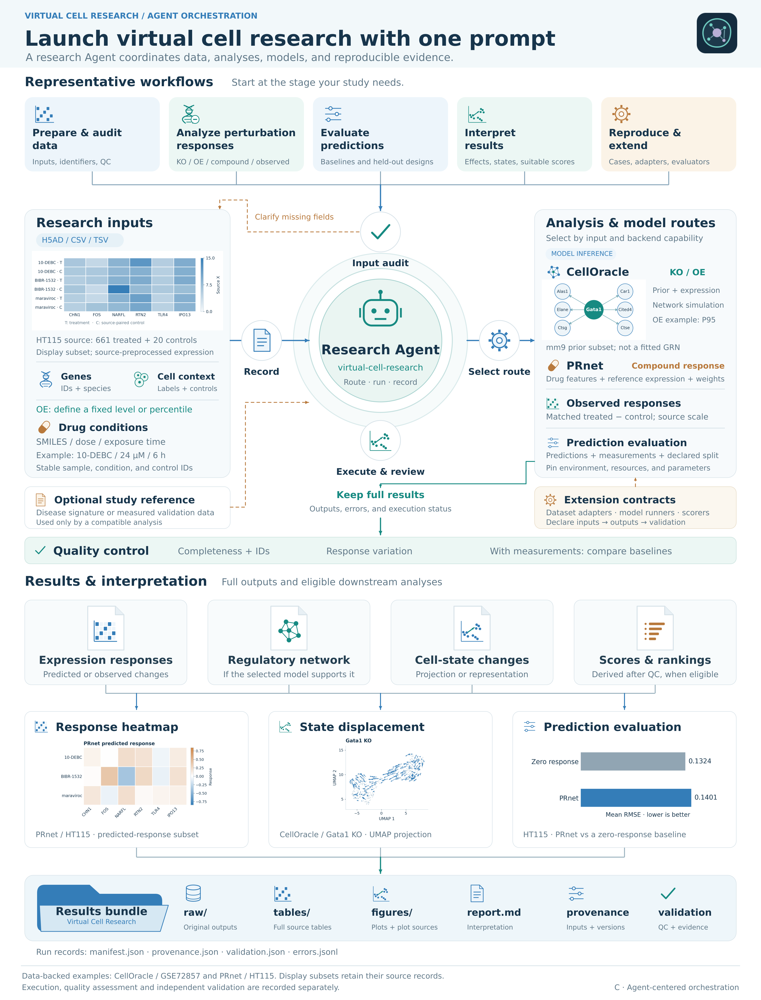

[English](README.md) | [简体中文](README.zh-CN.md)


[](virtual-cell-research/SKILL.md)
[](virtual-cell-research/requirements-tests.txt)
[](https://github.com/aper-ai/virtual-cell-workbench/actions/workflows/skill.yml)
[](virtual-cell-research/docs/licensing.md)

# Virtual Cell Research

**Launch virtual cell research with one prompt: identify opportunities for disease intervention from cellular changes and discover candidate drugs and gene targets for reversing disease states.**

**Research workflows for virtual cell science.** Give your Agent the relevant files and a research question. It organizes input checks, data preparation, analysis, compatible model execution, evaluation, figures, and a traceable research report.

Virtual Cell Research is a research Agent Skill for working with transcriptomic and single-cell data. It connects **data preparation, observed response analysis, in silico perturbation, prediction evaluation, and result interpretation** in a reproducible workflow. Gene knockout, overexpression, and compound screening are representative applications within this broader scope. You can also start with an input audit, a donor-paired comparison, predictions that need evaluation, or an existing result that needs review.

The current implementations focus on expression data, cellular context, and responses to experimental conditions. Each route records what inputs it accepts, what it actually computes, and how far its evidence extends. The researcher defines the scientific question; the Agent manages execution and preserves the connection between methods, complete results, and interpretation.



[Research capabilities](#research-capabilities) · [Quick start](#quick-start) · [Use your own data](#use-your-own-data) · [Real case results](#four-real-case-studies-from-methods-to-results) · [Case library](#case-library-current-evidence) · [Research collaboration](#research-collaboration-and-extension)

## Research capabilities

| Research task | Question it addresses | Required materials | Main outputs |
| --- | --- | --- | --- |
| **Data preparation and input audit** | Are the matrix, identifiers, scale, and metadata suitable for the intended analysis? | CSV, TSV, or H5AD; processing history, species, and sample/gene metadata | Prepared input, data card, identity and value checks, coverage, and specific blocking issues |
| **Observed condition responses** | How does expression change between matched experimental conditions, including within donors? | Measured expression, condition/control mapping, biological units, and the relevant case workflow | Paired responses, condition or donor summaries, figures, and the preserved measurement scale |
| **In silico gene perturbation** | How does a supported model respond to a defined change in a target gene? | Expression data, target, cellular background, and the model's resources; an explicit setting for OE | Model-specific expression, network, state-projection, or embedding effects; actual intervention settings |
| **Compound-response analysis and conditional screening** | What transcriptional responses are predicted for compounds in a compatible background? | Compound identities or structures, matched baseline, model resources, and supported dose/time conditions | Complete condition responses, coverage, and applicable comparisons; disease-direction scores require a comparable reference |
| **Prediction evaluation and held-out baselines** | Does a prediction improve on a simple baseline, and what does the recorded split establish? | Observed and predicted responses on the same scale, stable IDs, biological units, and available split records | Aligned metrics, zero-response comparisons, unit-level summaries, and membership checks; a donor-held-out reference case |
| **Result interpretation and reporting** | What was computed, what changed, and what evidence supports the interpretation? | Existing reports, manifests, source tables, figures, and supported result contracts | Structured interpretation, key numerical findings, linked evidence, quality issues, and next steps |
| **Case reproduction and model adapters** | Can another researcher repeat a workflow or add a clearly defined analysis route? | Data/model sources, licenses, input/output definitions, resources, and execution evidence | Reproducible cases, documented adapters, complete result contracts, and recorded implementation status |

These routes have different implementation stages. Observed analyses currently use explicit case workflows; the interpretation tool recognizes Kang, CellOracle, and PRnet result contracts. Models preserve their own output meanings: a CellOracle state projection, a Geneformer embedding effect, and a drug-response prediction are distinct quantities. See the [model capability register](virtual-cell-research/references/model-capabilities.md) and the [current entry points](#model-capabilities-and-current-entry-points) before choosing a route.

## Quick start

**Ask your Agent to install the Skill, send the relevant files and your research goal, then review the completed analysis.** The Agent handles environment preparation, execution, figures, and reporting. Routine use does not require you to type terminal commands.

Use a Skill-capable assistant such as [WorkBuddy](https://www.codebuddy.cn/docs/workbuddy/From-Beginner-to-Expert-Guide/Function-Description/Project), [Codex](https://developers.openai.com/codex/skills), [Claude Code](https://code.claude.com/docs/en/skills), [Google Antigravity](https://antigravity.google/docs/skills), or [Kimi](https://www.kimi.com/features/skills) / [Kimi Code](https://www.kimi.com/code/docs/en/kimi-code-cli/customization/skills.html). Choose a session that can access your files and execute the analysis. The Agent follows the current host's installation mechanism.

### 1. Send the repository link and ask the Agent to install

**Repository: [https://github.com/aper-ai/virtual-cell-workbench](https://github.com/aper-ai/virtual-cell-workbench)**

Copy this request into your assistant:

```text
Please install the Virtual Cell Research Skill:
https://github.com/aper-ai/virtual-cell-workbench

Read the repository instructions and install the complete virtual-cell-research/
directory using this assistant's supported Skill mechanism. Preserve its scripts,
cases, references, and resources, and verify that the Skill can be discovered and loaded.
```

The Agent reports the actual installation location and load status. Data, dependencies, weights, and priors are prepared for the selected task when needed.

### 2. Send your files and describe the research question

Attach expression data, sample or cell metadata, and processing notes, or provide an accessible local directory. Add the conditions, targets, predictions, or existing result files required by your question. For example:

```text
Use Virtual Cell Research with the expression matrix, sample metadata, and
processing notes I have provided. Compare the treatment and matched control
within each donor, and summarize the response across donors.

Check the data scale, identifiers, pairing, and biological units first.
Carry out the compatible analysis, generate the figures, and deliver the report,
complete source tables, quality checks, and execution records. Explain the findings.
```

The Agent reads the files and available records before asking about missing information that would change the scientific interpretation. You can combine installation, files, and the research request in one message. More examples cover input preparation, model analysis, prediction evaluation, and existing results [below](#copyable-research-requests).

### 3. Review the report, figures, and complete results

The Agent presents what was completed, opens or links the report and main figures, and provides the complete tables and execution records. It explains the baseline, measurement scale, direction of change, and scope of the evidence. Continue in the same conversation to compare conditions, refine a supported grouping, or revise a figure. Separate run directories preserve earlier results.

### Start with a public case if you do not yet have data

```text
Use Virtual Cell Research to run the prnet-ht115-demo observed-response case.
Prepare the required environment and data, calculate each treatment's response
against its source-designated control, and present the report, complete tables,
and figures. Explain the response scale, control pairing, and limitations.
```

This case downloads about **3.14 MB** and contains **661 treated expression profiles, 20 controls, and 978 genes**. It demonstrates input-to-report analysis of **measured responses**; this step does not run the PRnet prediction model. The report identifies **338 treated profiles paired across RNA plates** and the possible batch effects. [Case source and method](virtual-cell-research/cases/prnet-ht115-demo/README.md)

Other starting points include the [Kang donor-paired and held-out analyses](virtual-cell-research/cases/gallery/kang/README.md), [CellOracle Gata1 KO/OE simulations](virtual-cell-research/cases/gallery/celloracle/README.md), and [PRnet reference inference with baseline comparison](virtual-cell-research/cases/prnet-reference-evaluation/README.md). Ask the Agent to run the selected case and prepare its required resources. The [first-run guide](virtual-cell-research/references/first-run.md) describes execution and delivery in detail.

## Use your own data

### Materials to provide

| Material | What needs to be clear |
| --- | --- |
| Expression files | CSV, TSV, or H5AD; table orientation, or the selected H5AD `X`/layer |
| Values and genes | Actual raw-count, normalization, or log-processing history; species, gene ID type, and unique identifiers |
| Sample context | Available cell labels, donors, batches, conditions, and controls; metadata aligned by stable ID |
| Research conditions | The measured comparison or proposed perturbation; targets or compounds, separate/joint design, OE definition, and relevant dose/time |
| Evaluation materials | Observed/predicted values, corresponding baselines, biological units, and available training/evaluation membership records |
| Existing results | The full run directory when available, including source tables, manifests, reports, and figures |

The Agent checks the files and processing records already provided. Data preparation preserves values and complete identity axes in a new H5AD, data card, and check report; it does not silently normalize, select genes, fill missing values, or establish model compatibility. Ordinary environment and runtime choices can use documented defaults. Scientific inputs such as an unknown scale, control, target, or OE definition need evidence. [Data preparation details](virtual-cell-research/references/user-data.md)

### Copyable research requests

**Prepare data and audit the intended input**

```text
Use Virtual Cell Research to inspect my expression file and cell/gene metadata.
Read the processing notes to establish the scale, species, IDs, and matrix orientation.
Prepare a new input while preserving the original values and complete identifiers,
and check compatibility with the analysis I have described.
Deliver the data card, checks, prepared file, and concrete unresolved requirements.
```

**Analyze observed, donor-paired responses**

```text
Use Virtual Cell Research to analyze the measured treatment and control data I supplied.
Verify the donor, condition, and cell-label mapping; use the compatible case workflow
or identify the preparation it requires. Calculate within-donor responses on a stated
scale, summarize donors with equal weight, and show complete tables and figures.
Treat donors as biological units and explain unmatched conditions and batch effects.
```

**Simulate a gene knockout**

```text
Use Virtual Cell Research to simulate STAT3 and JUN knockout separately in my
single-cell data. Check the expression scale, target coverage, and cellular context,
then choose a compatible model. Return complete native outputs, affected genes,
applicable state figures, and an interpretation of the differences between targets.
```

**Simulate overexpression with an explicit definition**

```text
Use Virtual Cell Research to study the simulated effects of Gata1 overexpression
in my data. Explain how the selected model defines overexpression and check the
setting I supplied. Identify any missing scientific setting before simulation.
Deliver the baseline, actual target values, complete responses, and applicable state figures.
```

**Analyze compound responses and apply screening scores when justified**

```text
Use Virtual Cell Research with my expression data and compound library.
Check the model's gene space, actual baseline, cellular context, and supported
dose/time conditions before predicting compound responses.
If my disease reference is comparable and a score is applicable, calculate it and
explain its direction. Keep complete responses and record uncovered or unscored
conditions, including cases where a meaningful ranking cannot be resolved.
```

**Evaluate predictions and recorded held-out splits**

```text
Use Virtual Cell Research to evaluate my predicted and observed responses.
Align sample and gene IDs, verify the common scale and context, and use the stated
biological units. Compare with a zero-response baseline and audit the training/evaluation
membership records I supplied. Deliver complete sample-level and unit-level metrics,
the aligned results, and a report separating prediction performance from independence.
```

**Interpret an existing run**

```text
Use Virtual Cell Research to interpret the result directory I provided.
Check its actual task, output contract, baseline, status, and source tables.
For a supported result, generate a structured interpretation with key values,
linked figures, quality issues, and next steps. State which existing files were read
and identify missing evidence without presenting this review as a new model run.
```

### Analysis deliverables

| Deliverable | Purpose |
| --- | --- |
| Structured report, usually `report.md` | Research question, completed scope, key values, figure interpretation, and next steps |
| Complete matrices and indices | Baselines, measurements or predictions, responses, and corresponding cell/sample, gene, and condition IDs |
| Summary tables and figures | Gene responses, state projections, native scores, or applicable evaluation plots, with display-selection rules |
| Parameters and execution records | Input sources, model/resource versions, actual commands, environment, random seeds, and output locations |
| Quality and failure records | Coverage, anomalies, incomplete conditions, baseline comparisons, and the scope of validation |

Files follow the actual route. The [interpretation tool](virtual-cell-research/references/result-reading.md) reads supported existing results without rerunning the model. The [evaluation tool](virtual-cell-research/references/prediction-evaluation.md) aligns measurements and predictions and keeps their scientific validation status explicit.

## How an analysis proceeds

1. **Define the research question.** Establish the measured comparison, proposed intervention, evaluation target, or existing result to review.
2. **Check and prepare the inputs.** Verify scale, identities, biological units, conditions, targets, and controls where relevant.
3. **Run the selected analysis.** Use the compatible data workflow or model route; prepare model environments, weights, and priors only when the task requires them.
4. **Preserve complete results and assess quality.** Save native outputs, baselines, responses, and indices before selecting genes, scoring, or plotting.
5. **Evaluate and interpret.** Use applicable baselines and comparisons, produce traceable figures, and distinguish observations, simulations, and evaluations.
6. **Deliver a reviewable research package.** Summarize findings, methods, completed and failed conditions, source tables, figures, and reproducibility records.

Execution rules are maintained in [SKILL.md](virtual-cell-research/SKILL.md). See [input contracts](virtual-cell-research/references/input-contracts.md), [model setup](virtual-cell-research/references/model-setup.md), and [troubleshooting](virtual-cell-research/docs/troubleshooting.md) for the requirements of a selected route.

## Model capabilities and current entry points

| Route | Current implementation | Conditions and output meaning |
| --- | --- | --- |
| **CellOracle** | Parameterized KO/OE; Gata1 KO and OE executed on 500 cells with Linux CPU | Raw single-cell counts, a matching GRN prior, and a simulatable TF; internal expression differences and state projections |
| **PRnet** | CPU reference inference and baseline comparison with fixed official code, weights, and the HT115 demo | Compound transcriptional responses; a user's own matrix still requires separate checks of the weight-specific gene axis, preprocessing, and background |
| **Geneformer** | Parameterized delete/overexpress, input checks, and embedding export entry point | Human full-transcriptome raw counts and matching tokenizer/weights; embedding effects; real model execution remains pending in this project |
| **chemCPA / UniPert-G2CP** | Existing compound-screening adapter scripts and result contracts | Resources and execution must be configured and accepted for the task; chemCPA has specific cell-line covariates, while this UniPert-G2CP route uses its own background without a dose dimension |
| **GEARS / UniCure / DrugReflector** | Research workflows, resource notes, and code examples | Concrete adaptation and execution verification remain necessary; GEARS also needs matched perturbation training data |

The [capability register](virtual-cell-research/references/model-capabilities.md) documents detailed requirements. Executed reference cases provide a starting point; new data still require checks of species, scale, cellular context, and research target. An adapter script, a successful input check, and a completed model run establish different stages.

## Four real case studies: from methods to results

The following **five figures** were generated by repository scripts from public data and the recorded computations. The four case groups cover network simulation, measured compound responses, model predictions, and donor-held-out evaluation. Each has source tables, actual commands, and result records. [Complete gallery](virtual-cell-research/cases/gallery/README.md)

### 01 · CellOracle: how do Gata1 knockout and overexpression change the modeled state?

> Use Virtual Cell Research with raw counts from GSE72857 wild-type hematopoietic cells. Compare Gata1 KO and OE at a fixed internal P95, and generate state projections, downstream expression effects, and the actual target settings.

**Method.** GEO experimental labels establish the wild-type mouse bone-marrow background. A fixed subset of 500 cells is used. CellOracle 0.20.0 fits a shared regulatory network across the cells with 1,500 model genes, then runs KO and OE separately. KO sets Gata1 to zero; OE fixes it at the 95th percentile of its internal baseline expression, **1.556675**.


**Reading the state figure.** The scatter plots show all 500 baseline cells. A and C show KO/OE projections; B and D project randomized expression changes under the fixed network. All four panels use the same coordinates, the same 240 deterministically selected arrows, and a common vector scale. Arrow lengths are in UMAP projection units; the randomized results provide a descriptive reference.

| Result across all cells | Gata1 KO | Gata1 OE |
| --- | ---: | ---: |
| Mean projected displacement magnitude | 0.513265 | 0.620486 |
| Mean magnitude for one randomization | 0.311007 | 0.330776 |
| Non-target genes with a nonzero simulated response | 1,311 | 1,311 |


**Reading the expression figure.** Panels A and B exclude the directly set target Gata1 and show the eight largest positive and eight largest negative mean changes. The horizontal axis uses CellOracle's internal **imputed log1p(raw-count)** scale. In KO, Elane is +0.580168 and Car1 is −0.925505; in OE, Car1 is +1.823699 and Ctsg is −0.926096. Panel C orders all cells by baseline expression: fixing the target at P95 **raises 475 cells and lowers 25**, so this OE setting is not a uniform increase in every cell.

**Interpretation.** This is a network simulation on a fixed subset from one mouse. Excluding ambiguous multi-name gene mappings removed about 13.23% of molecular counts from the selected cells, and no independent Gata1 perturbation ground truth was used. The projected arrows and gene effects support follow-up research questions. [Full methods, source tables, and reproduction commands](virtual-cell-research/cases/gallery/celloracle/README.md) · [Execution evidence](virtual-cell-research/cases/gallery/celloracle/evidence.json)

### 02 · Airway: how do single and combined treatments differ within the same donor?

> Use Virtual Cell Research to analyze GSE52778. Verify sample and donor identities, compare dexamethasone, albuterol, and their combination against untreated controls, and explain the observed response scale.

**Method.** The input is source-provided bulk RNA-seq FPKM from human airway smooth muscle: **four donors, 16 expression profiles, and 23,273 source genes**. Each drug is used at 1 µM for 18 hours. GEO/SRA sample records establish identities. Three comparisons are calculated separately within each donor as `log2(1 + FPKM_treated) − log2(1 + FPKM_control)`.


**Reading the figure.** Each column is a donor, and each displayed value is that donor's paired difference. The three panels share a color scale and eight genes. Eligible genes have source status OK and FPKM ≥ 1 in every profile; four positive and four negative genes are selected by the donor-mean dexamethasone response. The table shows equal-donor mean responses for four of them.

| Gene | Dexamethasone | Albuterol | Combination |
| --- | ---: | ---: | ---: |
| SPARCL1 | +3.884 | +1.966 | +2.887 |
| FKBP5 | +3.701 | +1.591 | +2.631 |
| KCTD12 | −2.357 | −0.865 | −1.161 |
| TNFAIP6 | −2.292 | −0.881 | −1.006 |

**Interpretation.** This is a descriptive analysis of measured expression with four donors as the biological units. Differences must be read on the stated pseudocount scale. Visual differences in the combined treatment do not establish synergy or antagonism. [Complete results, pairing, and reproduction commands](virtual-cell-research/cases/airway-gse52778-drug-response/README.md) · [Execution evidence](virtual-cell-research/cases/airway-gse52778-drug-response/evidence.json)

### 03 · PRnet: does the model outperform a zero-response baseline?

> Use Virtual Cell Research to obtain the fixed official PRnet HT115 demo and weights. Run response prediction, show measured and predicted responses, and compare every treated profile with a zero-response baseline.

**Method.** Fixed official weights are used for CPU inference on **661 treated profiles × 978 genes**, preserving source-designated controls. The official demo's total normalization and `log1p` are applied, and treatment-minus-control responses are calculated on that scale. The main prediction averages conditional means over 16 decoder-noise vectors. The checkpoint is not retrained.


**Reading the figure.** A and B share a color scale and show 10 treatment conditions chosen by a fixed rule and 12 genes selected by measured response magnitude. Each point in C is a treated profile; points below the diagonal have lower PRnet error. D shows the error distributions across all treated profiles. Evaluation uses all 978 genes, and lower RMSE is better.

| Result across all treated profiles | Value |
| --- | ---: |
| PRnet mean per-profile response RMSE | 0.140141 |
| Zero-response mean per-profile response RMSE | 0.132420 |
| Mean RMSE difference, PRnet − zero response | +0.007721 |
| Profiles with lower PRnet error | 185 / 661 (27.99%) |

**Interpretation.** The model executed successfully, but its mean error did not improve on zero response. Checkpoint training overlap is unknown, the full demo participates in normalization, and 338 profiles have controls from another RNA plate. This is a fixed reference inference, and its results do not establish disease reversal or treatment efficacy rankings. [Methods, source tables, and reproduction commands](virtual-cell-research/cases/gallery/prnet/README.md) · [Execution evidence](virtual-cell-research/cases/gallery/prnet/evidence.json)

### 04 · Kang: can other donors' mean responses predict a held-out donor?

> Use Virtual Cell Research with the Kang IFN-β PBMC data. Analyze donor-paired CD14+ monocytes and, in each fold, predict one donor using only the other seven donors' mean responses. Generate response heatmaps and per-donor errors.

**Method.** GSE96583 contains control and six-hour IFN-β stimulation conditions for eight donors. Raw UMI counts from **2,785 control cells and 2,600 stimulated cells** are aggregated by donor and condition. CPM uses all **35,635 source genes**, and responses are `log2(1 + CPM_stimulated) − log2(1 + CPM_control)`. Each fold uses only the other seven donors' complete response vectors to predict the held-out donor.


**Reading the figure.** Each heatmap column is a donor; the displayed genes are the six largest positive and six largest negative donor-mean changes. Lines on the right connect the two full-gene errors for the same held-out donor. The mean predictor has lower error for all eight donors. Equal-donor mean RMSE is **0.620647**, compared with **0.837714** for zero response.

**Interpretation.** This is within-study cross-validation of a mean baseline. The eight folds share training donors, and condition-specific library effects remain. The full gene axis includes 20,815 genes with zero responses in all donors; aggregate error does not establish accurate prediction for every responding gene. [Full methods, per-donor results, and reproduction commands](virtual-cell-research/cases/gallery/kang/README.md) · [Execution evidence](virtual-cell-research/cases/gallery/kang/evidence.json)

## Case library: current evidence

The library records **11 workflows: five data-analysis/input-audit/baseline-evaluation cases, two executed model routes, and four catalogued data or method routes. Independent prediction validations: zero.** A dataset can support multiple workflows: HT115 supports observed analysis and PRnet inference; Kang supports donor pairing and held-out evaluation; Paul2015 supports a tutorial-object audit and a separate raw-count simulation. The four galleries organize these results by research question. [Case catalog and stages](virtual-cell-research/cases/README.md)

| Workflow | Current stage and available evidence |
| --- | --- |
| [HT115 observed responses](virtual-cell-research/cases/prnet-ht115-demo/README.md) | Complete observed responses calculated; source-designated controls and the source scale retained |
| [Airway compound observations](virtual-cell-research/cases/airway-gse52778-drug-response/README.md) | Paired comparisons and figures completed for four donors × three treatments |
| [Paul2015 input audit](virtual-cell-research/cases/celloracle-paul2015-input-audit/README.md) | Non-integer values found in the tutorial `raw_count` layer; blocked under this route's raw-count contract |
| [Kang donor pairing](virtual-cell-research/cases/kang-ifnb-pbmc/README.md) | Count aggregation and eight CD14+ donor pairs completed |
| [Kang leave-one-donor-out evaluation](virtual-cell-research/cases/kang-heldout-baseline/README.md) | Eight-fold mean-baseline comparison with zero response completed |
| [CellOracle Gata1 KO/OE](virtual-cell-research/cases/celloracle-paul2015-gata1/README.md) | KO and OE executed separately; complete native model outputs preserved |
| [PRnet reference inference](virtual-cell-research/cases/prnet-reference-evaluation/README.md) | Fixed-weight CPU inference and complete baseline comparison executed |
| [sci-Plex3 dose response](virtual-cell-research/cases/sciplex3-chemical-dose/README.md) | Sources, cell lines, compounds, and dose conditions catalogued; matrix acquisition pending |
| [Norman2019 CRISPRa](virtual-cell-research/cases/norman2019-k562-crispra/README.md) | Single-gene and combination activation route catalogued; data preparation pending |
| [Adamson2016 UPR CRISPRi](virtual-cell-research/cases/adamson2016-k562-upr-crispri/README.md) | UPR subexperiment catalogued; label reconstruction and model evaluation pending |
| [Replogle2022 K562 CRISPRi](virtual-cell-research/cases/replogle2022-k562-essential-crispri/README.md) | Author archive and pseudobulk route catalogued; matrix acquisition pending |

Ask the Agent to list the catalog or inspect a selected case before fetching its resources. Catalog inspection is offline; downloads are explicit and case-specific. Stages follow [catalog.json](virtual-cell-research/cases/catalog.json) and the corresponding execution records.

## Result quality and reproducibility

**Read the baseline and scale before interpreting magnitude.** Check the actual context, conditions, units, and completed scope. Displayed genes are selected summaries; complete results support alternative summaries. Prediction error, correlation, successful execution, and independent validation answer different questions.

**Every figure connects to source tables.** Stable IDs, complete responses, selection rules, and plotting entry points are preserved. Related panels use shared coordinates or color scales where appropriate. The [gallery review notes](virtual-cell-research/cases/gallery/review-notes.md) describe the numerical and visual checks for the four case groups.

**Every run retains its method.** Sources, resource identities, software versions, parameters, commands, and failed conditions accompany the results. Reruns use new directories. The source package includes workflows, scripts, case documentation, and lightweight figure sources; original matrices, weights, and full local run bundles are prepared per case. Further assessment of predictive value requires matched measurements, a defined split, and suitable baselines.

## Research collaboration and extension

The project brings models, public datasets, and analysis methods into executable research workflows that can be reproduced, compared, and reviewed. Contributions should establish the scientific scope of a method, make its data and evaluation assumptions explicit, and preserve enough evidence for others to reuse the work.

| Contribution area | Contributions | Research objective |
| --- | --- | --- |
| **Models and methods** | Adapters, perturbation semantics, input/output definitions, applicable contexts, and executed examples | Reproduce each method under its own scientific definition, with explicit capabilities and failure conditions |
| **Data and benchmarks** | Sources and licenses, stable IDs, condition/control mapping, reference tasks, and data splits | Build a traceable basis for method comparison and research across datasets |
| **Evaluation and validation** | Matched-scale baselines, held-out designs, suitable metrics, independent data, or experimental controls | Measure improvement over simple baselines and establish where the evidence applies |
| **Reproducible workflows** | Data preparation, model execution, result summaries, structured reports, interpretation, and usage guides | Preserve resources, parameters, complete outputs, and failures so others can repeat the analysis |

Case reproduction and adapter development are the current extension mechanisms. CellOracle and PRnet have executed model routes; other routes retain their actual implementation status. Independent prediction validation remains to be added. New capabilities and validation conclusions should each be supported by identifiable execution or evaluation evidence. Models, datasets, and papers retain their original attribution and resource-specific terms.

### Contribution standards and engineering checks

Follow the [contribution guide](virtual-cell-research/CONTRIBUTING.md): state the research purpose, inputs and outputs, sources and versions, minimal reproduction steps, complete-result location, and actual validation scope. Maintain usage instructions and interpretation alongside code and cases.

For contributors, run engineering checks and packaging in an independent Python 3.12 environment from the Skill directory:

```bash
python -m pip install -r requirements-tests.txt
python -m unittest discover -s tests -v
python scripts/cases.py validate
python scripts/package_skill.py
```

The package is created at `dist/virtual-cell-research.zip` inside the Skill directory. Engineering checks verify code and record consistency; real model execution and independent scientific evaluation are documented separately in their cases.

## Repository map

| Location | Purpose |
| --- | --- |
| [virtual-cell-research/README.md](virtual-cell-research/README.md) | Complete Skill guide and research entry points |
| [virtual-cell-research/SKILL.md](virtual-cell-research/SKILL.md) | Agent execution rules |
| [virtual-cell-research/references/](virtual-cell-research/references/) | First use, input preparation, capabilities, resources, interpretation, and evaluation |
| [virtual-cell-research/scripts/](virtual-cell-research/scripts/) | Data preparation, case acquisition, observed analyses, figures, evaluation, and packaging |
| [virtual-cell-research/examples/](virtual-cell-research/examples/) | Parameterized KO/OE routes and compound-screening adapter examples |
| [virtual-cell-research/cases/](virtual-cell-research/cases/) | Sources, commands, stages, and results for 11 workflows |
| [virtual-cell-research/cases/gallery/](virtual-cell-research/cases/gallery/) | Actual result figures, figure sources, and reading notes |
| [virtual-cell-research/tests/](virtual-cell-research/tests/) | Engineering checks for inputs, adapters, computations, and outputs |
| [docs/desktop-viewer.md](docs/desktop-viewer.md) | Companion Windows viewer for existing model result packages |

Use the Skill and the selected route's environment for research execution. The companion viewer opens existing results; its installer does not include the Skill's model environments or weights.

[Code license](LICENSE) · [Attribution](virtual-cell-research/NOTICE) · [Third-party resources and sources](virtual-cell-research/THIRD_PARTY_NOTICES.md) · [Methods and scope](virtual-cell-research/docs/methodology-and-scope.md)
