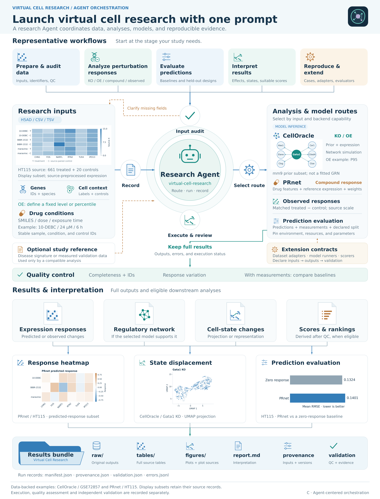
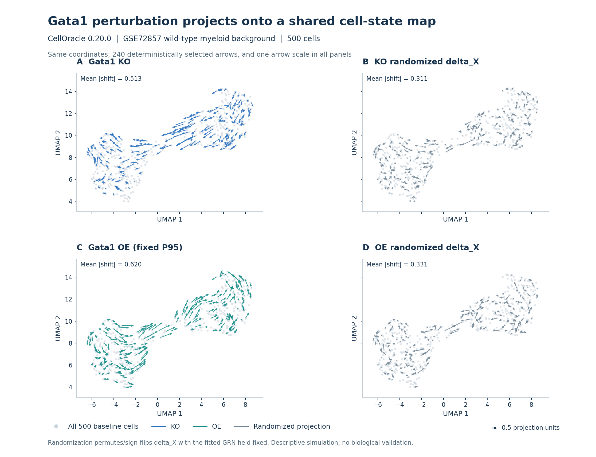
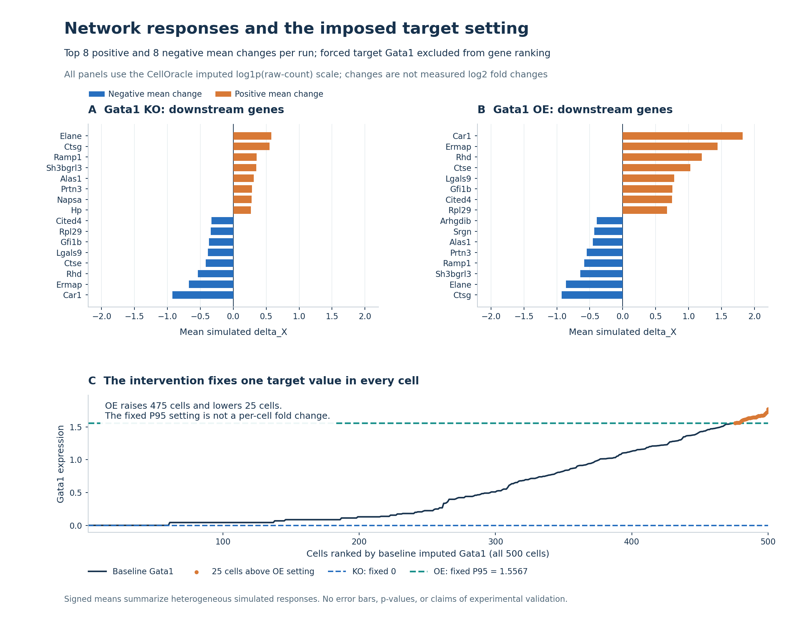
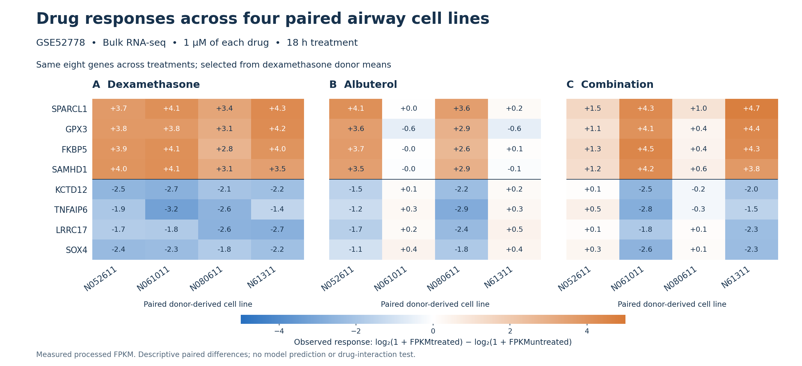
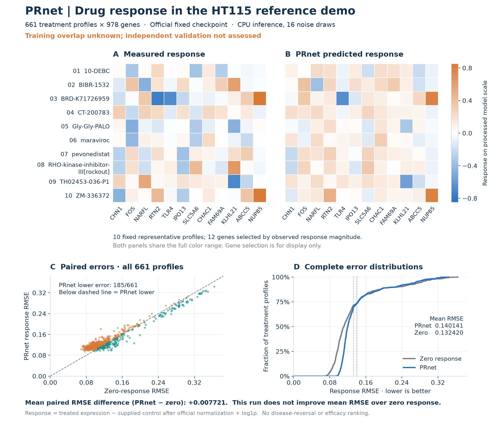
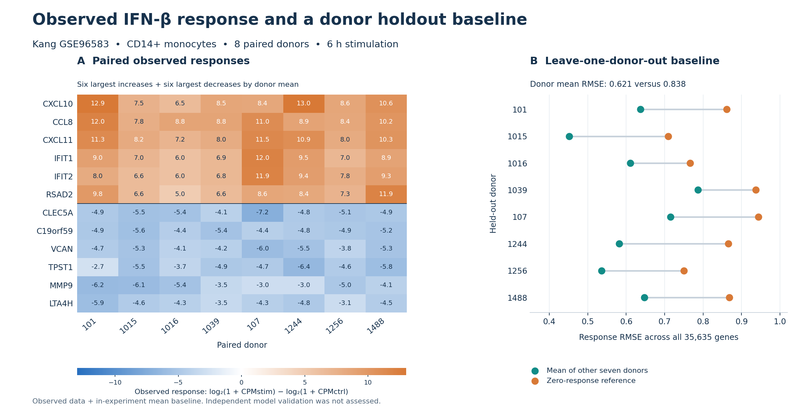

[English](README.md) | [简体中文](README.zh-CN.md)


[](virtual-cell-research/SKILL.md)
[](virtual-cell-research/requirements-tests.txt)
[](https://github.com/aper-ai/virtual-cell-workbench/actions/workflows/skill.yml)
[](virtual-cell-research/docs/licensing.md)

# Virtual Cell Research · 虚拟细胞研究 Skill

**一句话开启虚拟细胞研究。**

**面向虚拟细胞科学的研究工作流。** 将相关文件和研究问题交给 Agent，由它组织输入检查、数据准备、分析计算、兼容模型执行、结果评价、绘图与可追溯报告。

Virtual Cell Research 是面向转录组与单细胞数据的科研 Agent Skill，衔接**数据准备、观测响应分析、虚拟干预、预测评估与结果解释**。基因敲除、过表达和药物筛选是其中的代表性应用；研究也可以从输入审计、供体配对比较、已有预测的评价，或已有结果的复核开始。

当前实现聚焦表达数据、细胞背景与实验条件引起的响应。每条路线分别记录可接收的输入、实际计算内容与证据范围。研究者确定科学问题，Agent 负责执行与整理，保留方法、完整结果和解释之间的可追溯联系。



[研究能力](#研究能力) · [快速开始](#快速开始) · [自有数据](#用自己的数据开展研究) · [真实结果](#四组真实案例从方法到结果) · [案例库](#案例库当前完成到哪一步) · [研究协作](#研究协作与能力扩展)

## 研究能力

| 研究任务 | 希望回答的问题 | 所需材料 | 主要输出 |
| --- | --- | --- | --- |
| **数据准备与输入审计** | 矩阵、标识、尺度和元数据是否满足计划中的分析？ | CSV、TSV 或 H5AD；处理记录、物种及样本/基因信息 | 整理后的输入、数据卡、身份与数值检查、覆盖情况和具体阻断项 |
| **条件响应与配对观测分析** | 匹配实验条件之间，尤其同一供体内，表达怎样变化？ | 实测表达、处理/对照映射、生物学单位及适用案例流程 | 配对响应、条件或供体汇总、图表与保留的测量尺度 |
| **虚拟基因干预** | 在适用模型中，按明确方式改变目标基因会产生什么影响？ | 表达数据、目标、细胞背景及模型资源；OE 需明确设定 | 模型支持的表达、网络、状态投影或 embedding 影响，以及实际干预设定 |
| **药物响应分析与条件性筛选** | 候选化合物在兼容背景下产生怎样的预测转录响应？ | 药物身份或结构、匹配基线、模型资源及支持的剂量/时间条件 | 完整逐条件响应、覆盖与适用比较；疾病方向评分另需可比较参照 |
| **预测评价与留出基线** | 预测是否优于简单基线，已有划分记录能说明什么？ | 同尺度实测与预测、稳定 ID、生物学单位及可用划分记录 | 对齐指标、零响应比较、单位汇总与成员审计；供体留出参考案例 |
| **结果解释与报告** | 实际完成了什么，哪些结果变化，证据支持到哪一步？ | 已有报告、清单、源表、图和支持的结果契约 | 结构化解读、关键数值、证据链接、质量问题与下一步 |
| **案例复现与模型适配扩展** | 其他研究者能否重跑流程，或接入定义清晰的新分析路线？ | 数据/模型来源、许可、输入输出定义、资源与执行证据 | 可复现案例、适配说明、完整结果契约和实际实现阶段 |

各路线的实现阶段不同。观测分析当前使用明确的案例流程；结果解释工具识别 Kang、CellOracle 与 PRnet 的现有契约。不同模型保留各自的结果含义：CellOracle 状态投影、Geneformer embedding 影响和药物响应预测分别解释。选路前核对[模型能力登记](virtual-cell-research/references/model-capabilities.md)及下方[当前入口](#模型能力与当前入口)。

## 快速开始

**让 Agent 安装 Skill，把数据文件和研究目标交给它，随后查看完成的分析。** 环境准备、执行分析、绘图与报告由 Agent 组织完成，日常使用无需自己输入终端命令。

可使用 [WorkBuddy](https://www.codebuddy.cn/docs/workbuddy/From-Beginner-to-Expert-Guide/Function-Description/Project)、[Codex](https://developers.openai.com/codex/skills)、[Claude Code](https://code.claude.com/docs/en/skills)、[Google Antigravity（反重力）](https://antigravity.google/docs/skills)、[Kimi](https://www.kimi.com/features/skills) / [Kimi Code](https://www.kimi.com/code/docs/en/kimi-code-cli/customization/skills.html) 等支持 Skill 的助手。选择能读取你的文件并执行分析的会话即可；安装方式由 Agent 按当前宿主的机制处理。

### 1. 发送 GitHub 链接，让 Agent 安装

**仓库地址：[https://github.com/aper-ai/virtual-cell-workbench](https://github.com/aper-ai/virtual-cell-workbench)**

把下面这段话发给助手：

```text
请帮我安装 Virtual Cell Research Skill：
https://github.com/aper-ai/virtual-cell-workbench

读取仓库说明，按当前助手支持的方式安装完整的 virtual-cell-research/ 目录，
保留其中的脚本、案例、参考资料和资源，并检查 Skill 是否可以发现和加载。
```

Agent 会说明实际安装位置和加载状态。选定研究任务后，再按需准备该任务的数据、依赖、模型权重或先验。

### 2. 把文件和研究问题发给 Agent

上传表达数据、样本或细胞信息及处理说明，或提供可访问的本地目录。根据问题补充处理条件、目标、预测表或已有结果。例如：

```text
请使用 Virtual Cell Research，基于我提供的表达矩阵、样本信息和处理记录，
比较每位供体的处理与匹配对照，再汇总跨供体的表达响应。

先核对数据尺度、标识、配对关系和生物学单位，完成适用分析与绘图，
交付报告、完整源表、质量检查和运行记录，并解释主要结果。
```

Agent 会先读取文件和已有记录，只补问无法核实且会改变科学解释的信息。也可以把安装请求、文件和任务一起发送，由 Agent 连续完成。输入准备、模型分析、预测评价和已有结果的指令见下方[可复制研究指令](#可复制研究指令)。

### 3. 查看报告、图表和完整结果

Agent 会展示本次完成范围，打开或提供报告与主要图表，给出完整表格和运行记录，并解释基线、测量尺度、变化方向和证据范围。需要比较条件、调整支持的分组或修改图表时，在同一对话中继续提出要求；每次运行保留独立目录，便于比较与复查。

### 暂时没有数据？用公开案例开始

```text
请使用 Virtual Cell Research，运行 prnet-ht115-demo 真实观测响应案例。
准备所需环境和数据，计算处理与来源指定对照的响应，生成并展示报告、
完整表格和图，解释响应尺度、对照配对与结果局限。
```

这个案例约需下载 **3.14 MB**，包含 **661 条处理表达谱、20 条对照和 978 个基因**，展示从输入到报告的观测分析流程。这里计算**真实观测响应**，此步骤不运行 PRnet 预测模型。报告会标明 **338 条处理谱跨 RNA plate 配对**及可能的批次影响。[案例来源与方法](virtual-cell-research/cases/prnet-ht115-demo/README.md)

也可以从 [Kang 供体配对与留出分析](virtual-cell-research/cases/gallery/kang/README.md)、[CellOracle Gata1 KO/OE 模拟](virtual-cell-research/cases/gallery/celloracle/README.md)或 [PRnet 参考推理与基线比较](virtual-cell-research/cases/prnet-reference-evaluation/README.md)开始。让 Agent 运行选定案例，并准备对应资源；完整执行与交付说明见[首次使用](virtual-cell-research/references/first-run.md)。

## 用自己的数据开展研究

### 准备哪些材料

| 材料 | 需要明确什么 |
| --- | --- |
| 表达文件 | CSV、TSV 或 H5AD；表格行列方向，或选用 H5AD 的 `X` / layer |
| 数值与基因 | 原始计数、归一化或 log 处理的真实记录；物种、基因 ID 类型与唯一标识 |
| 样本背景 | 可用细胞标签、供体、批次、条件与对照；元数据按稳定 ID 对齐 |
| 研究条件 | 实测比较或计划干预；目标/化合物、逐个或联合设计、OE 定义及相关剂量/时间 |
| 评价材料 | 实测/预测值、对应基线、生物学单位及可用训练/评价成员记录 |
| 已有结果 | 尽量提供完整运行目录，包括源表、清单、报告和图 |

Agent 先检查已有文件和处理记录。数据准备在新的 H5AD、数据卡和检查报告中保留原始数值与完整标识，不静默归一化、筛选基因、填补缺失值，也不直接认定模型兼容。环境与普通运行设置可采用有依据的默认；未知尺度、对照、目标或 OE 定义等科学输入需要明确。[数据准备细节](virtual-cell-research/references/user-data.md)

### 可复制研究指令

**数据准备与输入审计**

```text
请使用 Virtual Cell Research，检查我的表达文件、细胞与基因信息。
读取处理记录，核对尺度、物种、标识和矩阵方向；保留原始数值与完整 ID，
生成新的可用输入，并核查是否适合我描述的分析。
交付数据卡、检查记录、整理后的文件及仍需解决的具体条件。
```

**供体配对的观测响应**

```text
请使用 Virtual Cell Research，分析我提供的实测处理与对照数据。
核实供体、条件和细胞标签映射，使用兼容的案例流程或指出所需准备。
按明确尺度计算供体内响应，按供体等权汇总，交付完整表格和图。
以供体作为生物学单位，解释未配对条件和批次影响。
```

**虚拟基因敲除**

```text
使用 Virtual Cell Research，对我提供的单细胞数据分别模拟 STAT3 和 JUN 敲除。
先检查表达尺度、目标覆盖和细胞背景，选择兼容模型；分别运行两个目标，
输出完整模型原生结果、变化基因、适用状态图和解释，并比较目标间的主要差异。
```

**按明确设定模拟过表达**

```text
使用 Virtual Cell Research，研究我的数据中 Gata1 过表达的模拟影响。
先说明所选模型如何定义过表达，核对我提供的设定；若缺少科学设定，
在模拟前指出需要明确的条件。交付基线、实际目标值、完整响应与适用状态图。
```

**药物响应分析与适用筛选**

```text
使用 Virtual Cell Research，结合我的表达数据与药物库分析药物转录响应。
先核对模型基因空间、实际基线、细胞背景及支持的剂量/时间条件，再执行预测。
若我提供的疾病参照可比较且评分适用，再计算分数并解释方向。
保留完整响应、未覆盖或未评分条件，以及无法形成可区分排名的原因。
```

**预测评价与留出成员审计**

```text
使用 Virtual Cell Research，评价我提供的预测与实测响应。
按样本和基因 ID 对齐，核对共同尺度与背景，采用指定的生物学单位。
与零响应基线比较，审计我提供的训练/评价成员记录。
交付完整逐样本和逐单位指标、对齐结果与报告，分别说明表现和独立性。
```

**已有结果解释与复核**

```text
使用 Virtual Cell Research，解释我提供的结果目录。
核对实际任务、结果契约、基线、运行状态和源表；对于支持的结果，
生成包含关键数值、关联图表、质量问题与下一步的结构化解读。
说明读取了哪些已有文件，指出缺少的证据，不把本次复核写成新模型运行。
```

### 分析交付物

| 交付内容 | 用途 |
| --- | --- |
| 结构化报告，通常为 `report.md` | 研究问题、完成范围、关键数值、读图说明和下一步 |
| 完整矩阵与索引 | 基线、实测或预测、响应及对应细胞/样本、基因、条件 ID |
| 汇总表和图 | 基因响应、状态投影、原生分数或适用评价图，并记录展示选择规则 |
| 参数与执行记录 | 输入来源、模型/资源版本、实际命令、环境、随机种子及输出位置 |
| 质量与失败记录 | 覆盖、异常、未完成条件、基线比较及验证范围 |

文件按实际路线生成。[结果解释工具](virtual-cell-research/references/result-reading.md)读取支持的已有结果，不重新运行模型；[预测评估工具](virtual-cell-research/references/prediction-evaluation.md)对齐实测与预测，并保留明确的科学验证状态。

## 一次分析怎样完成

1. **确定研究问题。** 明确实测比较、计划干预、评价目标或需要复核的已有结果。
2. **检查并准备输入。** 核对尺度、身份、生物学单位、条件及相关目标和对照。
3. **执行选定分析。** 进入兼容的数据流程或模型路线；任务需要模型时再准备环境、权重与先验。
4. **保存完整结果并检查质量。** 在筛选基因、评分和绘图前，保留原生输出、基线、响应与索引。
5. **评价与解释。** 使用适用基线和比较方法，生成可追溯图表，区分观测、模拟与评价。
6. **交付可复查研究包。** 汇总发现、方法、完成与失败条件、源表、图及复现记录。

执行规则由 [SKILL.md](virtual-cell-research/SKILL.md)维护。所选路线的具体要求见[输入契约](virtual-cell-research/references/input-contracts.md)、[模型配置](virtual-cell-research/references/model-setup.md)和[排错指南](virtual-cell-research/docs/troubleshooting.md)。

## 模型能力与当前入口

| 路线 | 当前实现 | 适用条件与结果 |
| --- | --- | --- |
| **CellOracle** | 参数化 KO/OE；500 细胞 Gata1 KO 与 OE 已在 Linux CPU 实跑 | 原始单细胞计数、匹配 GRN 先验及可模拟 TF；输出内部表达差值与状态投影 |
| **PRnet** | 固定官方代码、权重与 HT115 demo 的 CPU 参考推理和基线比较 | 输出药物转录响应；自有矩阵需另行核对权重基因轴、预处理与背景适配 |
| **Geneformer** | 参数化 delete/overexpress、输入检查与 embedding 导出入口 | 人类完整原始转录组与匹配 tokenizer/权重；输出 embedding 影响，真实模型执行待完成 |
| **chemCPA / UniPert-G2CP** | 已有药筛适配脚本与结果契约 | 按任务配置资源并验收；前者有特定细胞系协变量，后者使用自带背景且无剂量维度 |
| **GEARS / UniCure / DrugReflector** | 研究流程、资源说明与代码示例 | 需完成具体适配与执行验证；GEARS 还需匹配的扰动训练数据 |

[模型能力登记](virtual-cell-research/references/model-capabilities.md)记录详细要求。已执行参考案例提供选路起点；新数据仍按物种、尺度、背景和目标检查。适配脚本存在、输入检查通过和模型实际运行分别代表不同阶段。

## 四组真实案例：从方法到结果

以下 **5 张图**由仓库脚本读取公开数据与本次计算结果生成。四组案例分别展示基因网络模拟、药物观测、药物模型预测和供体留出评价；每组均有源表、实际命令与结果记录。[全部图集](virtual-cell-research/cases/gallery/README.md)

### 01 · CellOracle：Gata1 敲除与过表达怎样改变模型状态？

> 使用 Virtual Cell Research，从 GSE72857 野生型造血细胞原始计数出发，比较 Gata1 KO 和固定内部 P95 的 OE，生成状态位移、下游表达变化和实际目标设定图。

**方法。** 从 GEO 实验标签核实野生型小鼠骨髓背景，固定选择 500 个细胞；CellOracle 0.20.0 使用 1,500 个模型基因与全体细胞共同拟合的调控网络，分别执行 KO 和 OE。KO 将 Gata1 设为 0；OE 将其固定为基线内部表达的第 95 百分位 **1.556675**。



**读状态图。** 散点显示全部 500 个基线细胞；A、C 是 KO/OE 投影，B、D 是固定网络下随机化表达变化的投影。四个面板使用同一坐标、同一组 240 个确定性选取的箭头和统一比例尺，便于直接比较方向。箭头幅度是 UMAP 投影单位，随机化结果提供描述性参照。

| 全部细胞的结果 | Gata1 KO | Gata1 OE |
| --- | ---: | ---: |
| 平均投影位移幅度 | 0.513265 | 0.620486 |
| 单次随机化平均位移幅度 | 0.311007 | 0.330776 |
| 有非零模拟响应的非目标基因 | 1,311 | 1,311 |



**读表达图。** A、B 排除被强制设定的 Gata1，各展示正、负平均变化最大的 8 个基因；横轴使用 CellOracle 内部的 **imputed log1p(raw-count)** 尺度。KO 中 Elane 为 +0.580168、Car1 为 −0.925505；OE 中 Car1 为 +1.823699、Ctsg 为 −0.926096。C 将所有细胞按基线排序：固定 P95 使 **475 个细胞提高、25 个细胞降低**，因此这里的 OE 并不等于每个细胞都增加相同倍数。

**解释范围。** 这是单只小鼠、固定子集的网络模拟；多名基因映射排除损失了所选细胞约 13.23% 的分子计数，且没有独立 Gata1 扰动真值。状态箭头和基因变化用于提出后续问题。[完整方法、源表与复现命令](virtual-cell-research/cases/gallery/celloracle/README.md) · [运行记录](virtual-cell-research/cases/gallery/celloracle/evidence.json)

### 02 · Airway：同一供体中，单药与联合处理有什么不同？

> 使用 Virtual Cell Research，分析 GSE52778，核对样本与供体身份，比较地塞米松、沙丁胺醇和联合处理相对未处理对照的表达响应，生成图表和结果解释。

**方法。** 输入为人气道平滑肌的 bulk RNA-seq 来源 FPKM：**4 位供体、16 份表达谱、23,273 个来源基因**；每药 1 µM，处理 18 小时。通过 GEO/SRA 样本记录核实身份，为每位供体分别计算三个处理对比：`log2(1 + FPKM处理) − log2(1 + FPKM对照)`。



**读图。** 每列是一位供体，格内数值是该供体的配对差值。三个面板共享色标和八个基因；候选要求来源状态均为 OK 且所有表达谱 FPKM ≥ 1，再按地塞米松供体平均响应选取四个正向、四个负向基因。下表给出其中四个基因的供体等权平均值：

| 基因 | 地塞米松 | 沙丁胺醇 | 联合处理 |
| --- | ---: | ---: | ---: |
| SPARCL1 | +3.884 | +1.966 | +2.887 |
| FKBP5 | +3.701 | +1.591 | +2.631 |
| KCTD12 | −2.357 | −0.865 | −1.161 |
| TNFAIP6 | −2.292 | −0.881 | −1.006 |

**解释范围。** 本例完成的是实测表达的描述性分析，统计单位为四位供体；伪计数后的差值需按上述尺度阅读，联合处理的图形差异不能直接判为协同或拮抗。[全部结果、配对与复现命令](virtual-cell-research/cases/airway-gse52778-drug-response/README.md) · [运行记录](virtual-cell-research/cases/airway-gse52778-drug-response/evidence.json)

### 03 · PRnet：模型预测是否优于零响应基线？

> 使用 Virtual Cell Research，获取固定 PRnet 官方 HT115 demo 与权重，运行药物响应预测，画出实测和预测热图，并在全部处理表达谱上与零响应基线比较。

**方法。** 固定官方权重在 CPU 上推理 **661 条处理谱 × 978 个基因**，保留来源指定对照。沿官方 demo 执行总量归一化与 `log1p`，在该尺度计算处理表达减对照；主预测对 16 个 decoder-noise 向量下的条件均值取平均，本次没有重新训练权重。



**读图。** A、B 使用共同色标，展示 10 个按固定规则选择的处理条件和 12 个按实测响应幅度选择的基因。C 的每一点是一条处理谱，虚线下方表示 PRnet 误差较低；D 展示全部处理谱的误差分布。评价使用完整 978 基因，RMSE 越低越好。

| 全部处理谱的结果 | 数值 |
| --- | ---: |
| PRnet 平均逐谱响应 RMSE | 0.140141 |
| 零响应平均逐谱响应 RMSE | 0.132420 |
| PRnet − 零响应的平均 RMSE 差值 | +0.007721 |
| PRnet 误差更低的处理谱 | 185 / 661（27.99%） |

**解释范围。** 本次模型成功执行，但平均误差未优于零响应。checkpoint 训练重叠未知，全部 demo 参与归一化，且 338 条谱的指定对照跨 RNA plate；因此这是一项固定参考推理，结果不外推为疾病逆转或疗效排名。[方法、源表与复现命令](virtual-cell-research/cases/gallery/prnet/README.md) · [运行记录](virtual-cell-research/cases/gallery/prnet/evidence.json)

### 04 · Kang：其他供体的平均响应能预测留出的供体吗？

> 使用 Virtual Cell Research，下载 Kang IFN-β PBMC 数据，按供体配对分析 CD14+ 单核细胞；每次用另外七位供体的响应均值预测第八位，生成响应热图和逐供体误差。

**方法。** GSE96583 的八位供体各有对照与 IFN-β 刺激条件，刺激 6 小时。将 **2,785 个对照细胞、2,600 个刺激细胞**的原始 UMI 按供体/条件聚合，使用全部 **35,635 个来源基因**计算 CPM，再求 `log2(1 + CPM刺激) − log2(1 + CPM对照)`。每一折只用其余七位供体的完整响应均值预测留出者。



**读图。** 左侧每列是一位供体，展示供体平均变化最大的六个正向和六个负向基因；右侧连线比较同一位留出供体的两种全基因误差。八位供体的均值预测误差都较低，供体等权平均 RMSE 为 **0.620647**，零响应为 **0.837714**。

**解释范围。** 这是同一研究内的均值基线交叉验证；八折共享训练供体，条件特异文库影响仍在。完整基因轴包含 20,815 个共同零响应基因，汇总误差不能代表每个响应基因都预测准确。[完整方法、逐供体结果与复现命令](virtual-cell-research/cases/gallery/kang/README.md) · [运行记录](virtual-cell-research/cases/gallery/kang/evidence.json)

## 案例库：当前完成到哪一步

当前收录 **11 个工作流：5 项数据教学/输入检查/基线评估，2 条真实模型路线，4 项来源与路线整理；独立预测验证为 0 项。** 同一数据可承担多个工作流：HT115 用于观测教学与 PRnet 推理，Kang 用于观测配对与供体留出，Paul2015 分别提供教程对象检查与原始计数模拟。四组图集按研究问题组织。[案例目录与阶段记录](virtual-cell-research/cases/README.md)

| 工作流 | 当前阶段与可获得内容 |
| --- | --- |
| [HT115 观测教学](virtual-cell-research/cases/prnet-ht115-demo/README.md) | 已计算完整观测响应，学习指定对照与处理尺度 |
| [Airway 药物观测](virtual-cell-research/cases/airway-gse52778-drug-response/README.md) | 已完成 4 供体 × 3 处理的配对比较与绘图 |
| [Paul2015 输入检查](virtual-cell-research/cases/celloracle-paul2015-input-audit/README.md) | 已发现教程 `raw_count` 层非整数，按本入口原始计数要求阻断 |
| [Kang 供体配对](virtual-cell-research/cases/kang-ifnb-pbmc/README.md) | 已完成计数聚合与八个 CD14+ 供体配对 |
| [Kang 留一供体评估](virtual-cell-research/cases/kang-heldout-baseline/README.md) | 已完成八折均值基线与零响应比较 |
| [CellOracle Gata1 KO/OE](virtual-cell-research/cases/celloracle-paul2015-gata1/README.md) | 已分别执行 KO 和 OE，保存完整模型输出 |
| [PRnet 参考推理](virtual-cell-research/cases/prnet-reference-evaluation/README.md) | 已执行固定权重 CPU 推理与全量基线比较 |
| [sci-Plex3 剂量响应](virtual-cell-research/cases/sciplex3-chemical-dose/README.md) | 已整理来源、细胞系、药物和剂量条件；矩阵待获取 |
| [Norman2019 CRISPRa](virtual-cell-research/cases/norman2019-k562-crispra/README.md) | 已整理单基因/组合激活路线；数据准备待完成 |
| [Adamson2016 UPR CRISPRi](virtual-cell-research/cases/adamson2016-k562-upr-crispri/README.md) | 已整理 UPR 子实验；标签重建与模型评估待完成 |
| [Replogle2022 K562 CRISPRi](virtual-cell-research/cases/replogle2022-k562-essential-crispri/README.md) | 已整理作者存档与 pseudobulk 路线；矩阵待获取 |

让 Agent 先列出案例目录或查看选定案例，再获取所需资源。目录查看离线运行，下载按案例逐项明确执行；阶段以 [catalog.json](virtual-cell-research/cases/catalog.json)和对应运行记录为准。

## 结果质量与复现

**先看基线与尺度，再看变化大小。** 读报告时确认实际背景、干预、单位和完成范围；图中的 Top 基因用于展示，完整结果支持重新汇总。评价预测时同时看误差与简单基线，相关性、执行成功和独立验证各有不同含义。

**每张图都能回到源表。** 本项目保留稳定 ID、完整响应、展示筛选规则和绘图入口；并列图尽量共用坐标或色标。四组案例的数值与图形核对范围见 [复核记录](virtual-cell-research/cases/gallery/review-notes.md)。

**每次运行都能找到方法。** 输入来源、资源身份、软件版本、参数、命令和失败条件随结果保存；重新执行使用新目录。源码包含流程、脚本、案例和轻量图源，原始矩阵、模型权重与完整本地运行包按案例单独准备。需要继续判断预测价值时，使用匹配的实测数据设计留出与基线比较。

## 研究协作与能力扩展

本项目将模型、公开数据与分析方法组织为可运行、可比较、可复核的研究工作流。协作围绕具体科学问题展开：明确方法的适用范围，完善数据与评价依据，使研究者能够复用流程并核对证据。

| 共建方向 | 可贡献内容 | 协作目标 |
| --- | --- | --- |
| **模型与方法** | 模型适配、扰动语义、输入输出定义、适用背景与真实运行案例 | 使方法在各自科学定义下可复现执行，明确能力边界与失败条件 |
| **数据与基准** | 有来源与许可记录的扰动数据、稳定标识、条件与对照映射、参考任务与数据划分 | 为方法比较和跨数据集研究提供可追溯、可核对的数据基础 |
| **评测与验证** | 同尺度基线、留出设计、评价指标、独立数据或实验对照 | 评估预测相对简单基线的增益及适用范围，逐步补充独立验证证据 |
| **可复现工作流** | 数据准备、模型执行、结果汇总、结构化报告、结果解释与使用指南 | 保留资源、参数、完整产物和失败记录，支持研究者复用方法并复核结论 |

案例复现与模型适配是当前的能力扩展方式。CellOracle 与 PRnet 已完成真实模型执行，其他路线保留实际实现阶段；独立预测验证仍待补充。新增能力与验证结论分别由可定位的执行或评价证据支持。模型、数据和论文保留原始归属，复用条件按具体资源记录。

### 贡献规范与工程验证

请按 [贡献指南](virtual-cell-research/CONTRIBUTING.md) 说明研究目的、输入与输出、来源与版本、最小运行步骤、完整结果位置及实际验证范围。使用指南和结果解释与代码、案例一起维护，使其他研究者能够从同一份记录重建分析过程。

在独立 Python 3.12 环境、Skill 根目录进行工程检查与打包：

```bash
python -m pip install -r requirements-tests.txt
python -m unittest discover -s tests -v
python scripts/cases.py validate
python scripts/package_skill.py
```

打包产物为 Skill 目录下的 `dist/virtual-cell-research.zip`。工程检查验证代码和记录的一致性，真实模型执行与独立科学评价按各自案例补充。

## 仓库结构与阅读导航

| 位置 | 作用 |
| --- | --- |
| [virtual-cell-research/README.zh-CN.md](virtual-cell-research/README.zh-CN.md) | Skill 使用说明与任务入口 |
| [virtual-cell-research/SKILL.md](virtual-cell-research/SKILL.md) | Agent 执行规则 |
| [virtual-cell-research/references/](virtual-cell-research/references/) | 首次使用、输入准备、能力表、资源配置、结果解读与评价 |
| [virtual-cell-research/scripts/](virtual-cell-research/scripts/) | 数据准备、案例获取、观测分析、绘图、评价与打包工具 |
| [virtual-cell-research/examples/](virtual-cell-research/examples/) | KO/OE 参数化入口与药筛适配示例 |
| [virtual-cell-research/cases/](virtual-cell-research/cases/) | 11 个工作流的来源、命令、实际阶段与结果 |
| [virtual-cell-research/cases/gallery/](virtual-cell-research/cases/gallery/) | 实际结果图、图源与读图说明 |
| [virtual-cell-research/tests/](virtual-cell-research/tests/) | 输入、适配、计算与输出的工程检查 |
| [docs/desktop-viewer.md](docs/desktop-viewer.md) | 附带的 Windows 结果查看器说明：用于打开已有模型运行包 |

Skill 的使用与模型运行按本页的目录和环境准备；附带查看器的安装包提供结果阅读功能，不包含新 Skill 的模型环境与权重。

[代码许可](LICENSE) · [归属说明](virtual-cell-research/NOTICE) · [第三方资源与来源](virtual-cell-research/THIRD_PARTY_NOTICES.md) · [方法说明](virtual-cell-research/docs/methodology-and-scope.md)
