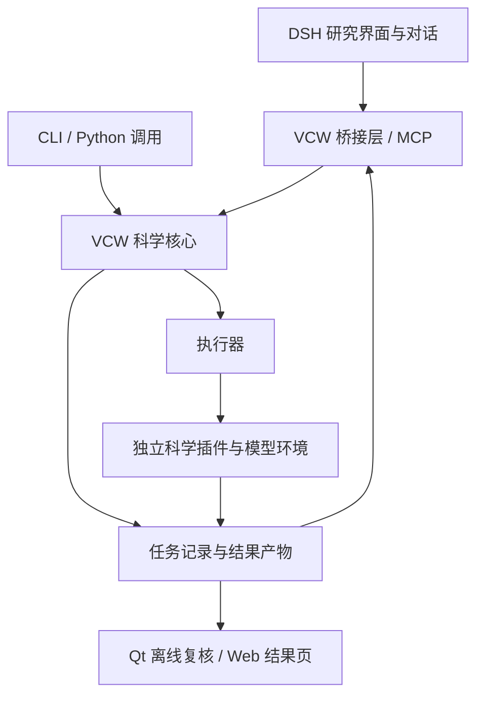

# 架构决策：独立科学核心，结合 DeepSeek Harness

状态：目标架构与实施计划。DSH 集成尚未实现。本文不代表已经接通任何虚拟细胞模型。

核查日期：2026-11-13。DSH 参考提交：`e8f7b93a344964de3dca1ace9e72b6e4d6de87cb`。

## 产品目标与第一阶段边界

让刚进入虚拟细胞领域的研究者完成可追溯的分析，让模型作者通过独立插件贡献方法，让维护者可以分别更新界面、科学方法和执行环境。

第一阶段聚焦转录组数据上的扰动研究：数据检查、基因干预、药物响应、结果解释与验证。空间、多组学、时间动力学和机制模型可以通过后续契约扩展；不能将第一阶段的表达矩阵接口宣称为完整的虚拟细胞标准。

用户首先选择研究问题和数据。平台根据插件声明及实际环境给出可用方法、输入限制和所需资源。新手和专家使用同一份结构化分析计划；新手看分步向导，专家可以展开参数、导出计划并通过 CLI 重跑。

## 决策

采用 **VCW 科学核心 + 科学插件 + DSH 研究入口**。科学核心独立于 Qt、DSH 和大语言模型。DSH 作为首选 Agent 宿主，领域功能通过 MCP 和薄插件接入，优先使用官方扩展点，不长期维护深度分叉。

当前 PySide6 应用继续承担离线结果查看和复核。先验证一个完整 DSH 研究流程，再决定主交互界面的迁移；过渡期不同时建设两套完整聊天与 Agent 系统。

这是目标拓扑，当前插件执行器还是同步本地子进程，未提供持久队列、远程执行或 MCP 服务。

## 为什么选择这个分工

| 路径 | 可以获得的能力 | 主要成本 | 决策 |
| --- | --- | --- | --- |
| 深度 fork DSH，科学逻辑和界面一起修改 | 直接控制宿主产品 | 跟踪宿主变更、Python 与 TypeScript 耦合、贡献门槛提高 | 第一阶段不采用 |
| 独立科学核心 + DSH 插件/profile | 复用 Agent 与交互宿主，科学方法独立开发测试 | 需要维护薄桥接层和兼容测试 | 首选 |
| Qt 内嵌 DSH Python SDK | 保留现有桌面端，能够调用 Agent | 自己承担聊天流、审批、会话界面工作 | 保留为过渡选项 |
| 只有让 Agent 执行命令的 skill | 很快展示研究引导 | 无法替代输入契约、质量检查、运行持久化 | 用于教程与流程说明 |

DSH 官方架构明确通过旁挂 Cordis 插件扩展；profiles 和 bundles 可以组合专门的应用。官方 Python SDK 已打包匹配的运行时，普通 SDK 执行不需要系统 Node.js，但插件管理命令仍需要 pnpm。Web Client 有界面插槽和独立模块，接上工具并不会自动生成完整科研界面。[1][2][3]

DSH 当前明确标为开发预览，存在兼容变化。因此应锁定经过验证的版本，并将宿主版本、桥接版本、科学核心版本分别记录；不让科学插件直接依赖 DSH 内部对象。[4]

## 哪些能力属于科学核心

核心负责跨方法共用、需要稳定审计的规则，不实现每种模型的算法。

| 核心对象（目标契约） | 必须保留的内容 | 解决的问题 |
| --- | --- | --- |
| 数据描述 | 数据指纹、物种、基因标识、矩阵层和尺度、细胞背景、批次、对照、注释可用性 | 避免拿不匹配的数据直接运行 |
| 分析计划 | 研究目标、输入引用、方法及版本、参数、对照、资源估计、预期产物 | 界面、CLI 与 Agent 提交同一种任务 |
| 能力声明 | 任务范围、支持物种、基因干预类型、基线来源、剂量/时间支持、输出语义 | 解释为什么某后端可用或不可用 |
| 运行记录 | run_id、计划快照、环境、权重/输入指纹、随机种子、状态转换、日志 | 重跑、排错和版本追溯 |
| 产物目录 | 文件类型、语义、大小、校验值、基因/细胞顺序、来源 | 让插件输出可被不同界面读取 |
| 质量记录 | 执行、响应、排名、独立验证分别记录，规则版本和证据引用 | 程序跑完不等于科学结论成立 |
| 基准记录 | 数据划分、对照方法、指标定义、适用范围、失败条件 | 社区贡献可以被独立检查 |

这些是下一轮契约设计范围，尚未全部成为当前代码中的数据类或 JSON Schema。

表达矩阵、表达变化、潜在表征、细胞状态位移和药物排序应使用不同产物类型。缺少到表达空间的合法映射时，不能把 embedding 当成表达变化。基因匹配、归一化和疾病逆转评分必须记录真实执行的处理，不能用界面默认值补成“已确认”。

## 两类插件，各自面向不同贡献者

**科学插件**面向 Python/生物信息学开发者。插件贡献数据读取与检查、模型适配、质量检查、评分方法或基准样例。尽量只需要实现能力声明、参数校验、执行适配和结果导出，不要求贡献者了解 DSH。

**DSH 插件**面向交互开发者。它贡献研究向导、工具卡片、进度与结果页，把结构化任务交给科学核心。它不另写一套基因匹配、评分或验证逻辑。

当前 `vcw_core` 是协议 `0.1` 草案与本地执行的最小实现，`examples/plugins/csv_qc` 提供真实 CSV 基础质控。它用于验证贡献接口，不是成熟的模型插件市场，也没有实现全部上述插件类型。具体命令和限制见 [插件 SDK](plugin-sdk.md)。

真实模型插件还需要声明：模型代码与权重版本、依赖和执行环境、支持的训练/推理背景、资源需求、权重获取方式、输入输出语义、参考样例与已知失败条件。平台对“已发现”“环境就绪”“流程跑通”“通过参考复现”“通过独立评估”使用不同标记，不能共用一个“已验证”。

## 科学质量是产品行为

1. **执行状态**回答代码是否成功、失败、取消或中断。
2. **响应检查**回答输出是否有限值、是否存在跨药物响应塌缩、剂量差异是否可辨认等；规则必须与模型能力匹配。
3. **排名检查**回答有效候选数量和排序证据是否足够。没有排名能力的任务应标为不适用。
4. **独立验证**回答是否有留出扰动数据、外部数据或实验支持。只读查看器对上游“已验证”声明保留来源，不自行认证。

质量未通过的输出仍可作为诊断产物保留。界面应清楚说明哪一部分失败、哪些图表仅供排查；不能只因为生成了 CSV 就展示“推荐药物”。

运行比较先核对细胞背景、基线、基因空间、尺度、时间/剂量单位、数据与权重版本。元数据缺失应显示缺失；不同后端的不同输出语义不能被统一算成可比较的数值。对历史样例保留说明，不把旧公开结果当作新版本重新计算的证据。

## 任务生命周期与 DSH 的边界

DSH 的默认进程内 jobs 随 Harness 进程退出而结束；跨重启持久执行需要其他 backend。这是官方明确的边界。[5]

因此，科研任务的权威状态应属于 VCW 执行服务。目标实现先采用单机任务库和独立 worker，再通过执行器适配器接入远程 GPU 或调度系统。关闭 DSH 窗口、断线、插件热更新和 Agent 取消回答，与“取消科研计算”应分别处理。

未来服务接口需要具有以下语义：

- 提交带幂等键的计划，返回持久 `run_id`，重复提交不重复启动计算。
- 状态查询返回执行器状态与记录时间，不将进程消失推断为成功。
- 取消请求具有确认结果；执行器不可达时记录待确认状态。
- 输入、参数、产物与日志在会话外保存，重连后可以查询。
- 断点恢复仅在后端真正支持时提供；其他中断应可追溯地重跑。

当前最小 CLI 运行器会保存失败/超时记录，但还不是上述持久服务。它使用本机用户权限执行显式选择的本地插件，子进程边界不构成安全沙箱。

## 第一条 DSH 集成流程

以下工具名是拟议接口，不是本仓库现成 API，也不是 DSH 自带工具。

| 拟议工具 | 工作 | 初期返回 |
| --- | --- | --- |
| `inspect_dataset` | 识别矩阵及元数据，报告兼容性问题 | 数据描述、问题列表、建议操作 |
| `list_compatible_backends` | 按数据、任务和本地环境过滤方法 | 可用/不可用及具体原因 |
| `validate_analysis_plan` | 校验参数、输入尺度、对照、资源与输出 | 可执行计划或结构化错误 |
| `submit_run` | 交给独立执行器 | run_id、状态查询入口 |
| `get_run_status` / `cancel_run` | 查看或取消指定任务 | 真实状态及失败/取消原因 |
| `read_result_summary` / `export_report` | 读取有界摘要、质量证据和导出报告 | 产物引用，完整结果保留在任务目录 |

第一步可通过 MCP 暴露数据检查与结果读取。DSH 官方支持外部 MCP 工具及 stdio/HTTP 连接。[6] 短任务可以调用明确的 Python CLI；几个小时的模型计算应先提交到独立服务，再让 DSH 查询。模型提示词不负责拼接任意 shell 命令。

对话默认发送任务描述、必要的有界摘要与产物引用，不自动把完整单细胞矩阵、原始样本元数据或凭据放进模型上下文。需要数据外传的能力应在研究计划中明确展示目的地和范围。模型回答引用实际运行证据，不能自行修改质量状态。

## 新手体验验收

主入口围绕“检查数据”“模拟基因干预”“预测药物响应”“复核已有研究”。模型名放在方法选择和高级设置中。

新手流程为：选择问题 → 导入数据 → 读取检查报告 → 查看可用方法及原因 → 确认结构化分析计划 → 查看进度 → 阅读带质量说明的结果。

必须覆盖以下失败场景：目标基因缺失、基因标识不一致、矩阵尺度不明、未提供细胞注释、缺少适配权重、GPU 不可用、预测响应塌缩、候选数量不足。界面应给出下一步能做什么，而非只显示 traceback。专家始终可以展开原始参数、环境和证据。

不把“新手友好”等同于隐藏不确定性。每张结果页都回答：用了什么背景、计算了什么、通过了什么检查、尚不能支持什么结论。

## 分阶段交付与完成条件

| 阶段 | 交付范围 | 完成条件 |
| --- | --- | --- |
| M0：当前基础改进 | 结果状态与比较修复、宽表预览、离线附件、构建证据、本地插件草案和 CSV QC | 可运行示例输出可被查看器读取；失败不会伪装成功；回归通过 |
| M1：DSH 最小贯通 | 固定 DSH 版本、MCP 桥接、数据检查与结果卡片 | 同一任务经 CLI 与 DSH 得到相同科学记录；无 LLM 时核心仍可运行；断线可重新读取记录 |
| M2：首个可信研究工作流 | 一个真实扰动后端、匹配参考数据、兼容校验、质量报告 | 官方或作者认可参考流程可复现；错误输入被明确拦截；科学证据范围写入结果 |
| M3：任务服务与第二类方法 | 单机持久任务、重连与取消、药物响应分支 | 中断/重启不会误报成功或重复提交；不同语义产物分别解释；药筛退化检查有失败样例 |
| M4：社区试用 | 插件模板、兼容矩阵、贡献指南、独立插件仓库示例、版本政策 | 外部作者无需修改核心即可完成插件；新手独立完成示例与导出；未通过验证的插件标记清楚 |

实际推进可交叉进行，但每一阶段以可验证的完整流程验收，不用“接了多少模型”代替完成质量。先建立一个可信模型参考实现，再接第二种不同输入/输出语义的方法，以此检验契约是否真正通用。

## 共建与维护

早期使用单仓库、明确目录边界和一套 CI。接口有真实第二个使用者后，再将稳定核心发布为 Python 包，将 DSH 桥接发布为独立 bundle。避免一开始拆成大量微服务和仓库。

贡献可分为模型适配、数据示例、基准验证、质量检查、研究模板、文档和界面。维护者负责契约与兼容策略；方法作者负责能力声明和参考复现；社区评估独立记录，不能被插件自行宣称替代。

插件发现、安装、环境检查和执行分别处理。初期使用经审阅的静态索引与显式安装，暂不建设开放自动执行的插件市场。按版本固定代码、权重与依赖；模型权重不进入桌面安装包。项目代码、示例数据和外部模型分别记录来源及许可。仓库公开和项目许可由维护者在发布前确认，本轮不变更仓库可见性。

## 官方参考

1. [DSH 架构：插件、profiles 与 bundles](https://deepseek-harness.github.io/deepseek-harness/en/reference/)
2. [DSH Python SDK](https://deepseek-harness.github.io/deepseek-harness/en/guide/python-sdk)
3. [DSH Web Client 架构](https://deepseek-harness.github.io/deepseek-harness/en/reference/subsystems/web-client)
4. [DSH 官方 README，固定参考版本](https://github.com/deepseek-ai/deepseek-harness/blob/e8f7b93a344964de3dca1ace9e72b6e4d6de87cb/README.md)
5. [DSH jobs 生命周期与持久执行边界](https://github.com/deepseek-ai/deepseek-harness/blob/e8f7b93a344964de3dca1ace9e72b6e4d6de87cb/packages/jobs/jobs/README.md)
6. [DSH MCP client](https://github.com/deepseek-ai/deepseek-harness/blob/e8f7b93a344964de3dca1ace9e72b6e4d6de87cb/packages/mcp/mcp-client/README.md)
