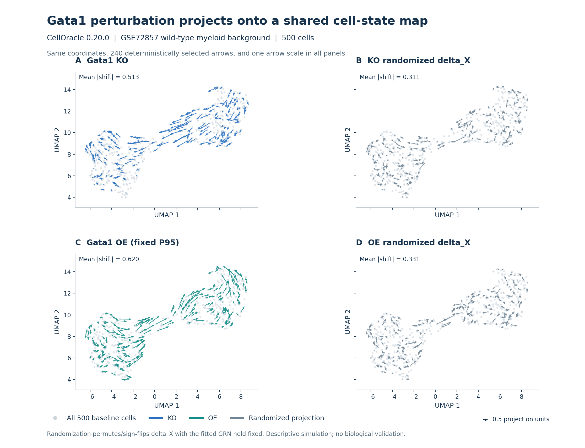
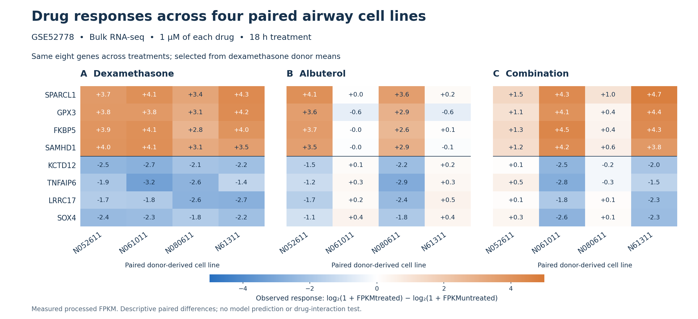
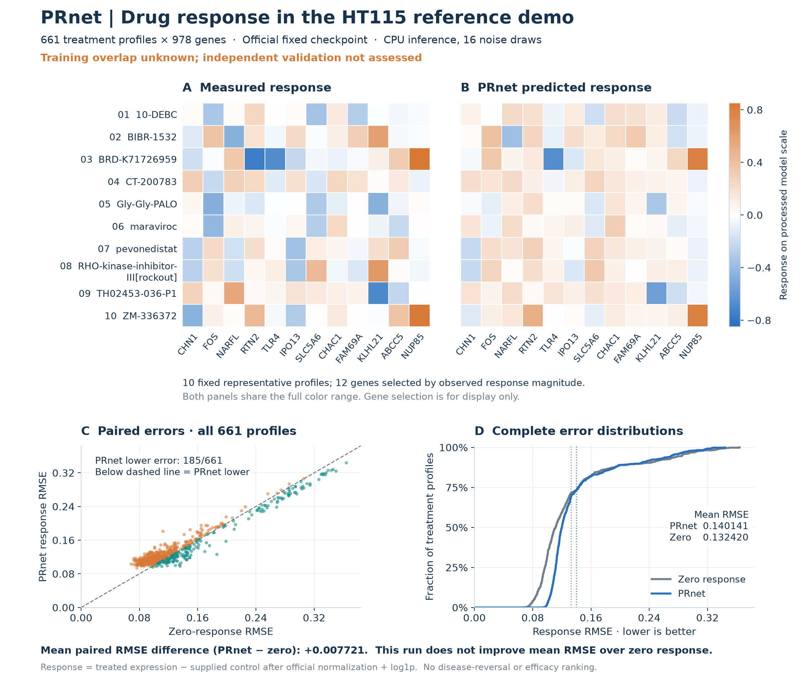

[](SKILL.md)
[](requirements-tests.txt)
[](https://github.com/aper-ai/virtual-cell-workbench/actions/workflows/skill.yml)
[](docs/licensing.md)

# Virtual Cell Research · 虚拟细胞研究 Skill

**面向虚拟细胞研究的可复现分析与方法协作。**

一句话定义研究任务，发起虚拟基因敲除、过表达与药物筛选；Agent 组织数据检查、模型执行、结果复核和报告生成。

**Virtual Cell Research** 是面向转录组与单细胞研究的科研 Agent Skill，围绕**虚拟基因敲除、虚拟过表达和虚拟药物筛选**，组织数据准备、模型执行、基线比较与结果解释。研究者提供表达数据、目标基因或药物库后，Agent 核对输入与对照、匹配适用模型并运行分析，按模型能力输出响应、变化基因、状态位移或药物评分，同时保存结构化报告、图表、质量检查和运行记录。各路线的适用条件、实现程度与验证状态分别记录。

## 能做什么

| 核心任务 | 输入 | 主要结果 |
| --- | --- | --- |
| **虚拟敲除** | 表达矩阵、目标基因、未干预背景 | 模型支持的表达变化、基因影响和细胞状态变化 |
| **虚拟过表达** | 表达矩阵、目标基因、明确的表达设定 | 指定设定下的模拟响应、变化方向及实际作用范围 |
| **虚拟药筛** | 药物库、细胞背景、模型需要的基线与条件 | 逐药转录响应及适用评分；疾病方向排名另需可比较的疾病参照 |

不同模型输出不同：表达预测、网络模拟和 embedding 变化分别解释；剂量比较只用于支持剂量的路线。已执行、已有适配和仍需实现的路线见下方能力表。

## 真实案例与研究结果

### 基因扰动：比较敲除与过表达

> 用 GSE72857 的野生型造血细胞，比较 Gata1 敲除和过表达，生成表达变化、状态位移和结果解释。



图由真实 CellOracle 运行输出生成。箭头表示模型在 UMAP 上的投影位移，随机化面板使用同一背景；这是网络模拟，未完成独立真实扰动验证。[结果、源表规则和复现命令](cases/gallery/celloracle/README.md)

### 药物响应：分析配对观测数据

> 分析 GSE52778，按供体配对比较单药和联合处理的表达响应，生成图表并解释尺度。



从公开 FPKM 矩阵和样本信息开始，完成身份核对、配对比较与绘图。这是实测观测分析，适合学习药物响应数据怎样组织；具体分析范围与完整结果见 [案例说明](cases/airway-gse52778-drug-response/README.md)。

### 预测评估：运行模型并比较基线

> 运行 PRnet 的 HT115 参考案例，展示预测与实测的响应差异，并与简单基线比较。



预测与观测使用共同尺度，误差比较保留全部处理表达谱。训练重叠未知，当前参考结果的解释范围见 [PRnet 图集](cases/gallery/prnet/README.md)。另有 [Kang 供体配对与留出评价图](cases/gallery/kang/README.md)，全部图片及可重跑命令汇总在 [公开案例结果](cases/gallery/README.md)。

## 使用指南与任务入口

| 研究需求 | 使用入口 |
| --- | --- |
| 有自己的 CSV、TSV 或 H5AD | [数据准备](references/user-data.md)：明确尺度和标识，整理输入并生成数据说明 |
| 已有数据和目标，想做基因扰动 | [KO/OE 执行入口](examples/ko_oe/README.md)：按模型契约准备资源，运行指定基因和模式 |
| 想实际运行一次药物响应模型 | [PRnet 参考案例](cases/prnet-reference-evaluation/README.md)：固定小型资源、CPU 推理和基线比较 |
| 希望先核对参考输入与分析流程 | [使用指南](references/first-run.md)：选择真实观测教学或模型案例 |
| 已有分析结果，需要解释与复核 | [结果解释](references/result-reading.md)：生成结构化说明，核对关键数值、源表和解释范围 |
| 有实测响应，希望检验预测 | [预测评估](references/prediction-evaluation.md)：按 ID 对齐、审计划分、比较简单基线 |

**已有研究问题和数据时，直接进入该任务。** 教学案例是可选入口，不要求每次都先跑教程。

## 研究任务指令

### 虚拟敲除

> 使用 Virtual Cell Research，对我提供的单细胞数据分别模拟 STAT3 和 JUN 敲除。先检查数据与基因覆盖，选择适用模型，输出完整模拟表达变化、变化基因、细胞状态图和结果解释。

### 虚拟过表达

> 使用 Virtual Cell Research，分析我提供的细胞背景中 Gata1 过表达的模拟影响。先说明所选模型如何定义过表达，核对我提供的设定，再输出基线、模拟响应、状态变化和质量检查。

### 虚拟药筛

> 使用 Virtual Cell Research，结合我的表达数据、药物库和疾病参照开展虚拟药筛。按输入选择兼容模型，注明实际基线，输出逐药响应、适用的疾病方向评分、图表和结果解释；保留无法预测或无法评分的条件及原因。

Agent 会先读取你已经给出的数据和设置，完成可做的检查，只询问无法确定且会改变研究问题的条件。模型、可用解释器和普通运行参数可以给出有依据的默认；目标、干预含义、对照和未知数据尺度需要明确。

## 一次分析如何完成

1. **理解任务。** 确定敲除、过表达、药物响应或结果评估，以及目标细胞背景。
2. **准备输入。** 检查表达尺度、行列标识、目标覆盖、样本信息和对照，保留原始数值及来源。
3. **匹配与运行模型。** 核对环境、权重、先验和模型能力，先检查小范围产物，再继续约定范围。
4. **检查与解释结果。** 保留完整预测与基线，检查异常、可区分性、适用的评分和评价基线。
5. **交付运行包。** 汇总主要发现与结果解释，保存图表、完整源表、参数、质量检查、失败记录和复现命令。

Agent 的执行规则见 [SKILL.md](SKILL.md)，科学输入定义见 [输入契约](references/input-contracts.md)，失败处理见 [排错指南](docs/troubleshooting.md)。

## 第一次使用怎样准备

保留完整的 `virtual-cell-research/` 目录。在支持 Skill 的 Agent 中按宿主方式加载，或明确让 Agent 读取该目录的 `SKILL.md`。本项目没有适用于所有 Agent 的统一安装路径，也可以直接运行 Python 入口。

下列命令均在包含 `SKILL.md` 的目录执行。数据准备、教学和结果工具使用独立 Python 3.12 环境；Windows 与 Linux/macOS 的建环境步骤见 [首次使用](references/first-run.md#建立数据教学环境)。

```bash
python -m pip install -r requirements-data.txt
python scripts/cases.py list
python scripts/prepare_user_data.py --help
python scripts/explain_result.py --help
python scripts/evaluate_predictions.py --help
```

轻量数据环境与模型环境分开。查看案例目录或命令帮助不会自动下载全部数据、安装模型或运行推理。

## 模型能力与实际入口

| 路线 | 当前入口 | 使用条件 |
| --- | --- | --- |
| **CellOracle** | 参数化 KO/OE；[Gata1 实际案例](cases/celloracle-paul2015-gata1/README.md) | 原始计数、匹配 GRN 先验、可模拟目标和独立环境；OE 需明确内部尺度设定 |
| **PRnet** | [固定官方权重参考推理](cases/prnet-reference-evaluation/README.md)，已在 CPU 实跑 | 当前参考入口使用固定 demo；自有基线仍需单独核对基因轴、预处理与输入域 |
| **Geneformer** | 参数化 delete/overexpress 与 embedding 导出 | 人类完整原始转录组、匹配 tokenizer/权重及环境；尚未在本项目完成真实模型验收 |
| **chemCPA、UniPert-G2CP** | 药筛适配脚本与结果契约 | 需按本次数据配置资源、权重、协变量和基线，完成实际验收 |
| **GEARS、UniCure、DrugReflector** | 任务流程、资源说明和代码示例 | 需具体适配与运行验证，尚非通用一键入口 |

更多模型适用范围见 [能力登记](references/model-capabilities.md)，环境与资源见 [模型配置](references/model-setup.md)。

## 结果怎样判断

先看本次完成了什么、用了什么基线和尺度，再看主要变化与图表。需要评价预测时，同时比较简单基线；相关系数为正不等于误差更小。Top 基因是按指定指标筛选的摘要，完整结果和未通过检查的条件都应保留。

每次运行分别记录计算状态、技术质量与科学验证状态。当前真实模型案例证明了对应路径的可执行性，独立科学验证仍待完成；转录响应评分不直接等于实际药敏、临床疗效或靶点确证。具体数值与证据见 [案例目录](cases/README.md)。

## 开放协作与生态共建

协作目标是将模型、数据与评价方法逐步衔接为可复现的研究工作流，使研究者能够核查输入、复用分析方法并判断结果的证据范围。欢迎围绕以下方向贡献：

| 方向 | 贡献重点 |
| --- | --- |
| **模型与方法** | 模型适配、扰动定义、适用背景、完整原生输出与真实运行案例 |
| **数据与基准** | 数据来源与许可、稳定标识、条件与对照映射、参考任务和数据划分 |
| **评测与验证** | 简单基线、留出设计、适用指标，以及独立数据或实验对照 |
| **可复现工作流** | 数据准备、执行记录、结构化报告、结果解释、可追溯图表与使用指南 |

当前协作基础是已登记的模型路线、公开案例和工具；各路线按实际实现程度维护，独立预测验证仍待补充。新增能力与验证结论应分别由可定位的运行和评价证据支持。

### 贡献规范与工程验证

按 [贡献指南](CONTRIBUTING.md) 提交研究目的、方法与数据来源、最小命令、完整结果位置和实际验证状态。在独立 Python 3.12 环境、包含 `SKILL.md` 的目录执行工程检查与打包：

```bash
python -m pip install -r requirements-tests.txt
python -m unittest discover -s tests -v
python scripts/cases.py validate
python scripts/package_skill.py
```

源码包位于 `dist/virtual-cell-research.zip`，包含流程、脚本、案例说明和必要资源记录。模型权重、原始表达矩阵、环境和本地运行结果按需准备。

## 使用许可与商业授权

有权授权的新贡献采用 **PolyForm Noncommercial 1.0.0**：个人非商业使用，以及协议列明的教育、公共研究等机构用途免费；超出许可范围的商业用途须单独取得书面授权。允许在许可范围内修改与分享。

既有 MIT 版本及沿用的旧内容继续保留原 MIT 权利，第三方模型和数据分别遵守自己的条款。当前新增许可主要覆盖新贡献，不为已有 MIT 分析代码建立排他商用权。完整范围、基准版本和商业咨询入口见 [使用许可](docs/licensing.md)。本项目采用“源码开放”的表述。

[许可](LICENSE) · [资源与来源记录](THIRD_PARTY_NOTICES.md) · [方法说明](docs/methodology-and-scope.md)
