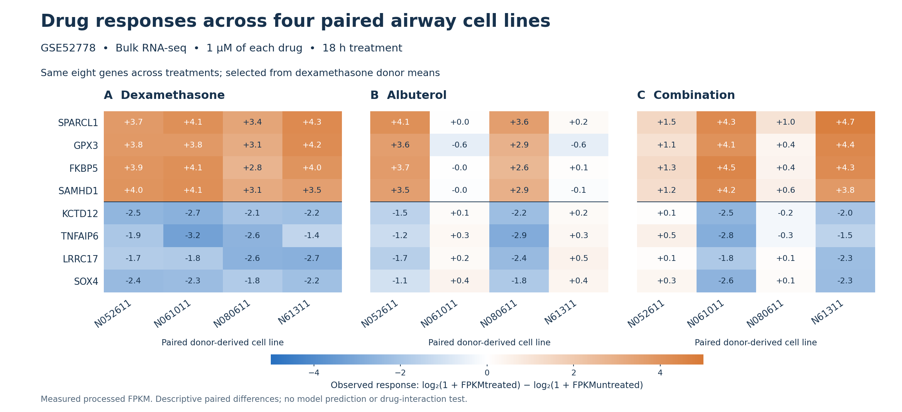

# Airway GSE52778：四位供体的三种处理条件观测响应

**可以直接这样问：**「下载 GSE52778 的原始来源 FPKM 表，先核对 LL 文库、GEO 样本与供体，再对每位供体比较 dexamethasone、albuterol 和两药组合相对 untreated 的响应。」

**本案例已实际下载三份官方来源文件，解析并核对全部 16 份样本，计算四位供体的三个完整处理对比，并生成下图。**这是另一个公开实验的真实数据复读；它没有用于对 CellOracle、PRnet 或任何模型作独立验证。



**读图：**三个面板使用同一组八个来源基因，格内是每位供体的真实配对差值。Dex 面板中四个选出的正向基因在四位供体均为正，四个负向基因均为负；其他处理在同一面板上表现出不同的供体响应。这个基因面板根据 Dex 的观测均值挑选，只适合描述性阅读，不能把它当作无偏全基因评估、药效排名或药物协同检验。

## 本轮实测结果

| 项目 | 实际结果 |
| --- | --- |
| 官方来源 | GEO **GSE52778**；SRA **SRP033351**；GSM1275862–GSM1275877 |
| 背景 | 人气道平滑肌；四位供体来源的原代细胞系；**bulk RNA-seq** |
| 条件 | Untreated、Dexamethasone、Albuterol、Albuterol_Dexamethasone；每药 1 µM，18 h |
| 来源表达 | 作者已处理的 **FPKM**，23,273 个唯一来源 gene_id × 16 份 profile |
| 配对 | 四位供体 × 三个处理对比；每个对比使用同一供体的 untreated |
| 全量输出 | 三个处理 × 四位供体 × 23,273 个来源基因，未按图的选择规则删除原始行 |
| 选图候选 | 四个来源 condition status 全为 OK，且全部 16 份 profile 的 FPKM ≥ 1；共 **10,849 个基因** |
| 图面板 | 按 Dex 四供体等权平均差值，取最大四个正值与最小四个负值；并列按 gene_id |
| 图值核对 | 96 个图值均从输出 CSV 的成对 FPKM 重新计算；最大绝对误差 **8.88 × 10⁻¹⁶** |
| 状态 | `run_status: completed`；`model_status: not_run`；`independent_validation: not_assessed` |

来源实验背景、处理时长和剂量由 [原始 GEO 样本记录](https://www.ncbi.nlm.nih.gov/geo/query/acc.cgi?acc=GSM1275863)及 [Himes 等原始研究](https://doi.org/10.1371/journal.pone.0099625)核对。本轮统计和图值来自脚本实际输出，见 [evidence.json](evidence.json)、[qc.json](qc.json)和 [figure_data.csv](figure_data.csv)。

### 这不是按列顺序猜出的供体配对

FPKM 表的列有 `Dex_LL14`、`Dex_LL06`、`Dex_LL02`、`Dex_LL10` 等，顺序并不按供体排列。GEO series matrix 给出了 GSM、SRX、真实供体与处理；SRA 完整 XML 又给出了每个实验的原始 FASTQ 文件名。脚本通过以下真实来源标识连接：

`FPKM 列中的 LL → SRA Original FASTQ filename → SRX/GSM → GEO donor/treatment`

例如，`Dex_LL14` 对应 SRA 中的 `LL14_R1.fastq`、`LL14_R2.fastq`；它们属于 **SRR1039521 / SRX384358 / GSM1275875**，GEO 与 SRA 注释均对应 **N061011 / Dexamethasone**。只读取这些官方文件名和身份记录，没有下载数十 GB 的 FASTQ，也没有把读段当作生物学重复。

| 真实供体细胞系 | Untreated | Dexamethasone | Albuterol | 两药组合 |
| --- | --- | --- | --- | --- |
| N61311 | LL01 | LL02 | LL03 | LL04 |
| N052611 | LL05 | LL06 | LL07 | LL08 |
| N080611 | LL09 | LL10 | LL11 | LL12 |
| N061011 | LL13 | LL14 | LL15 | LL16 |

完整的 16 项 GSM/SRX/SRR、原始文件名、列位置和来源注释见 [sample_mapping.csv](sample_mapping.csv)；12 个实际处理－对照连接见 [donor_pairs.csv](donor_pairs.csv)。脚本同时要求 GEO 与 SRA 的供体、处理、标题逐项一致，检查身份一对一覆盖，并拒绝缺失或重复配对。七项身份测试覆盖列顺序打乱、处理列错配、GEO/SRA 供体冲突、缺失对照、规范化身份顺序不变性，以及八个锁定字段中任一字段变更时拒绝；数值测试使用合成数据，不充当实验结果。

## 表达尺度、选图与来源状态

对每位供体和基因直接计算：

```text
response = log2(1 + source_FPKM_treated) − log2(1 + source_FPKM_untreated)
mean response = 四位供体的 response 等权平均
```

`+1` 在 FPKM 尺度上。没有再计算 CPM，没有把 FPKM 冒充原始计数，也没有对来源置信区间或 status 作新的显著性解释。这些差值不等于未经伪计数的 log fold change。所有来源 gene_id、gene_short_name 和 locus 保留；此表的 gene_id 为来源命名，**不是 Ensembl ID**，不擅自转换或合并。

全量来源有 3,307 个在 16 份 profile 中均为零的行；23,101 个行的四种 condition status 全部为 OK。原作者还标记 LOWDATA、FAIL、HIDATA，本例在完整表中保留这些标签，图的候选集合要求全为 OK。要求所有 16 份 profile 的 FPKM ≥ 1 是透明的展示过滤规则，会排除低表达或条件特异表达的真实基因，不能把图中没有出现的基因解释为不响应。

以下是八个展示基因的四供体等权平均差值；全部 96 个单供体数值、对应的处理和对照 FPKM 见图源 CSV。

| 来源 gene_id | Dexamethasone | Albuterol | 两药组合 |
| --- | ---: | ---: | ---: |
| SPARCL1 | 3.884 | 1.966 | 2.887 |
| GPX3 | 3.712 | 1.325 | 2.489 |
| FKBP5 | 3.701 | 1.591 | 2.631 |
| SAMHD1 | 3.695 | 1.577 | 2.449 |
| KCTD12 | −2.357 | −0.865 | −1.161 |
| TNFAIP6 | −2.292 | −0.881 | −1.006 |
| LRRC17 | −2.228 | −0.852 | −0.973 |
| SOX4 | −2.161 | −0.533 | −1.105 |

精确未四舍五入的均值见 [selected_gene_means.csv](selected_gene_means.csv)。三种处理共享来源对照，不能把 12 个对比视为 12 个独立供体；供体间和处理间差异也不能直接归结为临床疗效、相加、协同或拮抗。本例没有拟合药物交互作用模型，没有 P 值、FDR、置信区间或模型性能分数。

## 下载与复现

在包含 `SKILL.md` 的 Skill 根目录使用 [独立数据教学环境](../../references/first-run.md#建立数据教学环境)。三个官方资源共 **2,746,071 bytes**，每个资源下载至自己的新子目录：

```bash
python -m pip install -r requirements-data.txt
python scripts/cases.py show airway-gse52778-drug-response
python scripts/cases.py fetch airway-gse52778-drug-response --asset fpkm --output-dir local-runs/airway-input/fpkm
python scripts/cases.py fetch airway-gse52778-drug-response --asset metadata --output-dir local-runs/airway-input/metadata
python scripts/cases.py fetch airway-gse52778-drug-response --asset sra_mapping --output-dir local-runs/airway-input/sra_mapping
python scripts/observed_airway_case.py --input-dir local-runs/airway-input --output-dir local-runs/airway-observed
```

分析阶段不联网，CLI 强制核对 **FPKM 与 GEO series matrix 两份静态文件**的大小与 SHA256；对 **SRA 动态 XML**则核对来源实验、16 个完整样本身份和锁定的规范化身份 SHA256，同时保存本次原始响应的实际字节数与 SHA256。没有跳过身份校验的参数。校验和由本项目对实际下载或明确的规范化记录计算，**不是发布者签署的校验和**。已有输出目录不会覆盖。

### 实际解决的 SRA 动态响应问题

同一 SRA eutils URL 的两次完整下载均为 146,240 bytes，原始 SHA256 却不同。逐节点比较发现 **13 个 run 的 `SRAFiles` 子节点顺序变化**；仅对这些同级文件节点排序，整份 XML 即完全一致。所有 GSM/SRX/SRR、LL 原始文件名、供体、处理与标题均相同。把这种服务端序列化顺序误写成固定文件哈希，会使正确重跑被拒绝。

脚本因此把八个必要字段 `experiment`、`geo_accession`、`library_id`、`original_fastq_names`、`run_accession`、`sra_donor`、`sra_title`、`sra_treatment` 的全部 16 条记录按 GEO accession 排序，以 UTF-8、键排序、无额外空白的 JSON 序列化，锁定下面的指纹：

```text
2992f218505bc0d7a20cfa3579685848cd8ade5aea34900e0a52c4e20e58a927
```

规范化的完整身份投影见 [sra_identity.json](sra_identity.json)。这个投影中任一必要身份变化都会失败，不能只改变原始 XML 的哈希便绕过真实供体配对核对；响应大小也限于 2 MiB。catalog 的动态资源不声称有恒定的原始文件哈希，记录实际快照哈希与规范化验证方式。

已用第二份实际下载的 XML 完整重跑：全量 FPKM、所有处理／供体／基因轴、全量配对响应、映射 CSV、图值 CSV、全部基因汇总和 PNG 均与首次运行一致，最大响应差为 **0**。两份原始 XML 与原始差异文件保留在本轮运行目录；[metadata_refetch_verification.json](metadata_refetch_verification.json)记录两次哈希、节点顺序检查与端到端复跑结果。SVG 的时间／对象元数据可以变化，不作为数值一致性的判断依据。

| 资源 | 实际 bytes | SHA256 |
| --- | ---: | --- |
| GSE52778_All_Sample_FPKM_Matrix.txt.gz | 2,596,435 | `e7e54e8f564d417b47843e82c2a7140b92a783d6b5078816bae15d07fca126f6` |
| GSE52778_series_matrix.txt.gz | 3,396 | `67db46e962f795b9dd61fa6b4279f2678c6b2b9bf1df035fbc22fcf81b5e879e` |
| SRP033351_full.xml（第二次实际响应，原始哈希只记录本次快照） | 146,240 | `391c8a8747117e6f1eb6f41fdbee6f0f09e65669e1fec6ba2dd97879c94e547e` |

本轮首次执行目录为 `local-runs/gallery-airway-observed`，用第二份实际 SRA 响应完成的最终复跑为 `local-runs/gallery-airway-observed-v2`。原始输入和两份 XML 分别保留在 `local-runs/gallery-airway-input` 与 `local-runs/gallery-airway-metadata-refresh`；全部下载、身份探查和运行日志保存在 `local-runs/gallery-airway-logs/`。它们与原始输入不塞入 Skill 源码包。源码中的 PNG、SVG、图值、映射和 evidence 是便携审核材料。

| 完整运行产物 | 内容 |
| --- | --- |
| `report.md`、`drug_response.png`、`drug_response.svg` | 中文阅读说明与新计算结果图 |
| `tables/sample_mapping.csv`、`tables/donor_pairs.csv` | 真实源身份与供体配对 |
| `tables/source_annotations.csv` | 来源 gene_id、symbol、locus、condition status 及作者其他注释 |
| `raw/source_fpkm.npz` | 全部 23,273 × 16 来源 FPKM 与明确基因、列轴 |
| `raw/paired_responses.npz` | 3 × 4 × 23,273 配对响应与 treatment、donor、gene 轴 |
| `tables/gene_summary.csv` | 三个对比的全部基因均值、中位数、供体间样本标准差和方向计数 |
| `tables/figure_data.csv`、`tables/selected_gene_means.csv` | 图中数值、来源列与对应 FPKM |
| `qc.json`、`provenance.json` | 检查、选择规则、源文件/输出哈希、包版本和运行命令 |

`numpy.load(path, allow_pickle=False)` 可读取两个 NPZ；数组均带来源轴，不依赖猜测顺序。全量结果中的供体间标准差只是描述性离散度，不是置信区间。

## 一级来源与许可

- [GEO GSE52778](https://www.ncbi.nlm.nih.gov/geo/query/acc.cgi?acc=GSE52778)：原始研究提交的 FPKM 和样本注释。
- [GSM1275863](https://www.ncbi.nlm.nih.gov/geo/query/acc.cgi?acc=GSM1275863)：气道平滑肌、1 µM、18 h、FPKM 来源处理说明。
- [SRA SRP033351](https://www.ncbi.nlm.nih.gov/sra?term=SRP033351)：实验、样本、run 和原始 FASTQ 文件名；完整获取 URL 在 evidence 的 `sources.sra_mapping.url`。
- [Himes 等，PLOS ONE 2014，DOI 10.1371/journal.pone.0099625](https://doi.org/10.1371/journal.pone.0099625)：原论文，CC BY。本文的显著性分析与后续生物学验证不是本脚本重新获得的结果。

GEO/SRA 源文件未单独核实数据许可；原论文的 CC BY 与本项目代码 MIT 许可分别记录，不自动扩展为这三份数据文件的专用许可。本例执行了来源数据读取和描述性分析；既不是原始测序重处理，也不是独立模型验证。
