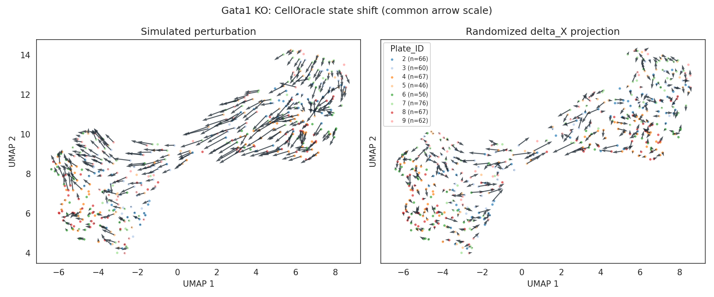
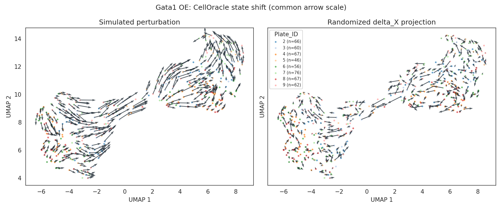

# 原始计数到 Gata1 KO/OE：实际 CellOracle 网络模拟

**本案例已在 Linux CPU 环境实际执行 CellOracle 0.20.0，完成 GRN 拟合、Gata1 KO 与另一次 OE 模拟、随机化投影对照和结果导出。独立生物学验证尚未完成。**

这里使用原研究 GSE72857 的整数分子计数和样本设计，构造有明确身份的小鼠造血背景。它与[教程文件输入审计](../celloracle-paul2015-input-audit/README.md)是不同入口：不把教程中非整数的 `raw_count` 层取整，也不通过改尺度声明来绕过输入要求。

## 实际结果与解释范围



图来自本次真实模型运行。左右两图使用相同 UMAP 坐标、同一组 400 个细胞箭头和共同箭头尺度；背景散点包括全部 500 个细胞。颜色是来源 `Plate_ID`，表示分选板，**不是细胞类型**。随机对照在固定 GRN 上重排、随机翻转 `delta_X` 后投影，不能解释成随机 GRN、独立实验或生物学特异性证明。

| 实际检查 | 结果 |
| --- | --- |
| 原始计数矩阵 | 10,368 wells × 27,297 个来源基因 ID |
| 选定背景 | Mouse 2，`Unsorted myeloid`，每孔 1 个细胞；GEO 逐 batch 核实 wild type、C57BL/6、骨髓、mm9 |
| 候选与 QC | 3,040 个背景候选；2,342 个通过至少 1,000 counts、500 个检测基因的案例阈值 |
| 固定小子集 | 500 个细胞；按 `SHA256("123:Well_ID")` 排序取前 500 个，选择不依赖模拟输出 |
| 准备后的基因 | 10,757 个有表达的单名基因；224 个细胞原始 Gata1 计数大于 0 |
| 模型入口 | 1,500 个 HVG，Gata1 已包含其中；20 PCs，全体细胞拟合一个 GRN |
| 真实计算产物 | 500 × 1,500 的基线、模拟表达和 `delta_X`；1,500 × 1,500 的拟合系数矩阵 |
| 数值复核 | 750,000 个 `delta_X` 均等于模拟表达减基线；CSV round-trip 后最大误差为 0；模拟 Gata1 值全部为 0 |
| 技术运行 | 本次约 54.5 秒，退出码 0；全部数据与投影有限，三张默认图生成成功 |
| 科学状态 | `model_status=executed`；`validation_status=not_assessed`；`simulated_unvalidated` |

运行证据、输入/脚本/产物哈希、失败记录和数值检查见 [evidence.json](evidence.json)。实测 Linux 包版本见 [environment-linux.json](environment-linux.json)；实际安装的 65 个 CellOracle Python 源文件均与官方分发包的 `RECORD` 哈希一致，逐文件哈希和聚合算法保留在 [backend-code-hashes.json](backend-code-hashes.json)。计时不包括安装、下载、输入准备，并会随机器与依赖变化。

## 1. 获取四项原始资源

以下命令在包含 `SKILL.md` 的 Skill 根目录运行。获取和输入准备使用[独立数据环境](../../references/first-run.md#建立数据教学环境)；真正模型运行使用后文独立 Python 3.10 环境。

```bash
python scripts/cases.py show celloracle-paul2015-gata1
python scripts/cases.py fetch celloracle-paul2015-gata1 --asset umi --output-dir local-runs/paul-umi
python scripts/cases.py fetch celloracle-paul2015-gata1 --asset design --output-dir local-runs/paul-design
python scripts/cases.py fetch celloracle-paul2015-gata1 --asset samples --output-dir local-runs/paul-samples
python scripts/cases.py fetch celloracle-paul2015-gata1 --asset mouse-grn --output-dir local-runs/paul-mouse-grn
```

资源约为 16.4 MB 原始分子计数、116 KB 实验设计、5.9 KB GEO SOFT 样本信息、4.6 MB 小鼠 mm9 promoter 先验。具体 URL、大小和 SHA256 在[资源记录](resources.json)与案例目录中。下载器只获取明确选择的文件；所有输出目录必须新建。

## 2. 从整数计数准备输入

```bash
python scripts/prepare_paul2015_case.py \
  --counts local-runs/paul-umi/GSE72857_umitab.txt.gz \
  --design local-runs/paul-design/GSE72857_experimental_design.txt.gz \
  --samples local-runs/paul-samples/GSE72857_family.soft.gz \
  --output-dir local-runs/paul-wt-prepared \
  --max-cells 500 --min-counts 1000 --min-genes 500 --seed 123
```

准备脚本强制核验三个官方文件的固定哈希，并检查矩阵与设计表的所有细胞 ID 精确匹配。原始实验同时包含 Cebpa/Cebpe KO、对应对照和其他分选背景，因此不能把整张矩阵当作同一个未扰动背景。

本案例仅保留 `Batch_desc="Unsorted myeloid"`、`Mouse_ID="2"`、`Number_of_cells="1"` 的 wells，再逐个 `Amp_batch_ID` 与原始 GEO SOFT 记录连接。AB173–AB176、AB203–AB214 对应 GSM1873452–GSM1873467，均明确标为 wild type，基因组为 mm9；来源标记为 Lin− cKit+ Sca1−。基线身份不靠鼠编号猜测。

2,109 个来源行含分号多基因名，准备脚本不擅自取第一个名称。它排除这些行，并在 `excluded_genes.csv`、`candidate_cells.csv` 记录逐基因和逐细胞计数影响。**这会移除约 13.2% 的候选和选中细胞分子计数，是实质性限制**；该取舍适合演示明确的输入契约，后续正式分析应核实别名或多基因映射，不能忽略这部分信息损失。

输出包括：

- `paul2015_wt_input.h5ad`：未归一化的非负整数计数、所选细胞的来源元信息、单名 gene symbols。
- `candidate_cells.csv`：全部 3,040 个候选的计数、检测基因数、QC 和最终选择标志。
- `excluded_genes.csv`：多名基因排除原因及其在候选背景中的计数总量。
- `sample_metadata.json`：入选 amplification batches 的原始 GEO 元信息。
- `qc.json`、`provenance.json`：输入检查、精确参数、来源/脚本/产物哈希和环境版本。

阈值是这个小案例的明确选择，不是完整单细胞 QC 标准；本例未进行系统性线粒体比例筛选或细胞类型注释。准备成功不等于模型已经运行。

## 3. 准备真实模型环境

**本次实际验收的平台是 Linux x86_64 CPU。** CellOracle 官方推荐独立环境；可用 Linux 或 WSL 中的 Python 3.10 和 C/C++ 编译工具准备环境。Windows 上的数据工具和快速测试通过，并不等于 CellOracle 原生 Windows 依赖安装通过。

以下是与本次环境对应的安装方式，不要在数据教学环境中强制降级依赖：

```bash
python3.10 -m venv .venv-celloracle
.venv-celloracle/bin/python -m pip install "setuptools<81" wheel "Cython==3.0.12" \
  "numpy==1.26.4" "pandas==1.5.3" "scipy==1.11.4" "matplotlib==3.6.3" \
  "scikit-learn==1.3.2" "numba==0.59.1" "scanpy==1.9.8" "anndata==0.10.8"

CFLAGS="-Wno-error=implicit-int -Wno-error=int-conversion" \
  .venv-celloracle/bin/python -m pip install --no-build-isolation \
  "celloracle==0.20.0" "numpy==1.26.4" "pandas==1.5.3" "scipy==1.11.4" \
  "matplotlib==3.6.3" "scikit-learn==1.3.2" "numba==0.59.1" \
  "scanpy==1.9.8" "anndata==0.10.8" "setuptools<81"

.venv-celloracle/bin/python -m pip check
.venv-celloracle/bin/python -c "import celloracle as co; import velocyto, gimmemotifs, pybedtools; print(co.__version__); co.check_python_requirements()"
```

实际安装使用同样版本约束及编译参数，通过 `uv pip` 在独立 Python 3.10.22 环境中完成。GCC 14 将 gimmemotifs 0.17.2 的旧 C 写法视为错误，所列 `CFLAGS` 仅使这两类旧语法诊断按警告编译；不替换科学计算代码，不使用空模块。实际安装、导入了 velocyto、gimmemotifs 和 pybedtools，`pip check` 没有依赖缺损。

一些独立的 motif discovery 外部程序未安装。本案例直接读取作者提供的 promoter 先验，不执行从头 motif 扫描；该环境不能据此宣称完整支持所有 motif discovery 流程。所有实际包版本保留在环境记录中，未来安装仍须检查解析到的版本。

## 4. 实际运行一次 Gata1 KO

```bash
OMP_NUM_THREADS=1 OPENBLAS_NUM_THREADS=1 MKL_NUM_THREADS=1 MPLBACKEND=Agg \
  .venv-celloracle/bin/python examples/ko_oe/celloracle_run.py \
  --h5ad local-runs/paul-wt-prepared/paul2015_wt_input.h5ad \
  --base-grn local-runs/paul-mouse-grn/mm9_TFinfo_dataframe_gimmemotifsv5_fpr2_threshold_10_20210630.parquet \
  --target-gene Gata1 --mode ko \
  --output-dir local-runs/paul-gata1-model \
  --group-col Plate_ID --n-hvg 1500 --n-pcs 20 --n-neighbors 50 --n-jobs 2 --seed 123
```

`Plate_ID` 只用于技术分组展示。未提供 `--grn-unit-col`，因此在全部 500 个细胞上拟合一个 GRN，没有把各分选板误当成细胞类型来拟合网络。

首次尝试显式使用 `--n-hvg 1000`，选出 1,001 个基因（额外包含 Gata1），但只有 790 个基因满足 CellOracle 0.20.0 内部 CV 计算的条件。其原生导入器访问 `score[999]`（第 1,000 个合格基因）时报错。该失败已保留，不计为成功模型结果。

检查源码后，本次改用明确记录的 `--n-hvg 1500`，其中 1,211 个基因满足内部检测条件，真实计算成功。适配脚本也增加了针对 **0.20.0** 的预检查：入选基因中应至少有 `min(基因数, 1000)` 个在大于 2 个细胞表达且平均原始计数处于 `(0, 35)` 的基因。不满足时给出可操作错误，不自动改 HVG 数、补零或修改表达尺度；其他未审计版本不会冒充已通过此检查。

## 5. 怎样复核结果

先看 `manifest.json`、`validation.json` 和 `report.md`，确认这一次真的完成，并核对实际输入哈希、参数与模型版本。再阅读：

| 文件 | 内容 |
| --- | --- |
| `raw/baseline_imputed_expression.csv.gz` | CellOracle 内部基线表达 |
| `raw/simulated_expression.csv.gz`、`raw/delta_X.csv.gz` | 完整模拟表达与模拟差值；行列 ID 必须对应 |
| `raw/simulation_grn_coefficients_000.csv.gz` | 本次模拟实际使用的全体细胞 GRN 系数 |
| `tables/target_expression_setting.csv` | 每细胞 Gata1 基线及固定 KO 设定 0 |
| `tables/gene_effects.csv` | 描述性基因变化，不含实验显著性结论 |
| `tables/cell_state_shift.csv.gz` | 逐细胞 UMAP、模拟位移、随机化位移及技术分组 |
| `figures/figure_manifest.csv` | 已生成、跳过或失败的图及源表 |

本次所有数值有限，三个表达矩阵的细胞和基因轴一致。每个 `delta_X` 都等于模拟表达减内部基线，Gata1 的模拟表达全为 0。共有 1,311 个非目标基因出现非零模拟差值；这些是网络计算结果，并非实测 Gata1 扰动差异基因。

平均 UMAP 位移幅度约 0.5133，单次随机化投影约 0.3110。这里只报告描述性数值，不能据此给出效应显著性、模型准确率或靶点确证。UMAP 轴、投影幅度、CellOracle 内部表达尺度也不能互相转换为实验倍数或百分比。

## 6. 已实跑的过表达分支

同一份原始数据准备结果也已在相同 CellOracle 0.20.0 环境执行 Gata1 OE，使用新的输出目录。这里明确选择内部 imputed 表达的 **95 分位**作为固定设定，仅用于本案例；它不是所有用户任务的默认值，也不代表实验过表达倍数。

```bash
OMP_NUM_THREADS=1 OPENBLAS_NUM_THREADS=1 MKL_NUM_THREADS=1 MPLBACKEND=Agg \
  .venv-celloracle/bin/python examples/ko_oe/celloracle_run.py \
  --h5ad local-runs/paul-wt-prepared/paul2015_wt_input.h5ad \
  --base-grn local-runs/paul-mouse-grn/mm9_TFinfo_dataframe_gimmemotifsv5_fpr2_threshold_10_20210630.parquet \
  --target-gene Gata1 --mode oe --oe-percentile 95 \
  --output-dir local-runs/paul-gata1-oe-model \
  --group-col Plate_ID --n-hvg 1500 --n-pcs 20 --n-neighbors 50 --n-jobs 2 --seed 123
```

本次仍为 **500 × 1,500** 的完整模型输出，约 50.7 秒，退出码 0。固定设定值为 **1.5566748438**：475 个细胞的目标表达被提高，原本高于设定值的 25 个细胞被降低。因此报告不能写成“全部细胞都上调”，也不能将该值解释成 1.56 倍过表达。



750,000 个 delta 元素已与模拟表达减基线逐项复核，CSV 往返后的最大绝对误差约为 `1.11e-15`。完整表达、目标设定表、投影和三张图均保留；输入、代码和全部产物哈希见 [OE 运行证据](oe-evidence.json)。KO 的原有证据单独保留，两个条件不混写为同一次执行。

本次 OE 同样没有独立真实过表达标签，科学状态保留 `simulated_unvalidated`。读图时沿用上述技术分组、随机化投影和 UMAP 的解释范围。

## 局限与来源

- 仅一个小鼠、500 个固定选中细胞，没有独立供体重复，也没有用于本例评估的真实 Gata1 KO 标签。
- 多名基因排除、HVG 选择、全体细胞 GRN、单次随机化和 UMAP 投影都会影响结果；未建立细胞类型特异网络或可信发育轨迹。
- 这是技术可运行且记录完整的模型模拟案例，独立预测验证仍为未评估。
- 原研究：[Paul 等，Cell 2015](https://doi.org/10.1016/j.cell.2015.11.013)；[GSE72857](https://www.ncbi.nlm.nih.gov/geo/query/acc.cgi?acc=GSE72857)。可核对原始样本 [AB175](https://www.ncbi.nlm.nih.gov/geo/query/acc.cgi?acc=GSM1873454) 和 [AB214](https://www.ncbi.nlm.nih.gov/geo/query/acc.cgi?acc=GSM1873467) 的基因型、组织及 mm9 声明；本地 SOFT 覆盖全部入选 batch。
- 模型：[CellOracle 论文](https://doi.org/10.1038/s41586-022-05688-9)、[官方安装说明](https://morris-lab.github.io/CellOracle.documentation/installation/index.html)、[PyPI 0.20.0](https://pypi.org/project/celloracle/0.20.0/)。模型算法归原作者；本项目新增原始数据准备、来源核对、可复现案例与适配边界检查。
- [CellOracle 固定版本许可](https://github.com/morris-lab/CellOracle/blob/7948870a3b70f7d228e54734e1fa9ed3291fc23b/LICENSE)含非商业学术用途限制；原始表达数据与先验的单独数据许可未核实。源码包仅保留说明、小型真实结果图和证据，不打包原始矩阵或先验，不以本项目的代码许可替代它们的条款。
