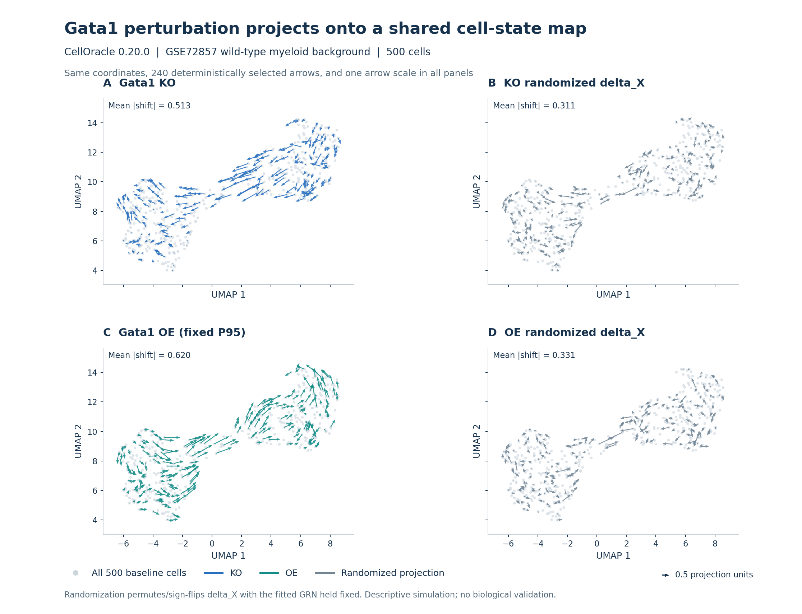
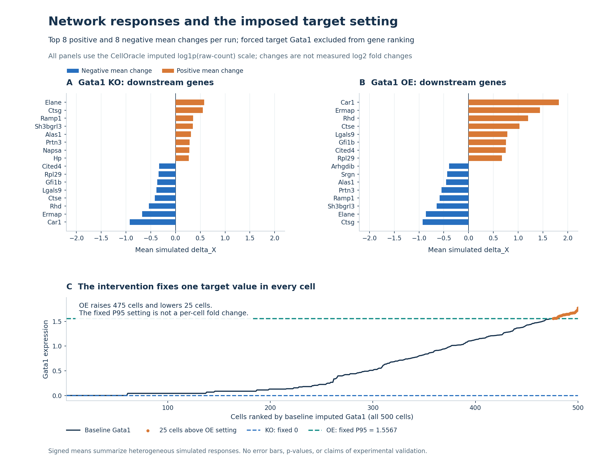
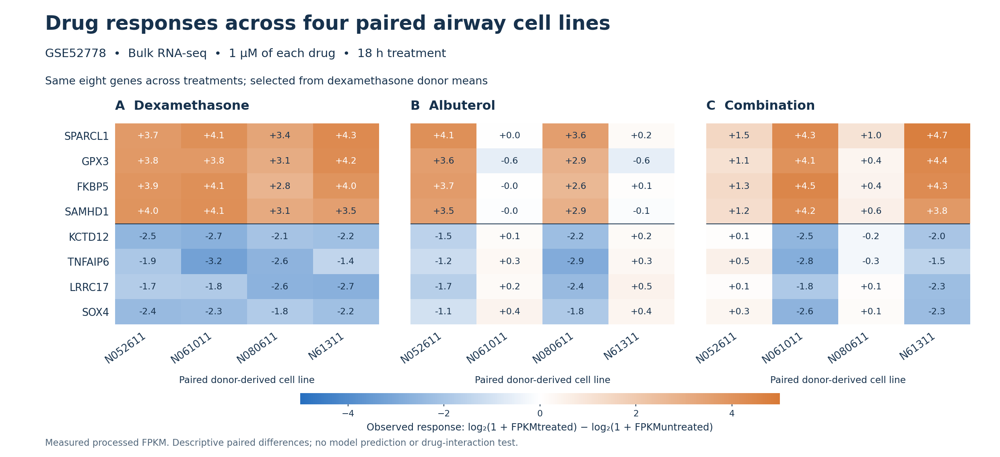
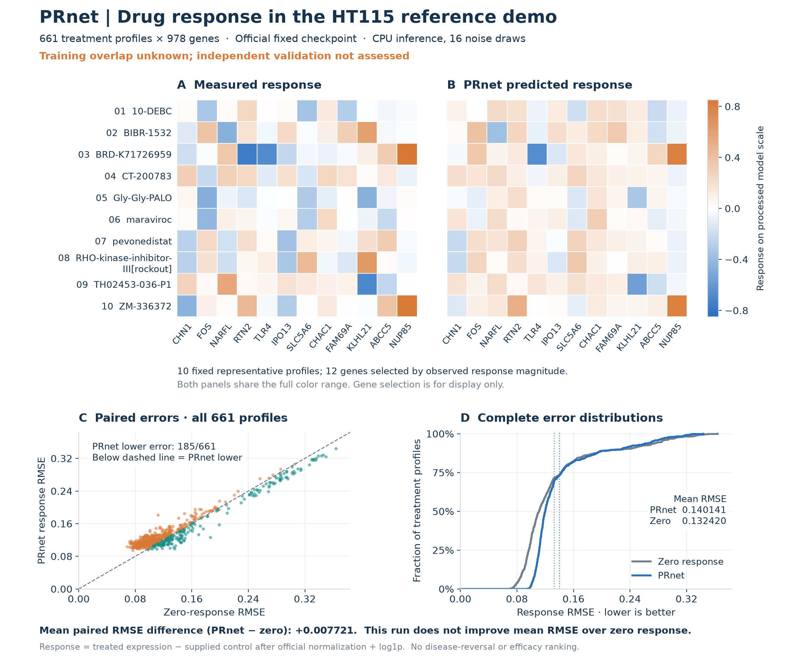
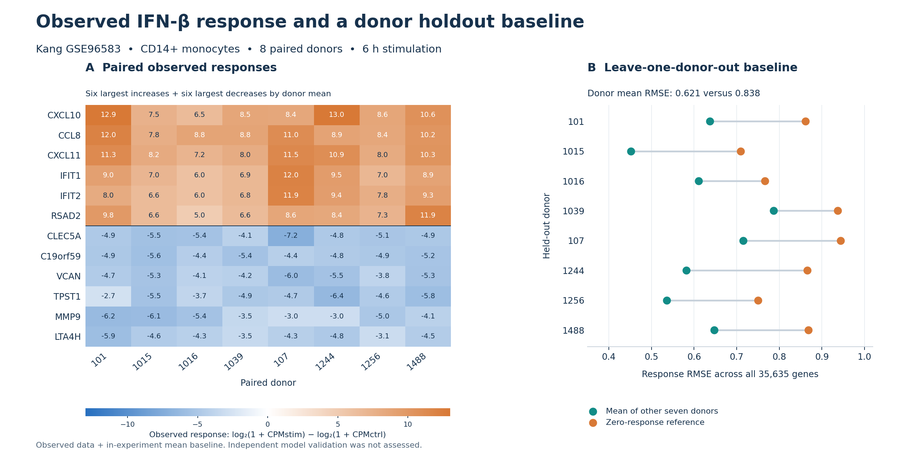

# 公开案例结果：从数据到图

这些图由 Virtual Cell Research 的数据处理、模型调用和绘图脚本实际生成。原始数据来自公开研究；每组结果分别保存本次资源身份、命令、参数、数值核对及图源。

## 选择你想看的研究任务

| 研究问题 | 公开数据 | 软件实际完成的处理 | 结果与复现 |
| --- | --- | --- | --- |
| 敲除或提高 Gata1 后，模型中的细胞状态怎样变化？ | Paul2015 / GSE72857 野生型造血细胞 | 原始计数准备、CellOracle GRN 拟合、KO/OE、随机化投影、下游表达与状态图 | [基因干预](celloracle/README.md) |
| 单药与联合处理的实际表达响应有什么不同？ | GSE52778 人气道平滑肌 | 样本身份核对、供体内对照配对、FPKM 变换、三种处理的观测响应与图 | [药物观测](../airway-gse52778-drug-response/README.md) |
| 模型预测的药物响应与实测有多接近？ | PRnet 官方 HT115 demo | 固定权重真实推理、全量响应导出、共同色标热图、完整样本基线比较 | [药物预测](prnet/README.md) |
| 其他供体的响应能否预测一位留出供体？ | Kang / GSE96583 PBMC | CD14+ 供体配对聚合、观测响应、八折均值基线拟合与评价 | [供体配对与预测评价](kang/README.md) |

## 基因干预：同时看状态位移和表达变化

状态图与表达图回答不同的问题。前者展示模型响应在低维空间中的投影，后者展示内部表达尺度的数值变化。过表达使用固定设定时，原本高于该设定的细胞可能被下调；图注与目标设定表应一起阅读。

## 药物观测：同一供体内比较处理条件

本例从作者公开的表达矩阵开始重新计算响应。FPKM、变换后的差值、原始计数和实验倍数有不同含义，具体定义见案例；图中没有补造显著性或药效结论。

## 药物预测：让简单基线一起出现在图上

热图的展示样本和基因有明确选择规则；评价仍覆盖本次完整处理表达谱。预测与观测保持相同基因、条件和尺度，恒定响应的相关系数不补成有效值。训练数据重叠未知，因此本例保持参考推理的解释范围。

## 供体评价：按生物学单位配对与留出

每轮均值基线只使用其余供体的数据。供体配对、共同零响应基因和条件特异文库的影响均在案例记录中说明；同一研究内的交叉验证没有被升级为独立模型验证。

## 怎样重跑

从上表进入案例，按其明确的数据与模型环境执行下载、分析和绘图命令。每次使用新的输出目录，保留原始资源、完整计算结果与日志。绘图入口读取运行产物，不从旧图片提取点值，也不根据展示效果修改计算结果。

各案例同时提供图源、PNG 预览、绘图参数及数值检查；以本次实际 `evidence.json` 和绘图记录为准。看到图生成成功，仍需分别判断输入适配、模型效果和科学验证范围。

本轮还对原始数据、完整矩阵与展示数值做了独立复算，并逐张检查最终 PNG，具体范围见 [数值与图形复核记录](review-notes.md)。

[回到 Skill 使用说明](../../README.md) · [完整案例目录](../README.md) · [贡献一个真实案例](../../CONTRIBUTING.md)
