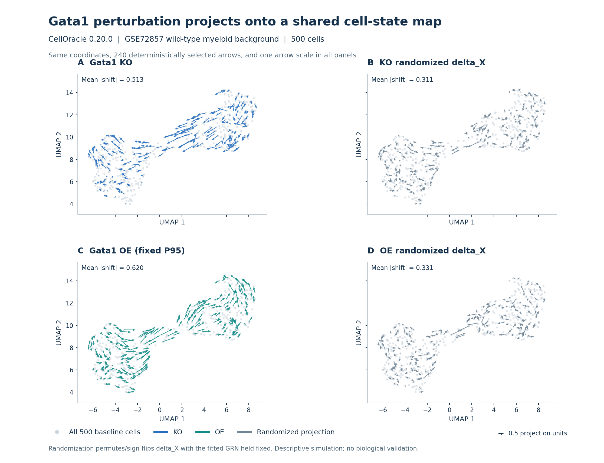
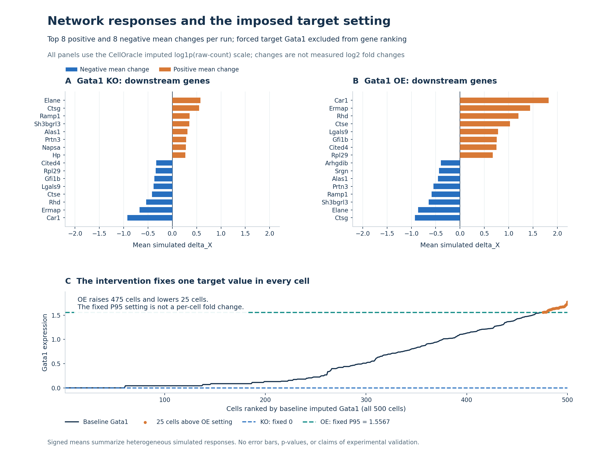

# Gata1 KO/OE：由公开原始计数重新计算的 CellOracle 图集

> 一句话指令：用 GSE72857 的野生型造血细胞，比较 Gata1 敲除与过表达，输出表达变化和细胞状态位移。

**这两张图来自 2026-11-13 本轮重新下载数据、建立独立环境并实际执行的 CellOracle 0.20.0 KO/OE 运行。** 图中表达变化和箭头是网络模拟输出；输入基线来自公开实验计数。这里没有使用论文现成图片、旧运行图片或模拟生成的输入矩阵，也没有完成独立生物学验证。技术状态为 `model_status=executed`，科学状态为 `validation_status=not_assessed` / `simulated_unvalidated`。

## 图 1：同一 UMAP 上比较 KO、OE 与随机化投影



**中文图注。** A、C 分别是 Gata1 KO 与固定 P95 的 OE 模拟位移；B、D 是各自 `delta_X` 随机化后的投影。四个面板都显示全部 500 个基线细胞，并使用同一组 240 个箭头、相同坐标边界和同一个箭头比例尺。箭头按 `SHA256("123:cell_ID")` 最小值确定性选择，不按位移大小筛选。背景点没有赋予细胞类型标签；来源中的 `Plate_ID` 是技术性分选板信息。

随机化保持各自已经拟合的 GRN 不变，对 `delta_X` 做重排和符号随机化后投影。它是描述性参照，不是随机 GRN、独立重复实验或显著性检验。图上局部方向相反可以作为继续研究的线索，不能据此宣布某个细胞命运转换已经得到实验验证。

| 本轮实际输出 | Gata1 KO | Gata1 OE |
| --- | ---: | ---: |
| 输入细胞数 / 模型基因数 | 500 / 1,500 | 500 / 1,500 |
| Gata1 固定设定值 | 0 | 1.5566748437731766（基线 P95） |
| 平均 UMAP 投影位移幅度 | 0.513265 | 0.620486 |
| 单次随机化平均投影位移幅度 | 0.311007 | 0.330776 |
| 非目标基因中有非零模拟差值的数量 | 1,311 | 1,311 |
| 模型进程退出码 | 0 | 0 |

这些 UMAP 幅度不是表达倍数，也不是模型准确率。数值来自全部细胞，而不是只来自绘出的箭头子集。完整绘图坐标和位移见 [cell_state_shift_source.csv.gz](cell_state_shift_source.csv.gz)，每行带有 `mode` 和 `arrow_selected`；具体比例尺、坐标边界、箭头 ID 及核对结果见 [plot_summary.json](plot_summary.json)。

## 图 2：下游正负效应与实际施加的目标值



**中文图注。** A、B 从各次运行的完整 `delta_X` 重新计算每个基因的平均变化，排除被强制设定的 Gata1，再分别选择正平均变化最大的 8 个基因和负平均变化最强的 8 个基因。两个面板采用相同且关于零对称的横轴。蓝色表示负平均变化，橙色表示正平均变化；它们不表示统计显著性。C 把全部 500 个细胞按基线 Gata1 imputed 表达从低到高排列，并叠加 KO=0 与 OE=P95 的固定设置。

本轮 KO 中，所选非目标基因的最大正平均变化是 Elane（+0.580168），最大负平均变化是 Car1（−0.925505）；OE 中分别是 Car1（+1.823699）与 Ctsg（−0.926096）。这些都是 CellOracle 内部 **imputed log1p(raw-count) 尺度**上的模拟差值，不是实测差异表达、log2FC 或候选靶点的实验确证。完整的逐基因汇总同时保留了平均绝对变化及上调、下调细胞比例，便于检查均值背后的异质性。

**“OE”是把所有细胞的目标值固定为 1.5566748437731766，不能读成每个细胞都增加。** 实际有 475 个细胞的 Gata1 被提高，25 个高于 P95 的细胞被降低；没有细胞恰好等于该设定值。下游模拟也因此可能在不同细胞中出现不同方向。图源见 [downstream_effects_source.csv](downstream_effects_source.csv)、[all_gene_effects_source.csv.gz](all_gene_effects_source.csv.gz) 和 [target_setting_source.csv](target_setting_source.csv)。

## 本轮数据与科学边界

基线来自 Paul 等研究的原始 GSE72857 整数分子计数、实验设计和 GEO SOFT 样本元信息。准备过程从 10,368 wells × 27,297 个来源基因 ID 中选取 `Mouse_ID=2`、`Unsorted myeloid`、每孔 1 个细胞的背景；逐 amplification batch 的 GEO 元信息确认其为 wild type、C57BL/6、骨髓、mm9。3,040 个候选中有 2,342 个通过本例的至少 1,000 counts 与 500 个检测基因阈值，再按固定哈希规则选取 500 个细胞。准备后有 10,757 个表达基因，模型使用 1,500 个 HVG（包括 Gata1）、20 PCs、`alpha=10`、3 次传播和全体细胞一个 GRN。

本例有意使用小规模、可追踪的演示背景。它不是 [CellOracle 原论文](https://www.nature.com/articles/s41586-022-05688-9)中 2,730 细胞、24 个 cluster 分别建模分析的复现，也不能承接论文其他实验的验证结论。未提供可信细胞类型注释、轨迹参考或独立扰动真值，因此不报告命运概率、轨迹一致性分数或预测准确率。原始基因 ID 中 2,109 行包含分号多名映射，准备脚本将其明确排除；本轮所选细胞由此去掉 284,322 / 2,149,673（约 13.23%）分子计数，这属于实质性信息损失。更完整的 QC、映射与细胞状态建模需要另行分析。

## 实际运行证据与核对

本轮原始运行保存在 `local-runs/gallery-celloracle-20261113/`，其中 `downloads/`、`prepared/`、`ko/`、`oe/`、`logs/` 和 `plots-final/` 分别保留下载记录、准备后的输入、两次模型的完整矩阵、命令日志和最终绘图输出。完整运行矩阵不随这组轻量图集复制；[evidence.json](evidence.json) 记录它们的路径、大小、SHA256、实际命令与退出码，并附带可携带的日志和运行清单。

| 核对项 | 本轮结果 |
| --- | --- |
| 四项公开资源 | 重新下载，固定大小与 SHA256 全部通过 |
| 环境与依赖 | Python 3.10.22；CellOracle 0.20.0；`pip check` 无依赖缺损 |
| 后端科学代码 | 65 个 CellOracle Python 源文件全部匹配官方分发包 `RECORD` 的哈希 |
| 每次表达矩阵 | 基线、模拟与 `delta_X` 都为 500 × 1,500；行列 ID、顺序与有限性通过 |
| 差值恒等式 | 每次核对全部 750,000 个值；CSV round-trip 后 `delta_X − (simulated − baseline)` 最大绝对误差为 0 |
| 目标固定值 | KO 最大误差 0；OE 最大误差 2.22 × 10⁻¹⁶ |
| KO/OE 可比性 | 输入哈希、细胞 ID、基线表达与 UMAP 坐标逐值完全一致 |
| GRN 比较 | 1,500 × 1,500 系数的基因轴、非零结构完全一致；最大系数差 2.72 × 10⁻¹⁵，通过明确记录的 10⁻¹² 绝对容差；不声称逐位相等 |
| 图源汇总 | 基因均值、平均绝对变化、正负比例及位移幅度均从完整矩阵/向量复核 |
| 图像质量 | 两张图均为 180 dpi PNG、小于 3 MB；逐张检查标题、图例、边界和比例尺 |

第一次绘图因要求两次 GRN 系数逐位完全相等而拒绝输出。检查发现最大差异仅为 2.72 × 10⁻¹⁵ 后，绘图核对改为明确的绝对容差，并在结果中保留 `fitted_grn_coefficients_exact=false`。模型代码与矩阵没有改动。第二次绘图技术成功，但视觉检查发现图例压住标题；调整排版、增加随机化箭头对比度后，再在全新的输出目录生成最终版本。失败记录、成功记录和真实警告均被保留。

环境中缺少若干可选 motif discovery 外部程序；本轮使用作者提供的固定 promoter 先验，没有执行从头 motif 扫描。运行还输出了 `pkg_resources` 弃用警告。详见 [environment-linux.json](environment-linux.json)、[backend-code-hashes.json](backend-code-hashes.json) 与 [evidence.json](evidence.json)，不能据这次成功声称其他 motif discovery 流程也已通过。

## 重新执行

命令在包含 `SKILL.md` 的项目目录执行。先按[原案例环境说明](../../celloracle-paul2015-gata1/README.md#3-准备真实模型环境)建立独立 Python 3.10 / CellOracle 0.20.0 环境；本轮解析出的全部依赖版本见上方环境记录。下面每个输出目录必须是新目录，绘图入口会拒绝覆盖已有目录。

```bash
CELLORACLE_PY=/path/to/celloracle-env/bin/python
CASE_RUN=local-runs/gallery-celloracle-reproduction

for asset in umi design samples mouse-grn; do
  "$CELLORACLE_PY" scripts/cases.py fetch celloracle-paul2015-gata1 \
    --asset "$asset" --output-dir "$CASE_RUN/downloads/$asset"
done

"$CELLORACLE_PY" scripts/prepare_paul2015_case.py \
  --counts "$CASE_RUN/downloads/umi/GSE72857_umitab.txt.gz" \
  --design "$CASE_RUN/downloads/design/GSE72857_experimental_design.txt.gz" \
  --samples "$CASE_RUN/downloads/samples/GSE72857_family.soft.gz" \
  --output-dir "$CASE_RUN/prepared" \
  --max-cells 500 --min-counts 1000 --min-genes 500 --seed 123

OMP_NUM_THREADS=1 OPENBLAS_NUM_THREADS=1 MKL_NUM_THREADS=1 MPLBACKEND=Agg \
  "$CELLORACLE_PY" examples/ko_oe/celloracle_run.py \
  --h5ad "$CASE_RUN/prepared/paul2015_wt_input.h5ad" \
  --base-grn "$CASE_RUN/downloads/mouse-grn/mm9_TFinfo_dataframe_gimmemotifsv5_fpr2_threshold_10_20210630.parquet" \
  --target-gene Gata1 --mode ko --output-dir "$CASE_RUN/ko" \
  --group-col Plate_ID --n-hvg 1500 --n-pcs 20 --n-neighbors 50 --n-jobs 2 --seed 123

OMP_NUM_THREADS=1 OPENBLAS_NUM_THREADS=1 MKL_NUM_THREADS=1 MPLBACKEND=Agg \
  "$CELLORACLE_PY" examples/ko_oe/celloracle_run.py \
  --h5ad "$CASE_RUN/prepared/paul2015_wt_input.h5ad" \
  --base-grn "$CASE_RUN/downloads/mouse-grn/mm9_TFinfo_dataframe_gimmemotifsv5_fpr2_threshold_10_20210630.parquet" \
  --target-gene Gata1 --mode oe --oe-percentile 95 --output-dir "$CASE_RUN/oe" \
  --group-col Plate_ID --n-hvg 1500 --n-pcs 20 --n-neighbors 50 --n-jobs 2 --seed 123

"$CELLORACLE_PY" scripts/plot_celloracle_case.py \
  --ko-run "$CASE_RUN/ko" --oe-run "$CASE_RUN/oe" \
  --output-dir "$CASE_RUN/plots" --target-gene Gata1 \
  --per-direction 8 --arrows 240 --seed 123 --dpi 180
```

复用绘图时，原始 AnnData、运行清单与完整矩阵都必须仍可读取。绘图程序会核对输入身份与哈希、CellOracle 版本、内部表达尺度、矩阵和坐标轴，并拒绝不匹配的结果，而不是为已有图补造图源。

## 原始论文与公开资源

- Paul et al., *Cell* (2015), [Transcriptional Heterogeneity and Lineage Commitment in Myeloid Progenitors](https://doi.org/10.1016/j.cell.2015.11.013)；[PubMed 26627738](https://pubmed.ncbi.nlm.nih.gov/26627738/)。
- Kamimoto et al., *Nature* (2023), [Dissecting cell identity via network inference and in silico gene perturbation](https://doi.org/10.1038/s41586-022-05688-9)；[PubMed 36755098](https://pubmed.ncbi.nlm.nih.gov/36755098/)。
- [GSE72857 原始数据记录](https://www.ncbi.nlm.nih.gov/geo/query/acc.cgi?acc=GSE72857)：[整数计数](https://ftp.ncbi.nlm.nih.gov/geo/series/GSE72nnn/GSE72857/suppl/GSE72857_umitab.txt.gz)、[实验设计](https://ftp.ncbi.nlm.nih.gov/geo/series/GSE72nnn/GSE72857/suppl/GSE72857_experimental_design.txt.gz)、[GEO SOFT 样本信息](https://ftp.ncbi.nlm.nih.gov/geo/series/GSE72nnn/GSE72857/soft/GSE72857_family.soft.gz)。
- [CellOracle 固定提交的 mm9 promoter 先验](https://raw.githubusercontent.com/morris-lab/CellOracle/7948870a3b70f7d228e54734e1fa9ed3291fc23b/celloracle/data/promoter_base_GRN/mm9_TFinfo_dataframe_gimmemotifsv5_fpr2_threshold_10_20210630.parquet)；资源大小、哈希与已有来源说明见[资源记录](../../celloracle-paul2015-gata1/resources.json)。
