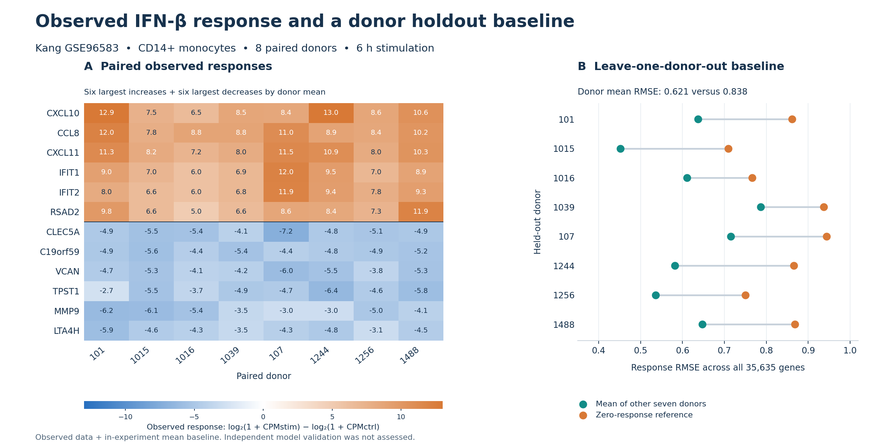

# Kang：观察真实供体响应，再看留一供体均值能预测多少

**可以直接这样问：**「下载 Kang 的 IFN-β PBMC 数据，按真实供体配对分析 CD14+ 单核细胞；用另外七位供体的响应均值预测第八位，画出响应热图和逐供体误差。」



**读图：**左图显示八位供体各自的实测响应，分别选取供体平均差值最大的六个正向基因与最小的六个负向基因；每列是一位真实供体。右图把同一位留出供体的两种 RMSE 连在一起：另外七位的响应均值为青色，零响应参照为橙色。八位供体的均值预测误差都较低，供体等权平均 RMSE 为 **0.620647 对 0.837714**。

这两部分来自本轮重新下载的六份固定 GEO 文件和重新执行的分析，未沿用旧预览图。生物学单位为 **八位供体**；纳入默认 CD14+ 分析的是 2,785 个对照细胞与 2,600 个刺激细胞，细胞不能代替供体充当独立重复。

## 图的尺度与完整计算

响应是同一供体的 `log2(1 + CPM_stim) − log2(1 + CPM_ctrl)`。先对来源 singlet 的原始 UMI 按供体、条件和来源细胞注释相加，再对每个供体条件使用**全部 35,635 个来源基因**的文库总量计算 CPM。这里的 `+1` 在 CPM 尺度上；差值不是原始 UMI 差，也不是未经伪计数的真实表达倍数。

左图的 12 基因仅用于展示：正向均值降序取六个，负向均值升序取六个，稳定 Ensembl gene_id 打破并列。绘图保留来源 symbol，精确 gene_id 和全部 96 个图值见 [figure_data.csv](figure_data.csv)。没有基于这 12 个基因计算右图误差。

右图每折使用另外七位供体的**全基因**响应均值，计算全部 35,635 个基因的 RMSE。基因轴中有 **20,815 个基因在八位供体中均为零响应**；这些共零基因会影响全基因误差大小，不能把此分数解释为每个响应基因均预测准确。实际逐供体误差见 [unit_metrics.csv](unit_metrics.csv)，配对及细胞数见 [donor_pairs.csv](donor_pairs.csv)。

## 重跑与证据

先按 [Kang 原始观测案例](../../kang-ifnb-pbmc/README.md)下载六份来源文件，再按 [留一供体案例](../../kang-heldout-baseline/README.md)执行基线。以下命令在 Skill 根目录运行；所有输出目录须为新目录：

```bash
python scripts/observed_kang_case.py --input-dir local-runs/gallery-kang-input --output-dir local-runs/gallery-kang-observed --cell-type "CD14+ Monocytes" --min-cells 20
python scripts/kang_holdout_baseline.py --observed-run local-runs/gallery-kang-observed --output-dir local-runs/gallery-kang-heldout
python scripts/plot_kang_case.py --observed-run local-runs/gallery-kang-observed --heldout-run local-runs/gallery-kang-heldout --output-dir local-runs/gallery-kang-figure
```

图脚本在绘制前核对六份原始资源身份、观测产物哈希、完整 gene/donor 轴、保存的均值、每个预测是否等于对应另外七位供体的均值，并从全基因数组重算 RMSE。实际执行目录、本轮数值、脚本与输入输出哈希见 [evidence.json](evidence.json)。默认源码不包含约 58.7 MB 的原始下载文件或完整运行矩阵；完整本地日志保存在 `local-runs/gallery-kang-logs/`。

## 能说明与不能说明什么

这是**真实观测加简单均值基线**，没有运行 CellOracle、PRnet 或其他虚拟细胞模型。供体留出仍处于同一次实验；八折共享训练供体，两个条件来自条件特异文库，不能写成八次独立实验、跨队列验证或复杂模型得到独立验证。没有显著性检验、置信区间、疗效或因果推断。`baseline_status: executed`；`model_status: not_run`；`independent_validation: not_assessed`。

来源为 [GEO GSE96583](https://www.ncbi.nlm.nih.gov/geo/query/acc.cgi?acc=GSE96583) 和 [Kang 等原始研究](https://pmc.ncbi.nlm.nih.gov/articles/PMC5784859/)。当前固定注释与论文 singlet 数不同的已知记录、313 个 barcode 碰撞处理、来源 NA 细胞及重复 symbol 的处理，继续按 [原始观测案例](../../kang-ifnb-pbmc/README.md)说明。GEO 源数据的独立许可未单独核实，不能自动套用代码许可。
