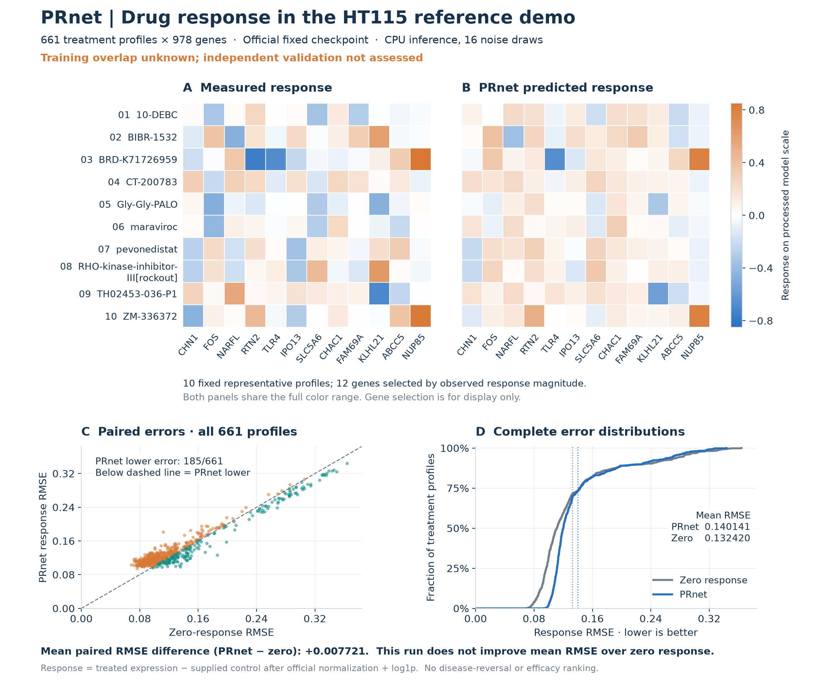

# PRnet 药物响应：真实推理后的图与基线

这张图来自 **2026-11-13 重新下载固定官方资源、重新建立模型环境、重新执行 CPU 推理**后的数值输出。图由本项目的 [plot_prnet_case.py](../../../scripts/plot_prnet_case.py) 新绘制，没有使用论文图片、历史结果图或模拟预测。

**本次运行成功；训练重叠未知，独立验证未评估。** 在全部 661 条处理谱上，PRnet 的平均响应 RMSE 为 **0.140141**，零响应基线为 **0.132420**。成功调用模型与获得优于简单基线的预测表现是不同的检查结果。

## 给助手的一句话

> 请获取固定的 PRnet 官方 HT115 demo 与 checkpoint，实际运行药物响应预测，画出实测和预测的同尺度响应热图，并用全部处理谱与零响应基线比较，保留输入、运行和图源证据。

## 怎样读图



**图注。** A、B 分别展示 10 个固定代表处理条件在 12 个基因上的实测和 PRnet 预测响应。响应定义为官方预处理后的处理表达减去该条谱指定对照的表达；蓝色为负，橙色为正。两幅热图使用同一色标，范围为 ±0.849943161，覆盖两幅图的所有值，没有截断极值。C 中每点对应一条处理谱，虚线下方表示 PRnet 的 RMSE 较低；D 展示全部 661 条谱的误差经验累积分布，竖直虚线标示均值。RMSE 均在完整 978 个基因上计算，热图选出的基因不参与缩减评价范围。

| 本次完整 661 条处理谱的比较 | 数值 |
| --- | ---: |
| PRnet 平均逐谱响应 RMSE | 0.1401410921291978 |
| 零响应平均逐谱响应 RMSE | 0.13242018096843164 |
| 平均配对差值，PRnet − 零响应 | +0.007720911160766117 |
| PRnet RMSE 较低的处理谱 | 185 / 661，27.99% |
| 零响应 RMSE 较低的处理谱 | 476 / 661，72.01% |
| 完全相等的处理谱 | 0 |

这些是描述性结果，没有把不同处理谱视为独立生物学重复，也没有进行显著性、疾病逆转或疗效检验。零响应向量恒定，其响应 Pearson 未定义；没有补为 0。参考运行也完整保存单次高斯采样、其他药物组均值等结果，但首页图专注于 PRnet 条件均值与零响应基线。

## 展示选择规则与条件身份

先按来源药物名称（去除首尾空格并忽略大小写）、`pert_id`、剂量、时间、RNA plate 和来源 profile ID 排序。每个别名排除组取排序后的首条记录；在这 349 个代表组中，按等间距排名选出 10 条。药物选择不读取预测误差、相关系数或疗效信息。

基因按**全部 661 条处理谱的平均绝对实测响应**降序取前 12 个，同值按基因 ID 排序。该规则使用实测结果，只用于展示，不作为独立评价证据。基因依次为：CHN1、FOS、NARFL、RTN2、TLR4、IPO13、SLC5A6、CHAC1、FAM69A、KLHL21、ABCC5、NUP85。名称直接保留固定 demo 的基因轴，没有另行猜测或替换符号。

下表对应图的行号。所有条件都是 HT115、6 小时；来源剂量单位为 `um`，展示为 μM。原始完整 profile ID、指定对照、RNA plate/well、`condition_id`、SMILES、别名排除组及跨板标记保存在 [figure_source.json](figure_source.json)。

| 图中行号 | 来源药物名称 | 来源 pert_id | 剂量 / μM |
| --- | --- | --- | ---: |
| 01 | 10-DEBC | BRD-K70792160 | 24 |
| 02 | BIBR-1532 | BRD-K04623885 | 80 |
| 03 | BRD-K71726959 | BRD-K71726959 | 122.55 |
| 04 | CT-200783 | BRD-K02822062 | 10 |
| 05 | Gly-Gly-PALO | BRD-K16701932 | 80 |
| 06 | maraviroc | BRD-A04352665 | 10 |
| 07 | pevonedistat | BRD-K67844266 | 11.1 |
| 08 | RHO-kinase-inhibitor-III[rockout] | BRD-K23875128 | 10 |
| 09 | TH02453-036-P1 | BRD-K79382620 | 11.1 |
| 10 | ZM-336372 | BRD-K73789395 | 102.71 |

每条热图行是一个实际处理条件；没有将不同剂量或不同板上的记录平均成一个“药物效果”。图中不推断化学结构的多样性，也不产生药物推荐排行。

## 实际运行与复现

在含 `SKILL.md` 的 `virtual-cell-research/` 根目录运行。模型环境与数据教学环境分开建立；主要版本见 [固定模型环境](../../prnet-reference-evaluation/environment.yml)，本次全部已安装版本见 [environment-freeze.txt](environment-freeze.txt)。本次使用 Python 3.12.14、torch 2.5.1+cpu、scanpy 1.11.5、RDKit 2025.9.1、numpy 2.5.4、pandas 3.1.1、anndata 0.13.4、scipy 1.18.1、h5py 3.16.0、matplotlib 3.11.2。

```bash
# 激活按固定模型环境建立的独立环境后执行；每一步使用新的输出目录。
python scripts/prnet_reference_case.py fetch \
  --output-dir local-runs/gallery-prnet-input

OMP_NUM_THREADS=1 MKL_NUM_THREADS=1 OPENBLAS_NUM_THREADS=1 \
python scripts/prnet_reference_case.py run \
  --resources-dir local-runs/gallery-prnet-input \
  --output-dir local-runs/gallery-prnet-output \
  --seed 2024 --noise-draws 16 --threads 1

python scripts/plot_prnet_case.py \
  --run-dir local-runs/gallery-prnet-output \
  --output-dir local-runs/gallery-prnet-figures
```

本次实际目录是 `local-runs/gallery-prnet-20261113-input`、`local-runs/gallery-prnet-20261113-output` 与 `local-runs/gallery-prnet-20261113-logs`。`fetch` 的七项资源均为本次从固定 URL 下载，并逐一通过字节数及 SHA256 校验；没有复用历史缓存文件。实际模型调用开始于 08:36:20 UTC，结束于 08:37:07 UTC。权重和完整运行大文件保存在运行目录，不复制进此图集目录。

主预测为 16 个 decoder-noise 向量下高斯条件均值的平均；这些数值抽样不是生物学重复。官方 PGM 架构、编码和权重由现有 `prnet_reference_case.py` 实际加载；本次没有重新训练或调整权重。绘图入口只读取完成的推理产物，不生成或替换预测。

## 证据与检查

| 文件 | 用途 |
| --- | --- |
| [predicted_response.png](predicted_response.png) / [SVG](predicted_response.svg) | 新生成的 180 dpi 组合图；PNG 小于 3 MB |
| [figure_source.json](figure_source.json) | 两张热图的全部值、所选行列 ID、全部 661 条配对 RMSE、选择规则与汇总 |
| [evidence.json](evidence.json) | 实际资源、模型、脚本、NPZ、源表和图像哈希；真实环境、运行状态、QC 与验证边界 |
| [execution_log.json](execution_log.json) | 本次获取、安装、推理、绘图及针对性测试的输出文本和日志哈希 |
| [environment-freeze.txt](environment-freeze.txt) | 本次独立环境的完整依赖版本 |

绘图前重新校验运行产物与 `provenance.json` 的哈希和大小，用 `numpy.load(..., allow_pickle=False)` 读取完整 NPZ 的 21 个数组。源表通过保存的 profile / condition / gene ID 关联；逐一核对指定对照值、实测与预测差值，以及四种方法的全部逐谱 RMSE、MAE 和汇总值。图源保存所有 661 条处理谱，没有丢弃不利结果或重新匹配对照。

[针对性测试](../../../tests/test_plot_prnet_case.py)覆盖表格重排、重复/缺失 ID、配对标签与实际数值不一致、响应值偏移、预测质量不能改变展示选择、以及错误 RMSE/伪造零响应相关系数。六项测试通过。这些是数据完整性回归测试，不是 PRnet 科学有效性的证据。PNG 已实际打开检查标题、药名、基因名、色标、坐标轴与页脚，无裁切或重叠。

本次推理的标准错误输出为空。环境安装曾记录“缓存与目标目录无法硬链接，回退到复制”的工具提示；它不改变模型计算。推理正常结束仍保留科学层面的警示：训练重叠未知、全部 demo 参与归一化、来源跨板配对未更改、未做独立或临床验证、其他组均值来自当前 demo。

## 解释范围与来源

来源文件有 681 条谱：661 条处理谱和 20 条对照，含 354 个 `pert_id`，别名排除后有 349 组。现有脚本沿官方 demo 先 `normalize_total()` 再 `log1p()`；实际归一化目标和 8037.517578125 取自全部 681 条谱的中位数，包括实测处理谱，因此属于带有 transductive 性质的参照处理。这些数据不是原始计数，图中差值不能直接称为原始尺度 log fold change。

338 条处理谱的来源指定对照跨 RNA plate，脚本保留原配对并标记。差值可能包含板间因素；该图没有做批次校正。来源的 `demo_split=test` 不是 checkpoint 训练成员排除证明。文件名为 `lincs_best_epoch_all.pt`，当前材料没有提供可核实的训练成员清单和 demo 排除证据，因此不能把本图称为独立测试或论文交叉验证复现。

- [官方固定代码版本](https://github.com/Perturbation-Response-Prediction/PRnet/tree/f19174bde3ed2633f54c7831799cc38c4ffc7a0d)
- [固定 HT115 demo](https://github.com/Perturbation-Response-Prediction/PRnet/blob/f19174bde3ed2633f54c7831799cc38c4ffc7a0d/dataset/demo.h5ad)
- [固定官方 checkpoint](https://github.com/Perturbation-Response-Prediction/PRnet/blob/f19174bde3ed2633f54c7831799cc38c4ffc7a0d/checkpoint/lincs_best_epoch_all.pt)
- [Qi 等，Nature Communications，2024](https://doi.org/10.1038/s41467-024-53457-1)
- [完整参考案例说明](../../prnet-reference-evaluation/README.md)

PRnet 模型、权重、编码与研究数据归原作者。本项目提供调用、核查和新绘图；模型不是本项目原创。PRnet 代码声明 Apache-2.0，权重和 demo 的独立许可未单独核实，不自动继承本项目许可。
