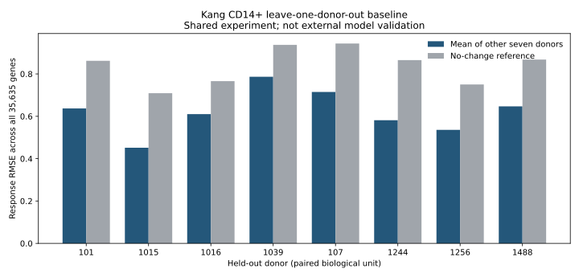

# 用另外七位供体预测：留一供体基线评估

**研究问题：已有一批 IFN-β 响应数据时，其他供体的平均响应能否预测一位未参与拟合的供体？**

本案例已经实际执行八折留一供体评估。每一折仅用另外七位供体的响应均值进行预测，并与“零响应”参照比较。它示范如何划分生物学单位、保留训练成员和读懂评估结果。

这里确实拟合并运行了一个简单均值估计器；没有调用 CellOracle、PRnet 等虚拟细胞后端。目录中的 `model_status=not_run` 专指这些后端；`baseline_status=executed`、`evaluation_status=completed` 记录本次实际计算。**独立科学验证仍为未评估**：同一实验内的供体留出不等于跨实验、跨队列验证。

## 真实结果

输入沿用 [Kang CD14+ 供体配对观测案例](../kang-ifnb-pbmc/README.md)：八位狼疮患者、IFN-β 处理 6 小时，八位供体各有对照和刺激 pseudobulk。响应为 `log2(1+CPM_stim) − log2(1+CPM_ctrl)`；CPM 分母使用完整来源基因计数。

| 方法 | 八位供体等权平均 RMSE | 平均 MAE | 平均响应 Pearson |
| --- | ---: | ---: | ---: |
| 另外七位供体的响应均值 | **0.620647** | 0.288463 | 0.673364 |
| 零响应参照 | **0.837714** | 0.365417 | 未定义，预测恒为零 |



八位供体的均值预测 RMSE 均低于零响应参照。这说明本次数据中可由其他供体均值捕获一部分共同响应；它不证明复杂模型有效，也不能说明所有基因都得到准确预测。这里保留全部 **35,635 个基因**，其中 **20,815 个基因在八位供体中均为零响应**。全基因误差会受到这些共零基因的影响。

方向一致率为 0.744926，计算对象是各供体实测非零响应基因，随后对供体等权平均。数值非零不代表显著变化，方向一致也不等于机制或疗效得到验证。

本次实际输入、脚本与产物哈希、逐折训练名单、数值复核和图源见 [evidence.json](evidence.json)。所有 285,080 个观测响应已从保存的整数 pseudobulk 重新计算，差异为 0；全部 285,080 个预测值与各自另外七位供体的均值逐项一致。

## 如何运行

先在 Skill 根目录建立[数据教学环境](../../references/first-run.md#建立数据教学环境)，并完成 [Kang 观测分析](../kang-ifnb-pbmc/README.md)。假设观测输出为 `local-runs/kang-observed`。下面为 Bash 多行写法；Windows PowerShell 可合并为一行执行，去掉行末反斜杠：

```bash
python scripts/kang_holdout_baseline.py \
  --observed-run local-runs/kang-observed \
  --output-dir local-runs/kang-heldout-baseline
```

无需模型权重、GPU 或额外下载。已有输出目录不能覆盖。程序先核对观测案例的六项原始资源身份、所需产物哈希及 CD14+ 八供体背景，再从保存的整数计数重建响应。

每折只对另外七位供体取均值，没有调参、基于评估答案挑选基因或拟合总体归一化。各供体、各条件的 CPM 使用自己的完整基因文库总量。原始单细胞矩阵的来源核查由前置观测案例负责，本步骤不会重新读取全部原始单细胞文件。

## 输出与复核

先打开本次 `report.md`，再看以下文件：

| 产物 | 内容 |
| --- | --- |
| `fitting.json` | 每折留出供体、七位训练供体、训练矩阵哈希和明确计算方式 |
| `evaluation-input/split_membership.csv` | 64 条折内成员记录：每折七个 train、一个 evaluation |
| `evaluation-input/observed.csv.gz`、`predicted.csv.gz` | 全量观测与预测响应，第一列为稳定 sample_id |
| `evaluation-input/metadata.csv`、`settings.json` | 供体单位、折、背景和尺度声明 |
| `evaluation/report.md`、`evaluation/evaluation.json` | 通用评估入口生成的中文报告与指标 |
| `evaluation/tables/unit_metrics.csv` | 每位供体的预测与零响应误差 |
| `evaluation/raw/aligned_responses.npz` | 全部已对齐数组、样本和基因 ID |
| `figure_manifest.json`、`holdout_metrics.svg` | 图生成状态及图；绘图失败仍保留数值 |

还可以直接把已生成的输入交给通用评估器，在新的目录中重算：

```bash
python scripts/evaluate_predictions.py \
  --observed local-runs/kang-heldout-baseline/evaluation-input/observed.csv.gz \
  --predicted local-runs/kang-heldout-baseline/evaluation-input/predicted.csv.gz \
  --metadata local-runs/kang-heldout-baseline/evaluation-input/metadata.csv \
  --settings local-runs/kang-heldout-baseline/evaluation-input/settings.json \
  --split-membership local-runs/kang-heldout-baseline/evaluation-input/split_membership.csv \
  --output-dir local-runs/kang-heldout-recheck
```

用于其他预测时，按[通用预测评估说明](../../references/prediction-evaluation.md)准备文件。成员检查只审核提供的记录，不能凭用户声明认证实际预训练过程或数据独立性。

## 解释边界

- 八折共用训练供体，不能当作八次独立实验；本例没有计算 P 值或置信区间。
- 对照和刺激来自条件特异文库，供体留出不能消除条件与文库混杂。本例没有跨队列、独立实验或健康人群验证。
- 沿用观测案例的来源 singlet、细胞注释、全基因分母和供体配对。当前 GEO 注释与原论文 singlet 数不同的情况仍保留，详见前置案例。
- 本例的基线方法是在当前实验内拟合的描述性预测参照，不是可直接用于任意患者的部署模型。
- 不用此分数给 CellOracle、PRnet 或其他后端背书，也不把它转写成药物疗效或因果结论。

原研究与数据：[Kang 等，Nature Biotechnology](https://pmc.ncbi.nlm.nih.gov/articles/PMC5784859/)、[GEO GSE96583](https://www.ncbi.nlm.nih.gov/geo/query/acc.cgi?acc=GSE96583)。数据来自原研究，本项目提供输入复核、划分记录、均值基线和评估工作流；数据的独立许可仍按前置案例记录。
