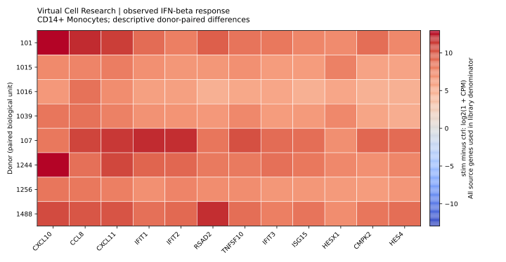

# Kang PBMC：按供体配对阅读 IFN-β 观测响应

**本案例已实际完成六份官方数据的获取、全量 barcode 对齐、原始计数检查、供体聚合、配对差值和图表。模型未运行，独立预测验证未评估。**

本例面向第一次接触单细胞干预研究的人：先看清同一供体的对照与刺激条件，再决定怎样组织模型训练或评估。默认分析来源注释中的 **CD14+ Monocytes**；它是一项真实观测数据教学，不加载虚拟细胞模型。

## 本次实际结果

| 内容 | 本次结果 |
| --- | --- |
| 来源 | GSE96583 batch 2；GSM2560248 对照、GSM2560249 IFN-β 刺激 |
| 物种与背景 | 8 位狼疮患者的人 PBMC；IFN-β 刺激与未刺激对照均培养 6 h |
| 来源矩阵 | 35,635 个基因 × 14,619 对照细胞；35,635 × 14,446 刺激细胞 |
| 来源细胞总数 | 29,065 |
| 来源 singlet 筛选 | 保留 24,679；排除 3,169 doublet 和 1,217 ambs |
| 供体 × 条件 × 原始细胞标签聚合 | 129 组；包含一个保留来源 `NA` 标签的未注释组 |
| 默认 CD14+ 分析 | 2,785 对照细胞、2,600 刺激细胞；8 个完整供体配对 |
| 每个供体、每个条件的最少细胞数 | 教学默认阈值 20；本次所选组合均通过，无配对被排除 |
| 模型与验证 | `model_status: not_run`；`independent_validation: not_assessed` |

结果和来源哈希见 [便携证据](evidence.json)。所有基因、供体和条件均保留稳定 ID；源数据与完整运行输出不放入 Skill 源码包。

### 固定来源数据与原论文的区别

[Kang 等原始研究全文（PMC5784859）](https://pmc.ncbi.nlm.nih.gov/articles/PMC5784859/)说明，IFN-β 实验使用 8 位狼疮患者的 PBMC，同一供体分别接受 6 h IFN-β 处理或未刺激培养；[GEO 刺激样本记录](https://www.ncbi.nlm.nih.gov/geo/query/acc.cgi?acc=GSM2560249)也记录了患者背景与 6 h 刺激条件。

论文正文与当前固定 GEO metadata 的 singlet 数存在差异。下表均为各条件的**全部 PBMC singlet 数**，不是 CD14+ 细胞数：

| 依据 | 对照 singlet | 刺激 singlet |
| --- | ---: | ---: |
| 原论文正文 | 12,138 | 12,167 |
| 当前固定 `GSE96583_batch2.total.tsne.df.tsv.gz` 按 `multiplets=singlet` 重数 | 12,315 | 12,364 |

差异的具体原因尚未核实，不能断言来自某个处理版本或额外过滤步骤。本案例重现固定输入及本页声明的筛选、聚合与配对计算，不声称逐项复现原论文分析；论文的统计检验与结论也不自动成为本案例的分析结果。固定 metadata 的发布入口见 [GEO GSE96583](https://www.ncbi.nlm.nih.gov/geo/query/acc.cgi?acc=GSE96583)。



图选取绝对供体平均差值最大的 12 个基因，显示每位供体的数值。它是描述性选图，没有显著性检验，也不是模型性能、药敏或疗效排名。

本次这 12 个基因的平均差值全部为正，**不代表没有负向响应**。热图只展示按上述规则选出的子集；查看完整的 `tables/gene_summary.csv`，分别检查 `mean_paired_difference` 的正值与负值，再结合 `positive_donors`、`negative_donors` 判断方向是否跨供体一致。

## 下载并运行

以下命令统一在包含 `SKILL.md` 的 **Skill 根目录**运行。先按 [首次使用指南](../../references/first-run.md#建立数据教学环境) 建立或复用独立 Python 3.12 环境；Windows 可使用 `.\.venv-data\Scripts\python.exe` 替代下文 `python`。

```bash
python -m pip install -r requirements-data.txt
python scripts/cases.py show kang-ifnb-pbmc
python scripts/cases.py fetch kang-ifnb-pbmc --asset control_matrix --output-dir local-runs/kang-input/control_matrix
python scripts/cases.py fetch kang-ifnb-pbmc --asset stimulated_matrix --output-dir local-runs/kang-input/stimulated_matrix
python scripts/cases.py fetch kang-ifnb-pbmc --asset genes --output-dir local-runs/kang-input/genes
python scripts/cases.py fetch kang-ifnb-pbmc --asset metadata --output-dir local-runs/kang-input/metadata
python scripts/cases.py fetch kang-ifnb-pbmc --asset control_barcodes --output-dir local-runs/kang-input/control_barcodes
python scripts/cases.py fetch kang-ifnb-pbmc --asset stimulated_barcodes --output-dir local-runs/kang-input/stimulated_barcodes
python scripts/observed_kang_case.py --input-dir local-runs/kang-input --output-dir local-runs/kang-observed --cell-type "CD14+ Monocytes" --min-cells 20
```

六个资源合计约 **58.7 MB**，每个资源均低于默认 64 MiB 下载限额。`fetch` 只获取一个明确的文件，实际分析不会联网。文件放在对应资源 ID 子目录，脚本按来源文件名读取；不要把六个资源都下载到同一个已有叶目录。最终输出目录必须是新目录，重跑请换名字。

本案例 CLI 强制核对六份官方文件的大小与 SHA256；没有跳过哈希参数。测试中的小型 synthetic fixture 只经显式 Python 测试入口运行，不能冒充真实观测数据。

| 资源 ID | 来源文件 | bytes |
| --- | --- | ---: |
| `control_matrix` | `GSM2560248_2.1.mtx.gz` | 28,545,918 |
| `stimulated_matrix` | `GSM2560249_2.2.mtx.gz` | 29,050,932 |
| `genes` | `GSE96583_batch2.genes.tsv.gz` | 277,054 |
| `metadata` | `GSE96583_batch2.total.tsne.df.tsv.gz` | 756,342 |
| `control_barcodes` | `GSM2560248_barcodes.tsv.gz` | 52,904 |
| `stimulated_barcodes` | `GSM2560249_barcodes.tsv.gz` | 52,366 |

资源直链、哈希与许可记录在 [catalog.json](../catalog.json) 和 [evidence.json](evidence.json)。本次哈希标识实际取得的固定文件，不声称它们是发布者另行签署的校验和。

## 每一步怎样计算

1. **按源文件核对身份。** 基因使用唯一 Ensembl ID；不同基因可以有相同 symbol，不合并这类记录。Matrix Market 的行数必须对应 gene 表，列数必须对应各样本 barcode。
2. **对齐原始标签。** 使用来源 `ind` 作为供体、`stim` 作为条件、`cell` 作为来源细胞注释、`multiplets` 作为来源 singlet 状态；不从顺序猜标签。
3. **检查并聚合计数。** 扫描全部存储数值，要求非负、有限、整数，拒绝重复稀疏坐标。按供体 × 条件 × 来源细胞标签对 singlet 原始 UMI 相加；逐样本核对聚合前后 UMI 总数完全相同。单细胞矩阵保持稀疏，不展开为 29,065 × 35,635 的稠密矩阵。
4. **构建完整配对。** 对选定细胞类型，每位供体须有 ctrl 和 stim，且两侧都达到 `--min-cells`、文库总量大于零。缺失条件、低细胞数和零文库均保留具体排除原因。
5. **在供体内求差，再对供体等权汇总。** 对每个聚合表达谱使用全部来源基因计算 CPM，再做 `log2(1 + CPM)`；同一供体内 stim 减 ctrl。所有基因结果都保留，图仅展示一个有明确选择规则的小子集。

设同一供体、条件、细胞类型内的基因计数和为 `C[g]`：

```text
CPM[g] = 1,000,000 × C[g] / sum(C[所有来源基因])
L[g] = log2(1 + CPM[g])
Δ[供体,g] = L[stim,g] − L[ctrl,g]
描述性均值[g] = 对所有纳入供体的 Δ 等权平均
```

`+1` 是 **CPM 尺度上的伪计数**。这个差值不是原始 UMI 差，也不等于真实表达倍数；没有假设两组细胞是同一个细胞的前后追踪。生物学配对单位为 **供体**，不是一万多个细胞。

## 本次实际解决的对齐问题

### 313 个跨样本同名 barcode

两个样本的原始 barcode 都以 `-1` 结尾。它们有 313 个重名；发布的合并元数据将 stim 中对应的 313 个名字额外追加一个 `1`，末尾成为 `-11`。

脚本只对本案例固定文件应用这个经逐条核对的来源规则，验证映射的唯一性、条件一致性和全量覆盖。输出同时保存 **样本 accession＋原 barcode 的稳定 ID**、原始 metadata ID、矩阵列号与改名标记。不能把 stim 的所有后缀改成 `-2`，也不能不区分样本直接连接 barcode。

### 未注释细胞与重复基因符号

来源 `cell` 字段有 9 个字面量 `NA`，其中 6 个为 singlet。脚本保留原始标签并标记未注释，其计数另存于一个来源组；不把它冒充第九种确定细胞类型，也不允许选择 `--cell-type NA`。默认 CD14+ 分析不包含这些细胞。

基因表中有 2,697 条重复 symbol 记录，但 Ensembl ID 唯一；计算和表格按唯一 ID 对齐。按 symbol 静默去重会丢失原始基因和计数，本例没有这样做。

## 运行后先读哪些文件

打开生成的 `report.md`，它含热图和可点击源表链接：

| 产物 | 内容 |
| --- | --- |
| `tables/cell_index.csv.gz` | 全部来源细胞的 sample、barcode、metadata ID、原标签、筛选原因和 UMI 总量 |
| `tables/genes.csv` | 全部来源基因的唯一 ID 与原符号 |
| `raw/pseudobulk_counts.npz` | 129 × 35,635 的整数聚合计数；`scipy.sparse.load_npz` 读取 |
| `tables/pseudobulk_index.csv` | 聚合矩阵每行的 donor、condition、原细胞标签、细胞数和文库大小 |
| `tables/donor_pairs.csv` | 所选细胞类型的供体配对、两侧细胞数及排除原因 |
| `raw/paired_responses.npz` | 全基因配对差值和 donor/gene 轴；`numpy.load(..., allow_pickle=False)` 读取 |
| `tables/paired_responses.csv.gz` | 8 × 35,635 的同一配对差值矩阵 |
| `tables/gene_summary.csv` | 按供体等权的均值、中位数、跨供体样本标准差及方向计数；没有 P 值 |
| `tables/figure_data.csv` | 热图实际使用的 8 × 12 个数值与稳定 ID |
| `qc.json`、`figure_manifest.json` | 数据检查、配对排除、图生成或失败状态 |
| `provenance.json` | 实际解释器、调用参数、包版本、输入输出哈希 |

初学者可按下面的顺序读结果：

1. 先看 `tables/donor_pairs.csv`，确认两侧细胞数与排除原因。默认 CD14+ 分析的**生物学重复单位是 8 位供体**；2,785 个对照细胞和 2,600 个刺激细胞是各供体贡献的观测量，不能当作独立重复数。
2. 再看 `tables/gene_summary.csv` 的有符号均值、跨供体样本标准差和正负方向计数，同时查看正向与负向基因。标准差描述供体间差异，不是置信区间；该表没有 P 值或 FDR。
3. 查看具体基因或连接完整响应、图数据时，使用唯一的 `gene_id`（Ensembl ID），并结合 `tables/genes.csv` 阅读 symbol。来源中存在重复基因符号，不能仅凭 symbol 去重、合并或假设只对应一条记录。

输入或计算失败会在新输出目录保存 `error.json`；原输入与已有结果不覆盖。绘图失败保留已完成的全量数据和报告。若设置过高的细胞数阈值导致没有完整配对，输出仍保留聚合数据与排除原因，状态为 `completed_without_paired_response`，不会生成伪造的差值或图。

## 解释边界与后续研究

这里使用来源的细胞注释和 singlet 标记，未新增线粒体比例、细胞质控阈值或 doublet 模型。默认最少 20 个细胞是可记录、可更改的教学参数，不是通用质量认证。

两种条件对应两份来源文库。即使供体配对完整，共享文库／批次差异仍可能参与观测差值；本例没有做批次校正或因果识别。结果不能外推成所有人群的一般反应。

这项工作没有训练或运行预测模型。今后用于模型训练或评估时，要另行核查训练重叠、以供体为单位设计划分、保留真实对照，并声明独立验证的范围。不能把本次观测差值当成“虚拟细胞模型预测准确”的证据。

GEO 文件未单独核实数据许可。数据、原论文和模型各保留来源，不能自动套用本项目代码 MIT 许可，也不把不同衍生文件的 CC-BY 条款外推到本组原始来源文件。

## 原始来源

- [GEO GSE96583](https://www.ncbi.nlm.nih.gov/geo/query/acc.cgi?acc=GSE96583)
- [Kang 等原始研究，DOI 10.1038/nbt.4042](https://doi.org/10.1038/nbt.4042)
- [原始研究全文，PMC5784859](https://pmc.ncbi.nlm.nih.gov/articles/PMC5784859/)
- [GSM2560248 对照](https://www.ncbi.nlm.nih.gov/geo/query/acc.cgi?acc=GSM2560248)
- [GSM2560249 刺激](https://www.ncbi.nlm.nih.gov/geo/query/acc.cgi?acc=GSM2560249)
