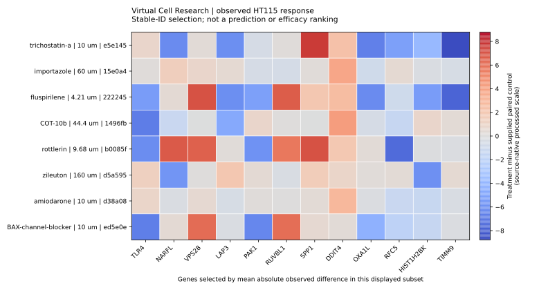

# HT115 实测药物响应：从矩阵到可追溯的对照差值

**本案例已经完成真实数据读取、逐 profile 对照检查、全量观测差值计算与绘图。模型未运行，独立验证未评估。**

这是 Virtual Cell Research 的入门教学案例。它用官方公开的小型 HT115 表达数据帮助你理解：一份干预数据由哪些字段组成、怎样确认对照、怎样区分观测结果与模型预测，以及为什么分析成功后仍要检查局限。

| 本次实际读取的内容 | 结果 |
| --- | --- |
| 细胞背景 | 人 HT115 细胞系；不是 A549 |
| 表达谱与基因 | 681 个 profile × 978 个基因 |
| 处理与对照 | 661 个化合物处理 profile；20 个 DMSO vehicle 对照 |
| 暴露时间 | 6 h |
| 化合物标识 | 354 个处理 `pert_id`；349 个处理名称 |
| 本脚本的条件划分 | 661 个条件，保留 RNA plate 等字段；每条件 1 个处理 profile |
| 原始配对跨 RNA plate | 338 个处理 profile，全部保留并标记 |
| 一个名称对应多条来源 SMILES | 5 个名称，全部记录 |
| 计算内容 | 原始 `X_treatment − X_paired_control` |
| 模型 / 独立验证 | `model_status: not_run`；`independent_validation: not_assessed` |

可核对本次运行的[便携证据记录](evidence.json)。它包含输入哈希、执行脚本哈希、包版本、实测计数、QC、产物哈希和图的选择规则，不含本机绝对路径。源数据和完整响应矩阵通过下面的命令在你自己的运行目录生成。

## 先看已经生成的结果



这张图来自本次真实数据计算，不是示意表达矩阵。先将条件稳定 ID 排序并取前 8 个条件，再在这 8 个条件中按平均绝对观测差值选择前 12 个基因。颜色保留正负号，零点居中。图中药物不是按疗效选择，基因不是按统计显著性筛选。

完整的 **661 × 978** 观测差值均另存 NPZ 和压缩 CSV。本次还将它们与导出的来源 X、原始配对 ID 逐项重建比较，全部完全一致。预览 SVG 约 87 KiB，为矢量路径和文字；它只展示小型子集。

## 这个案例教会你什么

- **表达谱不一定是单细胞。** 这里的一个 profile 是来源 L1000 数据的一条表达谱，不能把 681 个 profile 写成 681 个单细胞。
- **对照属于数据模型的一部分。** 每一行处理数据使用原始 `paired_control_index` 指定的对照；脚本不选择“效果更好”的对照，也不替换跨板配对。
- **有结果不等于有预测。** 本次数据中处理后的表达本来就已观测到，因此减去对照得到的是观测差值。没有加载 PRnet 权重，也没有运行训练或推理。
- **变化幅度不等于药效。** 该差值不表示细胞存活率、疾病逆转率或临床疗效。这里只展示描述性变化及其来源。

## 在本机完成一次相同分析

以下命令统一在包含 `SKILL.md` 的 `virtual-cell-research/` **Skill 根目录**执行，不在外层工作台仓库根目录或 `cases/prnet-ht115-demo/` 内执行。先按 [数据环境说明](../../references/first-run.md#建立数据教学环境) 创建或复用独立 Python 3.12 环境；下文 `python` 指向该环境，Windows 可使用 `.\.venv-data\Scripts\python.exe`。

依赖来自 Skill 根目录的 [requirements-data.txt](../../requirements-data.txt)，用于读取 H5AD、计算和绘图；不需要测试专用安装、模型权重或 GPU。

```bash
python -m pip install -r requirements-data.txt
python scripts/cases.py show prnet-ht115-demo
python scripts/cases.py fetch prnet-ht115-demo --asset demo --output-dir local-runs/prnet-input --max-mib 8
python scripts/observed_prnet_case.py --input local-runs/prnet-input/demo.h5ad --output-dir local-runs/prnet-observed
```

上述 `local-runs/...` 路径均相对于当前 Skill 根目录，不会写到外层工作台目录。`local-runs/prnet-input` 和 `local-runs/prnet-observed` 都必须是新目录；缺少的父目录会自动创建。再次下载或分析时换一个新的输出目录名，并让 `--input` 指向实际下载位置；脚本不覆盖已有结果。网络只用于显式 `fetch` 下载数据，观测分析入口本身不访问网络，也不下载或运行模型。

成功时终端会报告：

```json
{
  "profiles": 681,
  "treated_profiles": 661,
  "genes": 978,
  "model_status": "not_run",
  "independent_validation": "not_assessed",
  "figure_status": "generated"
}
```

实际输出还包含你的 `output_dir`。如果绘图库遇到错误，数值结果和报告仍保留，`figure_manifest.json` 记录失败原因；终端中的 `figure_status` 会显示 `failed`。

### 来源校验与输入保护

入口仅接受本案例固定来源的官方 `demo.h5ad`，文件不超过 8 MiB，并强制验证 SHA256：

```text
c3bd7c7e3e08fa68062fbf2080ada31f9086359b5ab03f843b7f0efd21389d9b
```

不匹配时程序停止，不会把任意 H5AD 冒充此真实案例。命令行没有跳过哈希的参数。测试代码通过仅供函数调用的显式参数使用合成 fixture，所有这类输出都标为 `synthetic_test_fixture`，不会计入本案例实测证据。

程序同时验证必要 obs / var 字段、唯一行列 ID、有限数值、控制标志、剂量和时间、名称/SMILES 别名的一致性，以及原始配对是否存在、是否为 control、细胞背景和暴露时间是否一致。跨板关系会记录，而不会静默修正。用户自有数据需要另外设计输入映射和分析方案；该入口是一个来源明确的小型教学案例。

## 怎样阅读输出目录

| 产物 | 怎么用 |
| --- | --- |
| `raw/source_profiles.npz` | 来源 X、原始 profile ID 和 gene ID；未再次归一化 |
| `tables/source_profiles.csv`、`tables/source_genes.csv` | 原始元数据，包括原始剂量占位值及 `demo_split` 标签 |
| `tables/condition_index.csv` | 逐 profile 的条件 ID、原始指定对照、对照 plate 和跨板标记 |
| `raw/observed_responses.npz` | 全量差值、处理 profile ID、配对 control ID、gene ID、condition ID |
| `tables/observed_responses.csv.gz` | 同一全量差值的压缩 CSV，行为处理 profile，列为基因 |
| `tables/condition_mean_responses.csv.gz` | 条件内差值均值；此数据的 plate 分层条件各只有 1 个 profile |
| `tables/condition_summary.csv` | 每条件 profile 数、对照数、跨板数与描述性变化幅度 |
| `tables/top_observed_genes.csv` | 每条件最多 10 个绝对变化较大的基因，保留符号；没有显著性检验 |
| `tables/figure_data.csv` | 小型预览图实际使用的全部数值和条件/基因 ID |
| `figures/observed_response.svg`、`.png` | 同一张描述性预览图的矢量版和位图版 |
| `qc.json`、`figure_manifest.json` | 数据检查结果、保留的警告与绘图状态 |
| `provenance.json`、`report.md` | 来源、哈希、运行环境、操作定义、结果解释和限制 |

NPZ 不需要反序列化 Python 对象。在同一个 Skill 根目录启动 Python，再执行下面的代码，查看第一个处理 profile 的指定对照，并按基因 ID 取一个真实观测差值：

```python
import numpy as np

with np.load("local-runs/prnet-observed/raw/observed_responses.npz", allow_pickle=False) as data:
    print(data["observed_delta"].shape)  # (661, 978)
    print(data["profile_ids"][0], data["paired_control_ids"][0])
    gene_position = np.flatnonzero(data["gene_ids"] == "STAT3")[0]
    print(float(data["observed_delta"][0, gene_position]))
```

需要同时查看对应条件、剂量和 plate 时，将 `profile_ids` 与 `tables/condition_index.csv` 的 `source_profile_id` 连接，不按行号猜测，也不只按药物名连接。

## 这次发现的真实数据问题

### 338 个处理 profile 的原始配对跨 RNA plate

这些配对存在、引用真实对照，且细胞背景和处理时间相同，但来自另一块 RNA plate。脚本保留来源配对，逐条标记 `cross_rna_plate`。这些差值可能含有批次因素，不能直接解释为纯粹的药物作用。

如果以后需要评估其他对照构造方式，应把它作为单独的方法比较，保留原始和新方案的配对依据。本案例没有更换对照，也没有进行批次校正。

### 五个名字有多个来源 SMILES

`curcumin`、`dexamethasone`、`manumycin-a`、`parthenolide`、`sirolimus` 各对应两条来源 SMILES。不同字符串不必然意味着不同化学实体，本次没有进行化学等价性判定。脚本使用 `pert_id`、来源 SMILES、细胞、剂量、时间和 plate 组成稳定条件身份，防止只按名称合并不一致记录。

### X 是来源已处理尺度

本次读取的 X 是有限连续浮点值，范围约 **2.4149–15.0**；这里将它明确标为 `source_native_processed_scale`。没有把它声明为原始 UMI count、普通 `log1p` count 或表达倍数。相减结果也只能在该来源尺度下解读。

对照的原始 `pert_dose=-666` 和 `pert_dose_unit=-666` 是来源占位值，不是负浓度；数据另有派生的 `dose=0` 字段。输出会同时保留它们。

### 没有独立模型验证或临床效力结论

官方 demo 的处理行带有 `demo_split=test` 标签，但标签本身无法证明这些数据与任意预训练模型互不重叠。本次根本没有运行模型，因此既不声称“PRnet 复现成功”，也不声称完成了模型独立验证。

按 plate 保留身份后，本次 661 个条件各只有一个处理 profile。描述性排序不包含 P 值，不把 profile 数当作独立生物学重复数，不推导真实药敏或临床候选药物。

## 来源、许可和可追溯性

- [官方 PRnet 仓库](https://github.com/Perturbation-Response-Prediction/PRnet)。数据固定在提交 `f19174bde3ed2633f54c7831799cc38c4ffc7a0d`，不是随默认分支变化的链接。
- [固定版本 `dataset/demo.h5ad`](https://raw.githubusercontent.com/Perturbation-Response-Prediction/PRnet/f19174bde3ed2633f54c7831799cc38c4ffc7a0d/dataset/demo.h5ad)：**3,136,818 bytes**；SHA256 见上文与 [evidence.json](evidence.json)。
- [PRnet 原始论文](https://doi.org/10.1038/s41467-024-53457-1)。此处只使用其公开数据制作独立的观测分析教学流程。
- [LINCS 公开数据再分发说明](https://clue.io/connectopedia/data_redistribution)。官方 PRnet 仓库代码标为 Apache-2.0；本 demo 文件未单独标明数据许可，不能将本 Skill 的许可自动应用于数据。

此目录只提交原创教学文档、便携证据和真实生成的小型图。表达数据、模型权重和全量运行结果均不打包进此目录。完整数值由显式下载后在本地生成。
