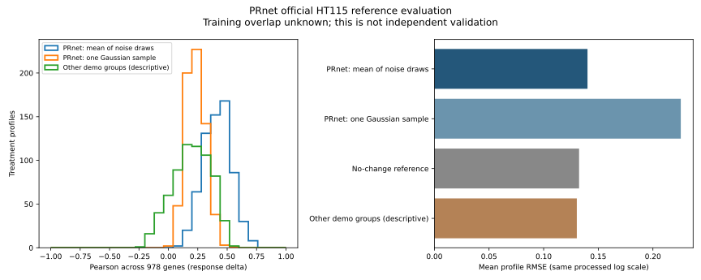

# PRnet：实际模型推理与基线参照

本案例已在 Linux、Python 3.12、CPU 环境中加载官方固定 checkpoint，对官方 HT115 demo 的 **661 条处理表达谱 × 978 个基因**完成真实推理。它提供可追踪的模型调用、同尺度响应比较和完整输出。

**训练重叠未知，独立验证未评估。** 这不是独立留出测试，也不直接复现论文中的交叉验证分数。案例说明和评估入口由本项目开发；PRnet 模型、权重、药物编码与研究数据分别归原作者。

## 这次真正得到的结果

以下数值对应便携 [evidence.json](evidence.json) 中记录的固定输入、权重、版本和参数。主预测平均了 16 个 decoder-noise 向量下的高斯条件均值；这些数值抽样不是生物学重复。

| 方法 | 平均逐 profile 响应 RMSE | 平均逐 profile 响应 Pearson |
| --- | ---: | ---: |
| PRnet 条件均值 | 0.140141 | 0.415055 |
| PRnet 单次高斯采样 | 0.225522 | 0.231642 |
| 不变化基线，即零响应 | 0.132420 | 未定义，因为响应恒定为零 |
| 排除当前药物组后的其他 demo 组均值 | 0.130364 | 0.198230 |



在这个固定 checkpoint、demo 和处理路径上，**正相关没有转化为优于零响应基线的平均 RMSE**。它仍是一次成功执行的模型分析，但不能据此声称已经证明准确性，更不能外推为整个 PRnet 方法在其他设置中的结论。绝对处理后表达的平均相关约为 0.8300；不变化基线约为 0.8464，因此不能只展示绝对表达相关。

其他组均值只使用当前 demo 的其他药物组，按共享来源 `pert_id`、名称或 RDKit 规范异构 SMILES 的连通组排除当前组的全部条件。它是描述性参照，不是外部可部署基线；排除构造还能导致逐基因结构性负相关，不能解释为生物学反向效应。

本 demo 按 plate 等字段划分的 661 个条件各只有一条处理表达谱。上述汇总是描述性数值，没有把这些 profile 或数值抽样当作独立生物学重复，也没有进行统计显著性或疗效检验。

## 从 Skill 根目录运行

下面均在包含 `SKILL.md` 的 `virtual-cell-research/` 根目录运行。真实模型环境与 [数据教学环境](../../references/first-run.md#建立数据教学环境) 分开。不要把 torch、scanpy 和 RDKit 强装进已有 CellOracle 环境。

已实测的主要版本列在 [environment.yml](environment.yml)。以下 venv 路径提供同样的主要依赖；完整实际环境记录在运行后的 `provenance.json`。本次实际模型验收在 Linux CPU 完成，Windows 的同一模型运行尚未验收。

```bash
python3.12 -m venv .venv-prnet
source .venv-prnet/bin/activate
python -m pip install torch==2.5.1 --index-url https://download.pytorch.org/whl/cpu
python -m pip install scanpy==1.11.5 rdkit==2025.9.1 numpy==2.5.4 pandas==3.1.1 anndata==0.13.4 scipy==1.18.1 h5py==3.16.0 matplotlib==3.11.2

python scripts/prnet_reference_case.py fetch --output-dir local-runs/prnet-reference-input
python scripts/prnet_reference_case.py run --resources-dir local-runs/prnet-reference-input --output-dir local-runs/prnet-reference-output --seed 2024 --noise-draws 16 --threads 1
```

Windows 可用 `py -3.12 -m venv .venv-prnet` 建环境，后续把 `python` 换成 `.\.venv-prnet\Scripts\python.exe`；不用执行 `source`。依赖安装成功仍不等于模型推理已经验收。实际失败记录和环境版本应保留。

`fetch` 明确获取七个固定资源，总计约 **5.41 MB**，其中权重 2,210,427 bytes、demo 3,136,818 bytes；其余为官方模型、编码、推理参考和许可文本。源码包不包含这些模型资源。每个资源分别核对大小和 SHA256；下载步骤不会运行外部 Python 文件，也不安装环境。

### 下载中断怎样继续

每次获取和运行都使用新目录，已有输入/结果不会被覆盖。若部分资源下载失败，可把旧目录作为只读缓存，明确创建一个新目录：

```bash
python scripts/prnet_reference_case.py fetch --reuse-dir local-runs/prnet-reference-input --output-dir local-runs/prnet-reference-input-retry
python scripts/prnet_reference_case.py run --resources-dir local-runs/prnet-reference-input-retry --output-dir local-runs/prnet-reference-output-retry --seed 2024 --noise-draws 16 --threads 1
```

已存在的缓存文件必须逐项符合固定哈希，才会复制到新目录；缺少的资源从原始 URL 获取。坏文件不会被静默接受或覆盖。旧失败目录和记录保留。`resources.json` 区分本次下载与 `reused_verified`；后者不能写成重新下载。

本次就遇到一次许可文本的 HTTP 503：前六项资源下载成功，原失败记录保留；随后复用了本机先前从同一官方版本取得且再次核对哈希的文件，才完成推理。不能把这次网络暂时失败写成模型失败。

## 输入与实际调用

1. **固定数据身份。** 入口仅接受本案例固定 demo 和 checkpoint，校验全部资源哈希后才导入官方代码。978 基因顺序直接来自该固定文件，不通过同维度假定任意基因顺序兼容。
2. **核对处理与对照。** 使用来源 `paired_control_index`；全部配对必须存在、指向对照、细胞背景和时间一致。338 条跨 RNA plate 配对保留并标记，不偷偷更换对照。
3. **沿官方 demo 预处理。** `normalize_total()` 后 `log1p()`，实际归一化目标和为 **8037.517578125**。该值是全部 681 条来源表达谱行和的中位数，包括实测处理谱，因此带有明确的 transductive 参照性质。原始 demo 已是处理后的表达尺度；这里不能称为原始计数，也不能直接将差值解释为原尺度 log fold change。
4. **真实模型调用。** 读取官方 `PGM` 和 FCFP4 1024-bit + `log10(dose + 1)` 编码，严格加载权重、调用 `eval()`，在 CPU 按原 profile 顺序、固定 seed 运行。相对官方 Trainer，改为保留 profile ID、新目录写入、保存预测均值及单次高斯采样；不是原脚本逐字节复现。
5. **同尺度评估。** 响应 = 处理后模型尺度表达 − 对应模型尺度对照。保存完整观测/预测/零响应/其他组参照，再计算逐 profile 和逐基因指标；恒定向量的 Pearson 记为未定义。

这里的参数化入口不接受任意用户 H5AD。应用到新数据时仍要核对训练域、基因顺序、预处理及背景；不能根据这个 demo 成功就认定外部样本兼容。

## 运行后看哪些文件

先打开 `report.md`，其中直接链接 QC、条件索引、完整源表和图。然后查看：

| 产物 | 内容 |
| --- | --- |
| `manifest.json` | 运行、模型执行、预测、独立验证分别记录；具体参数和开始/结束时间 |
| `validation.json` | 训练重叠未知、独立验证未评估、参照限制与各方法指标 |
| `qc.json` | 轴和配对检查、跨板数、尺度、固定背景下化学输入敏感性 |
| `raw/reference_predictions.npz` | 原始及处理后 X、基线、观测、预测均值、采样、方差、实际噪声、profile/gene/condition ID |
| `tables/condition_index.csv` | 每条处理谱、指定对照、条件、排除组与跨板标记 |
| `tables/profile_metrics.csv`、`gene_metrics.csv` | 不同方法的逐处理谱和逐基因指标，空值表示相关系数未定义 |
| `tables/*_delta.csv.gz` | 全量观测、预测及其他组参照响应 |
| `figures/figure_manifest.csv` | 出图状态、源表、尺度及失败原因 |
| `provenance.json` | 实际解释器、命令、依赖版本、资源和脚本哈希、产物哈希 |
| `errors.jsonl` | 失败记录；成功运行时为空 |

NPZ 使用 `numpy.load(path, allow_pickle=False)` 读取。不要按排序后的行号猜测另一张表；通过保存的 profile/condition/gene ID 对齐。绘图失败不会删除数值结果；资源校验失败会停止模型加载并保留失败记录。

## 科学解释范围

模型的来源 `demo_split=test` 不证明它未参与此 checkpoint 的训练。当前发布文件名为 `lincs_best_epoch_all.pt`，分发资料没有提供可核实的训练成员/基因列表元数据与 demo 排除清单。本案例依靠固定官方 demo 与官方入口对应来约束基因轴，但不能补造训练划分证据。

固定同一处理后对照均值和同一零噪声向量后，条件之间的化学输入变化与总体响应 RMS 比约为 0.2672；输出不是完全相同，但存在较大的共同成分。这只是输入敏感性诊断，不直接证明药物区分准确性或药效。

本案例没有疾病逆转排名、临床候选推荐或独立预测验证。它的价值是把“模型能够运行”“在当前数据上的表现”“相对简单基线的增益”“是否独立验证”分别呈现。

## 来源

- [官方固定代码版本](https://github.com/Perturbation-Response-Prediction/PRnet/tree/f19174bde3ed2633f54c7831799cc38c4ffc7a0d)
- [官方 demo 入口](https://github.com/Perturbation-Response-Prediction/PRnet/blob/f19174bde3ed2633f54c7831799cc38c4ffc7a0d/test_demo.py)
- [官方 checkpoint](https://github.com/Perturbation-Response-Prediction/PRnet/blob/f19174bde3ed2633f54c7831799cc38c4ffc7a0d/checkpoint/lincs_best_epoch_all.pt)
- [Qi 等，Nature Communications，2024](https://doi.org/10.1038/s41467-024-53457-1)
- [作者公开数据存档](https://zenodo.org/records/14230870)

PRnet 代码声明 Apache-2.0；权重和 demo 文件的单独许可尚未核实，不自动继承本 Skill 的代码许可。原始文件按需从提供方获取，模型理论和原始数据均不归本项目原创。
